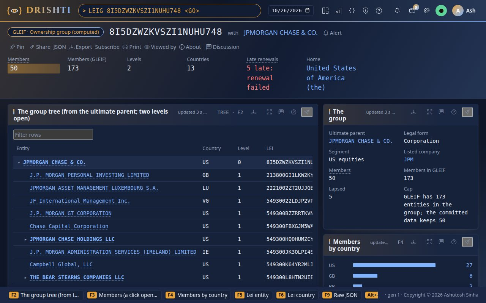
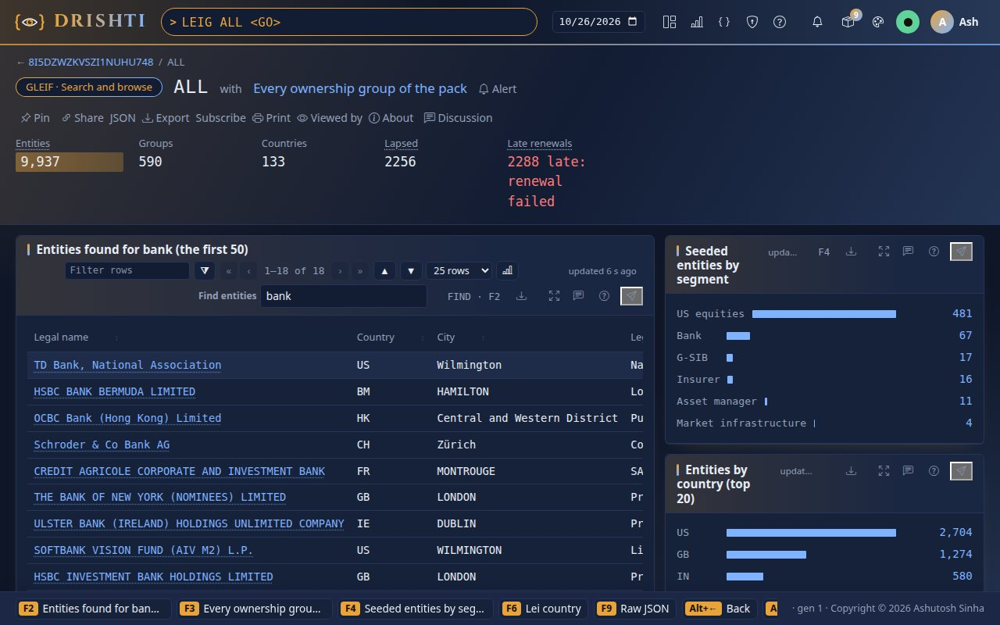
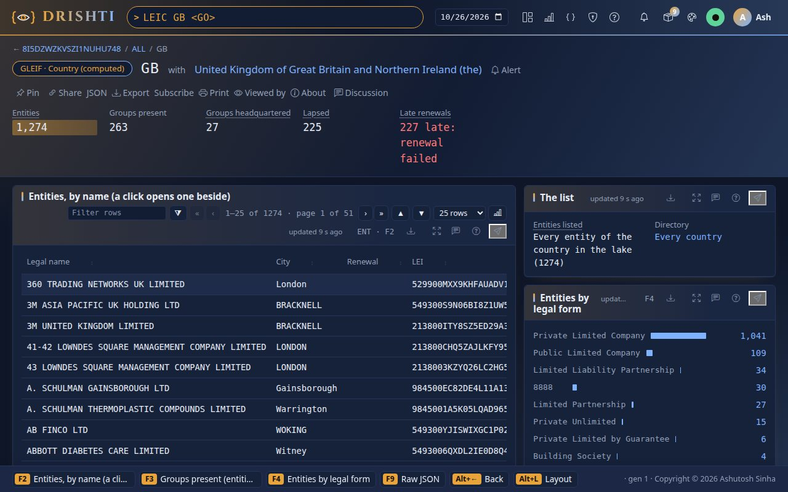
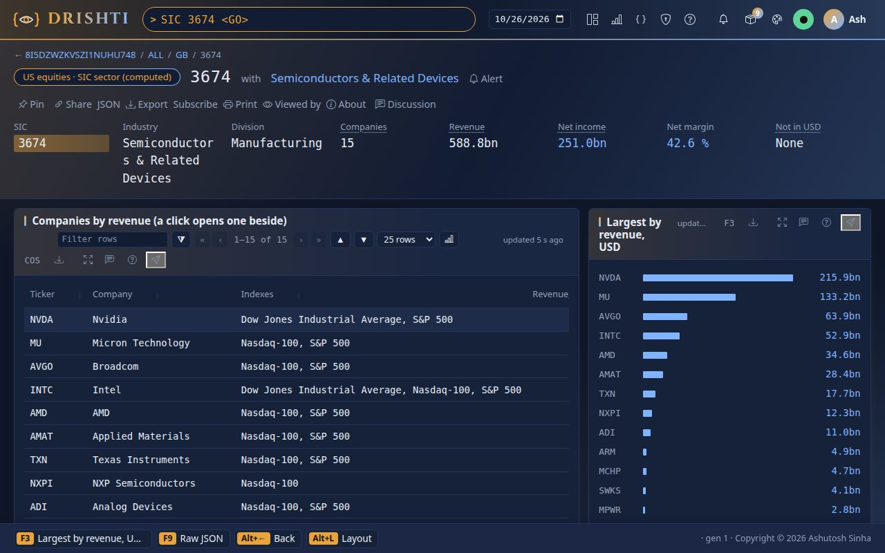
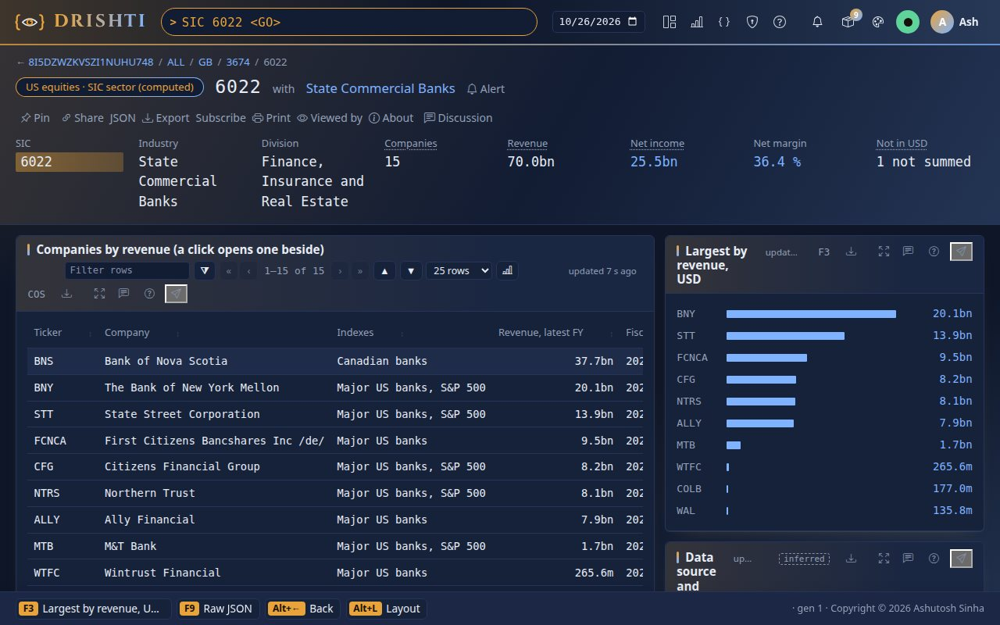
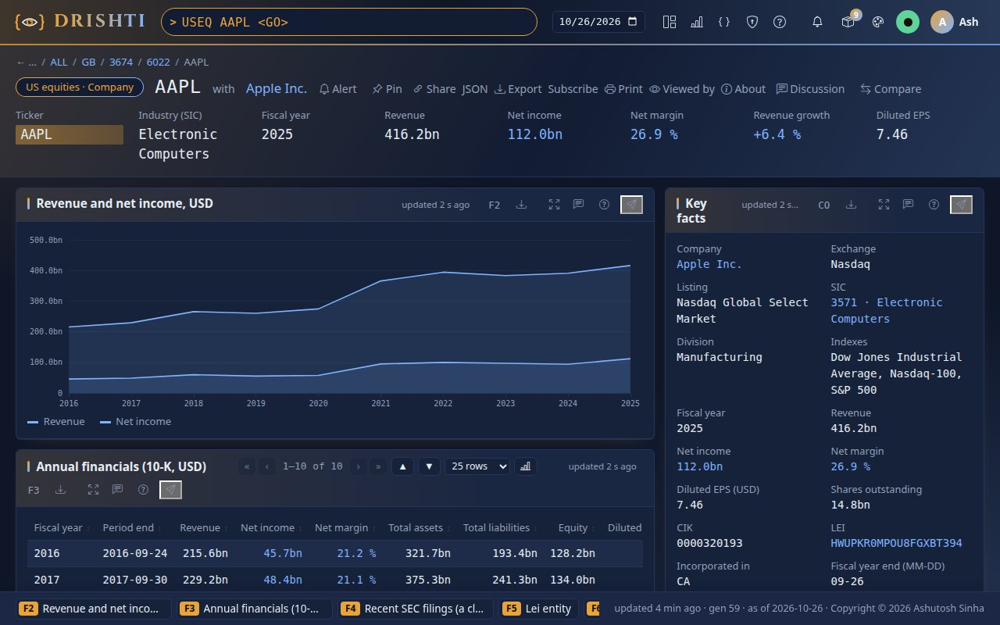
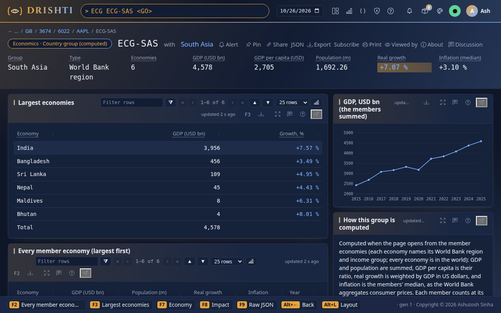
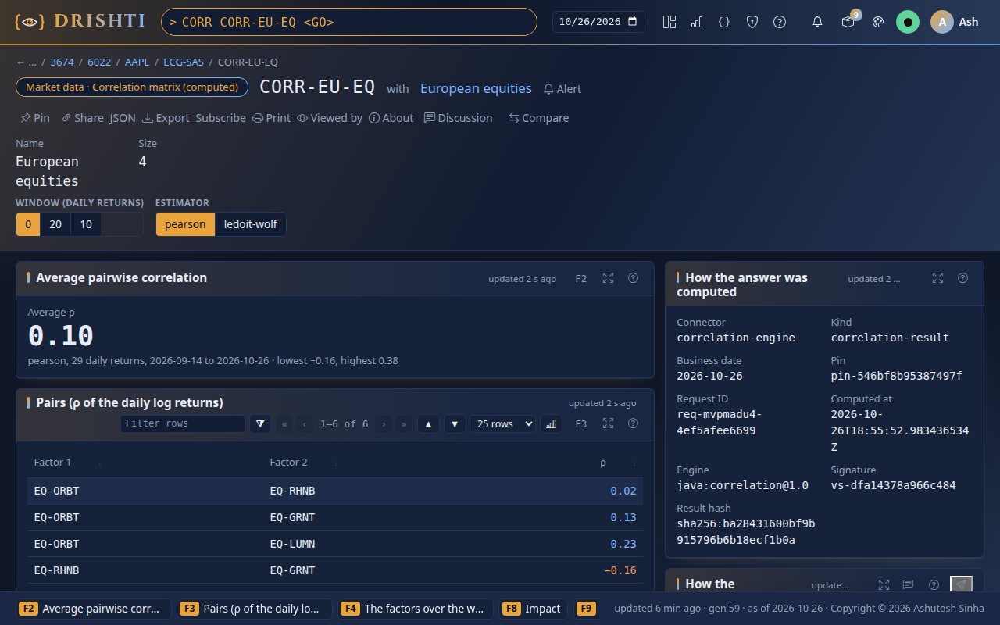
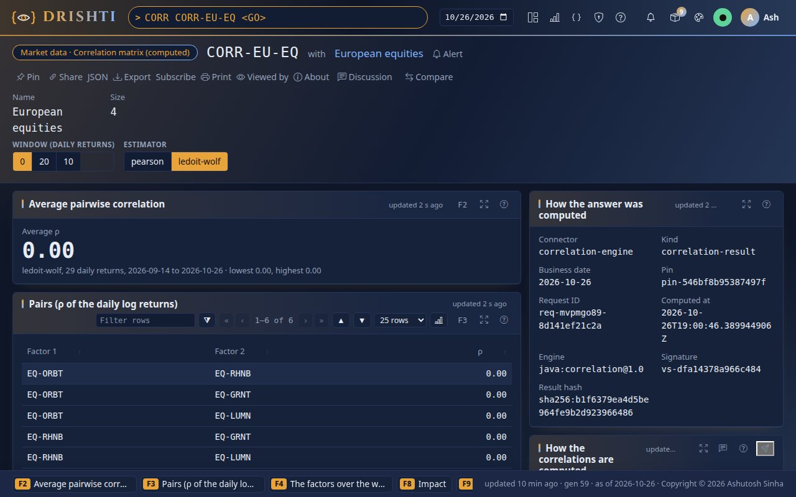
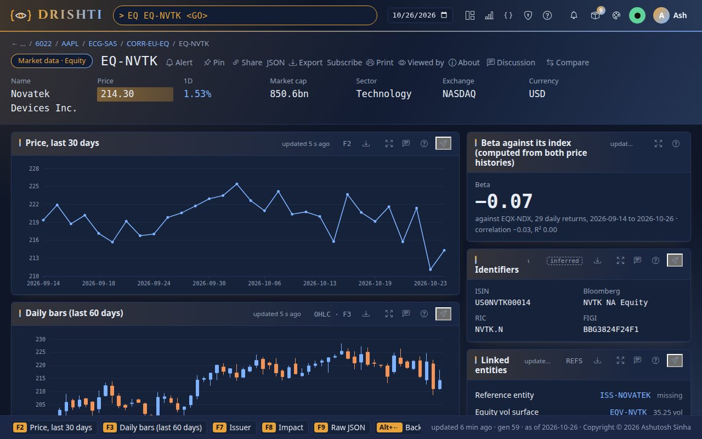

<!--
  Project Drishti · Any data. Any domain. One grammar.

  Copyright (c) 2026 Ashutosh Sinha <ajsinha@gmail.com>.
  All rights reserved.

  PROPRIETARY AND CONFIDENTIAL.

  This file is the confidential and proprietary property of Ashutosh Sinha.
  Unauthorised copying, use, modification, distribution or disclosure of this
  file, via any medium, is strictly prohibited except with the express prior
  written permission of the copyright holder.

  See the LICENSE file in the root of this repository for the full terms.
-->
# Tutorial 27 · Groupings and analytics, computed

An ownership group, a country's legal entities, a SIC sector, a World Bank region, a set of correlations, a company's margin and a
stock's volatility are all **derived** from data the packs already hold. Since 2.9.2 Drishti computes them when you open them, from that
data, instead of keeping stored copies that drift. In this tutorial you open each one on the committed data, see where every number comes
from, change a correlation's window and estimator, and run the guard that keeps the stored copies from coming back. Each step shows the
UI, the command line and the YAML behind it; the outputs were captured as the user `rita` with sign-in off, on a lake built on 2026-10-26. Everything else (every column, formula, input, error and the reconciliation with the
retired pages) is in the one reference, [GROUPINGS_ANALYTICS_GUIDE.md](../guides/GROUPINGS_ANALYTICS_GUIDE.md); each step ends with its
sections.

## Time to complete

About 25 minutes.

## Before you start

- [Tutorial 1](01-first-15-minutes.md) done: a server and console you can build, start and stop.
- The demo lake built with the public-data packs: `python3 tools/drishti.py lake demo`, and the packs loaded:
  `DRISHTI_PACKS=core,market-data,trading,counterparty-risk,market-risk,world-economy,news-and-markets,us-equities,gleif`.
- For the command-line steps: `DRISHTI_SERVER=http://localhost:18480` and `DRISHTI_TOKEN=...` (My account → API tokens), or `--user`
  with sign-in off.

The GLEIF, SEC and World Bank figures are published data (CC0, public domain, CC BY 4.0). The market data behind the correlations is the
demo's synthetic data.

**Where this data comes from.** The inputs are external data: the `us-equities` pack from SEC EDGAR, Wikidata, the Nasdaq Trader directory and GLEIF (`tools/publicdata/us_equities.py`), the `gleif` pack from GLEIF's golden copy, LEI API and mapping files (`tools/publicdata/gleif.py`), the `world-economy` pack from the World Bank (`tools/publicdata/world_economy.py`), all openly licensed; price history (`PXH`, steps 7 to 9) is read live from Yahoo Finance, **internal only** and off as shipped. The groupings and analytics themselves are computed by Drishti. Each source, its licence and how to refresh it: [External data](../guides/PUBLIC_DATA.md).

## What you will learn

- which pages are computed and from what: LEIG and LEIC from the legal entities, SIC from the companies, ECG from the economies;
- how a derived connector groups a kind's documents into pages, with no member cap, and what `then`, `tree` and `also-group-by` add;
- why sector totals add the USD reporters only, and why a region's inflation is a median;
- how CORR's window and estimator change the answer, and what a Ledoit-Wolf shrinkage of 1 tells you;
- that the USEQ ratios and PXH analytics are worked out as the page is drawn, and why PXH stays internal and off;
- how the old ids and links keep working, and the guard that fails the build if a stored copy returns.

## Step 1 · An ownership group, from its entities

**In the UI.** Type `LEIG 8I5DZWZKVSZI1NUHU748` and press Enter: JPMorgan Chase & Co.'s ownership group. The pill reads *GLEIF ·
Ownership group (computed)*.

**From the command line.**

```bash
python3 tools/drishti.py view get lei-group/8I5DZWZKVSZI1NUHU748
```

```text
$ drishti.py view get lei-group/8I5DZWZKVSZI1NUHU748
GLEIF · Ownership group (computed)  8I5DZWZKVSZI1NUHU748  with JPMORGAN CHASE & CO.   [LEIG]

Key figures
  figure           value
  ---------------  ------------------------------
  Members          50
  Members (GLEIF)  173
  Levels           2
  Countries        13
  Late renewals    5 late: renewal failed
  Home             United States of America (the)

  JPMORGAN CHASE & CO.  US       0      8I5DZWZKVSZI1NUHU748

Members (a click opens one beside)  (table, members, F3)
  Legal name                                                    Country  Level  LEI
  ------------------------------------------------------------  -------  -----  --------------------
  ...
```

**In YAML.** The page is a derived connector of the gleif pack, `config/packs/gleif/pack.yaml`:

```yaml
gleif-groupings:
  plugin: derived
  kinds: [lei-group, lei-country]
  settings:
    lei-group:
      from: lei-entity                 # every legal entity of the lake, as of the date you picked
      group-by: $.LEI_GROUP            # an entity's ownership group: its ultimate parent
      max-members: 100000              # no cap
      fields:
        MEMBERS: count
        LATE_RENEWALS: "sum $.RENEWAL_LATE ? 1 : 0"
      tree: { id: LEI, parent: PARENT } # each member's level, and the tree from the ultimate parent down
      then:
        MEMBERS_IN_GLEIF: "$.GLEIF_GROUP_SIZE == null ? $.MEMBERS : max($.GLEIF_GROUP_SIZE, $.MEMBERS)"
```

You should see the strip **Members 50**, **Members (GLEIF) 173**, **Levels 2**, **Countries 13**, **Late renewals 5 late: renewal failed**;
the tree with the ultimate parent and two levels open; the members table with all 50 (20 at level 1, 29 at level 2); and on the right
*Cap: GLEIF has 173 entities in the group; the committed data keeps 50*. The computation has no cap: the 50 is the size of the committed
snapshot (a wider refresh brings more). Click any member: its key facts open beside the table.



Further: [guide sections 2](../guides/GROUPINGS_ANALYTICS_GUIDE.md#2-leig-an-ownership-group) and [11](../guides/GROUPINGS_ANALYTICS_GUIDE.md#11-lei-group).

## Step 2 · Every group, and the type-ahead

**In the UI.** Type `LEIG ALL`. Then type `LEIG Ford Motor` without pressing Enter and watch the suggestions.

**From the command line.**

```bash
python3 tools/drishti.py view get lei-group/ALL
```

```text
$ drishti.py view get lei-group/ALL
GLEIF · Search and browse  ALL  with Every ownership group of the pack   [LEIG]

Key figures
  figure         value
  -------------  -------------------------
  Entities       9,937
  Groups         590
  Countries      133
  Lapsed         2256
  Late renewals  2288 late: renewal failed
```

**In YAML.** `ALL` is one more group every entity joins, and its page keeps only its figures:

```yaml
      also-group-by: { all: "'ALL'" }   # every entity is also in ALL
      unlisted: ALL                      # ALL keeps no member ids, rows or tree, only what its then fields made
      search-fields: NAME                # the type-ahead finds a group by its ultimate parent's name
```

You should see **Entities 9,937**, **Groups 590**, **Countries 133**, **Lapsed 2,256** and **Late renewals 2,288**; the groups table with
every ultimate parent, largest in GLEIF first (a click opens the group's facts beside it); and the entity search box. The type-ahead
suggests Ford Motor Company's group by its name.



Further: [guide sections 2 and 19](../guides/GROUPINGS_ANALYTICS_GUIDE.md#19-the-derived-connector).

## Step 3 · A country, every entity of it

**In the UI.** Type `LEIC GB`.

**From the command line.**

```bash
python3 tools/drishti.py view get lei-country/GB
```

```text
$ drishti.py view get lei-country/GB
GLEIF · Country (computed)  GB  with United Kingdom of Great Britain and Northern Ireland (the)   [LEIC]

Key figures
  figure                value
  --------------------  ------------------------
  Entities              1,274
  Groups present        263
  Groups headquartered  27
  Lapsed                225
  Late renewals         227 late: renewal failed
```

**In YAML.** The same connector groups the same entities by another key:

```yaml
    lei-country:
      from: lei-entity
      group-by: $.LEI_COUNTRY
      fields:
        ENTITIES: count
        GROUPS_HEADQUARTERED: "sum $.LEI == $.LEI_GROUP ? 1 : 0"
      then:
        GROUP_ROWS: group($.ROWS, 'GROUP')     # each group's entities here
      sort: { ROWS: NAME asc, GROUP_ROWS: value desc }
```

You should see **Entities 1,274**, **Groups present 263**, **Groups headquartered 27**, **Lapsed 225** and **227 late**; the entities
table listing all 1,274 by name (the stored page stopped at 400); the groups present with their entities here, largest first; and cities on
the right (`LONDON` 494 and `London` 245: GLEIF keeps the city as each entity wrote it). `LEIC ALL` lists the 133 countries.



Further: [guide sections 3 and 12](../guides/GROUPINGS_ANALYTICS_GUIDE.md#12-lei-country).

## Step 4 · A sector, and the currency rule

**In the UI.** Type `SIC 3674`, then `SIC 6022`.

**From the command line.**

```bash
python3 tools/drishti.py view get sic-sector/3674
python3 tools/drishti.py view get sic-sector/6022
```

```text
$ drishti.py view get sic-sector/6022
US equities · SIC sector (computed)  6022  with State Commercial Banks   [SIC]

Key figures
  figure      value
  ----------  ----------------------------------
  SIC         6022
  Industry    State Commercial Banks
  Division    Finance, Insurance and Real Estate
  Companies   15
  Revenue     70.0bn
  Net income  25.5bn
  Net margin  36.4 %
  Not in USD  1 not summed
```

**In YAML.** `config/packs/us-equities/pack.yaml`, the connector `us-equities-groupings`:

```yaml
    sic-sector:
      from: us-company
      group-by: $.SIC
      fields:
        REVENUE: "sum $.CURRENCY == 'USD' ? $.REVENUE : null"      # USD reporters only
        NON_USD: "sum $.CURRENCY != 'USD' ? 1 : 0"
      then:
        NET_MARGIN: "$.REVENUE ? $.NET_INCOME / $.REVENUE * 100 : null"
```

You should see, for 3674 (Semiconductors & Related Devices), **Companies 15**, revenue **588.8bn**, net income **251.0bn**, **Net margin
42.6%** and **Not in USD: None**, the companies ranked by revenue from NVDA (215.9bn). For 6022 (State Commercial Banks): **Companies 15**,
revenue **70.0bn** and **Not in USD: 1 not summed**: BNS reports in CAD, so it is listed and counted but not added to a USD total.





Further: [guide sections 4 and 13](../guides/GROUPINGS_ANALYTICS_GUIDE.md#13-sic-sector).

## Step 5 · A company's margin and growth, worked out on the page

**In the UI.** Type `USEQ AAPL`.

**From the command line.**

```bash
python3 tools/drishti.py view get us-company/AAPL
```

```text
$ drishti.py view get us-company/AAPL
US equities · Company  AAPL  with Apple Inc.   [USEQ]

Key figures
  figure          value
  --------------  --------------------
  Ticker          AAPL
  Industry (SIC)  Electronic Computers
  Fiscal year     2025
  Revenue         416.2bn
  Net income      112.0bn
  Net margin      26.9 %
  Revenue growth  +6.4 %
  Diluted EPS     7.46
```

**In YAML.** No connector: the company page's strip computes the ratios from the record's facts,
`config/packs/us-equities/sutras/us-company.v1.sutra.yaml`:

```yaml
  - { label: Net margin, bind: "$.REVENUE ? $.NET_INCOME / $.REVENUE * 100 : null", fmt: margin1, tone: sign }
  - { label: Revenue growth, bind: "first($.FINANCIALS[?@.YEAR == $.FISCAL_YEAR - 1]).REVENUE ? ($.REVENUE - first($.FINANCIALS[?@.YEAR == $.FISCAL_YEAR - 1]).REVENUE) / abs(first($.FINANCIALS[?@.YEAR == $.FISCAL_YEAR - 1]).REVENUE) * 100 : null", fmt: growth1, tone: sign }
```

You should see **Net margin 26.9 %** (fiscal 2025: 112.01bn of net income on 416.16bn of revenue) and **Revenue growth +6.4 %** against
fiscal 2024; the financials table's net margin for every year. Press F9 (raw): the record has `REVENUE`, `NET_INCOME` and `FINANCIALS`, and
no `NET_MARGIN` or `REVENUE_GROWTH` any more. The same holds one level down and one level up: `FACT AAPL-REVENUE` works out each
year's change from the values (no `CHANGE_PCT` stored), and `IDX SP500` adds up its members' revenue and divisions as it opens.



Further: [guide sections 7 and 16](../guides/GROUPINGS_ANALYTICS_GUIDE.md#16-the-useq-ratios).

## Step 6 · A World Bank region from its economies

**In the UI.** Type `ECG ECG-SAS`, then `ECG ECG-HIC`.

**From the command line.**

```bash
python3 tools/drishti.py view get country-group/ECG-SAS
```

```text
$ drishti.py view get country-group/ECG-SAS
Economics · Country group (computed)  ECG-SAS  with South Asia   [ECG]

Key figures
  figure                value
  --------------------  -----------------
  Group                 South Asia
  Type                  World Bank region
  Economies             6
  GDP (USD bn)          4,578
  GDP per capita (USD)  2,705
  Population (m)        1,692.26
  Real growth           7.07%
  Inflation (median)    3.10%
```

**In YAML.** `config/packs/world-economy/pack.yaml`, the connector `macro-groupings` (written by `tools/packgen/economics/make.py`):

```yaml
    country-group:
      from: economy
      group-by: $.REGION_GROUP
      also-group-by: { income: $.INCOME_GROUP, world: "'ECG-WLD'" }   # an economy is in its region, its income group and the world
      fields:
        GDP_USD_BN: sum $.GDP_USD_BN
        INFLATION: median $.INFLATION                                  # the World Bank's aggregate for prices
      then:
        GROWTH: "$.GROWTH_WEIGHT > 0 ? $.GROWTH_WEIGHTED / $.GROWTH_WEIGHT : null"   # weighted by GDP
```

You should see for South Asia **Economies 6**, **GDP 4,578** USD bn, **GDP per capita 2,705**, **Population 1,692.26** m, **Real growth
7.07%**, **Inflation (median) 3.10%**, every member at its latest year (2025 for all six); India first among its members (3,956bn at 7.57%). For the high-income group,
84 economies, 75,910bn and growth 1.88%: figures the stored page did not have.



Further: [guide sections 5 and 14](../guides/GROUPINGS_ANALYTICS_GUIDE.md#14-country-group).

## Step 7 · Correlations from price history: window and estimator

**In the UI.** Type `CORR CORR-EU-EQ`. Set *Window* to 20, then back to 0, and *Estimator* to ledoit-wolf. The choice is kept in the
address (`?ctl.estimator=ledoit-wolf`), so a link opens the same answer.

**From the command line.**

```bash
python3 tools/drishti.py compute run correlation-engine correlation-result CORR-EU-EQ
python3 tools/drishti.py compute run correlation-engine correlation-result CORR-EU-EQ --param window=20
python3 tools/drishti.py compute run correlation-engine correlation-result CORR-EU-EQ --param estimator=ledoit-wolf
```

```text
$ drishti.py compute run correlation-engine correlation-result CORR-EU-EQ
correlation-engine CORR-EU-EQ  READY  (req-mvpm71zs-c7d061e7856f)
  MATRIX_ID    CORR-EU-EQ
  NAME         European equities
  ESTIMATOR    pearson
  WINDOW       29
  AVAILABLE    29
  FROM         2026-09-14
  TO           2026-10-26
  AVERAGE      0.0962
  MIN_RHO      -0.1564
  MAX_RHO      0.3818

$ drishti.py compute run correlation-engine correlation-result CORR-EU-EQ --param estimator=ledoit-wolf
correlation-engine CORR-EU-EQ~estimator=ledoit-wolf  READY  (req-mvpm729c-002dd111e08d)
  MATRIX_ID    CORR-EU-EQ
  NAME         European equities
  ESTIMATOR    ledoit-wolf
  WINDOW       29
  AVAILABLE    29
  FROM         2026-09-14
  TO           2026-10-26
  AVERAGE      0.0
  MIN_RHO      0.0
  MAX_RHO      0.0
  SHRINKAGE    1.0

$ drishti.py compute run correlation-engine correlation-result CORR-EU-EQ --param estimator=kendall
correlation-engine CORR-EU-EQ~estimator=kendall  REFUSED  (req-mvpm72cq-292c1a84f66f)
  estimator kendall is not allowed for correlation-result; allowed: pearson, ledoit-wolf
```

**In YAML.** The page's panels read the computed kind with the page's controls (`config/packs/market-data/sutras/market-data/correlation-matrix.v1.sutra.yaml`):

```yaml
controls:
  - { id: window, kind: segmented, label: Window (daily returns), options: ["0", "20", "10"], default: "0" }
  - { id: estimator, kind: segmented, label: Estimator, options: ["pearson", "ledoit-wolf"], default: "pearson" }
panels:
  - id: pairs
    kind: table
    source: { kind: correlation-result, id: "$.MATRIX_ID", params: { window: ctl.window, estimator: ctl.estimator } }
    rows: "$src.PAIRS"
```

You should see with the defaults (every return, Pearson) **Average ρ 0.10** over 29 daily returns (2026-09-14 to 2026-10-26 on a lake built on 2026-10-26:
`lake demo` moves the test data's 2026-08-19 to 2026-09-30 to end on the day you build it), the highest pair RHNB and LUMN at 0.38 and the
lowest RHNB and GRNT at −0.16; with window 20, **0.14**; with Ledoit-Wolf,
**0.00** with a shrinkage of 1: on 29 days of four factors the sample correlations are within noise, and the estimator shrinks them all
the way to none. The factors table gives each factor's volatility over the window (EQ-ORBT 22.7%).





Further: [guide sections 6, 15 and 20](../guides/GROUPINGS_ANALYTICS_GUIDE.md#15-correlation-result).

## Step 8 · An equity's beta from price history

**In the UI.** Type `EQ EQ-NVTK` and look at the **Beta** panel on the right; then type `EQB EQ-NVTK`.

**From the command line.**

```bash
python3 tools/drishti.py compute run equity-analytics equity-beta EQ-NVTK
```

```text
$ drishti.py compute run equity-analytics equity-beta EQ-NVTK
equity-analytics EQ-NVTK  READY  (req-mvpm72g6-5abbc916b272)
  EQUITY       EQ-NVTK
  INDEX        EQX-NDX
  WINDOW       29
  AVAILABLE    29
  FROM         2026-09-14
  TO           2026-10-26
  BETA         -0.0725
  ALPHA        -0.000881
  CORRELATION  -0.0333
  R_SQUARED    0.0011
  VOLATILITY   0.2672
  INDEX_VOLATILITY 0.1227

$ drishti.py compute run equity-analytics equity-beta EQ-CSCA
equity-analytics EQ-CSCA  FAILED  (req-mvpm72j5-a7a17e82f69a)
  EQ-CSCA names no index (EQUITY_INDEX): its beta has nothing to be measured against
```

**In YAML.** The market-data pack's `equity-analytics` connector reads the equity and the index it names
(`config/packs/market-data/pack.yaml`, written by `tools/packgen/banking/corr_kinds.py`):

```yaml
    reads:
    - { kind: equity, as: equity, id: "{id}" }
    - { kind: equity-index, as: index, ids: "{inputs.equity.EQUITY_INDEX}", limit: 1 }
    engine: { type: java, class: com.ash.drishti.compute.reactive.analytics.BetaEngine }
```

You should see a beta of **−0.07** against EQX-NDX over 29 daily returns, with a correlation of −0.03. The
security master's stored beta (1.28) was set by hand; the demo's price walks are independent, so the measured beta is near zero. `EQ
EQ-CSCA` names no index: its Beta panel stays empty, and `EQB EQ-CSCA` says why in words.



Further: [guide sections 8.1 and 17.1](../guides/GROUPINGS_ANALYTICS_GUIDE.md#171-equity-beta).

## Step 9 · PXH: off as shipped, internal use only

**In the UI.** Type `PXH PX-AAPL`.

**From the command line.**

```bash
python3 tools/drishti.py view get price-history/PX-AAPL
```

```text
$ drishti.py view get price-history/PX-AAPL
drishti: the server said 404 DRS-1001: DRS-1001 no source holds price-history/PX-AAPL (asked file; us-equities-prices, which kind 'price-history' is routed to, is disabled)
```

**In YAML.** The prices and their analytics come from one live connector, off until a site turns it on (`config/packs/us-equities/pack.yaml`):

```yaml
  us-equities-prices:
    plugin: yfinance
    enabled: ${DRISHTI_US_EQUITIES_PRICES_ENABLED:false}
    settings:
      benchmark: ${DRISHTI_US_EQUITIES_BENCHMARK:SPY}     # beta and correlation are measured against it
```

You should see that the page has no data: the connector is off as shipped. Free price feeds forbid redistribution, so the prices, and the
returns, volatility, drawdown and beta computed from them as they are read, are for internal demonstrations only. A site that turns it on
(`DRISHTI_US_EQUITIES_PRICES_ENABLED=true`, and its machine can reach Yahoo) sees the **Analytics** panel beside the quote.

Further: [guide sections 8, 17 and 21](../guides/GROUPINGS_ANALYTICS_GUIDE.md#17-the-pxh-analytics).

## Step 10 · The guard

**In the UI.** Open Admin → Connectors: `gleif-groupings`, `us-equities-groupings` and `macro-groupings` are derived connectors and
`correlation-engine` a reactive one; no Delta connector lists `lei-group`, `lei-country`, `sic-sector` or `country-group`.

**From the command line.**

```bash
python3 tools/drishti.py contract show LEIG
python3 -m unittest -q tools/test_contracts.py
```

**In YAML.** `tools/contracts.policy.yaml` records the decision:

```yaml
computed-in-place:
  lei-group:
    release: 2.9.2
    contract: ../guides/GROUPINGS_ANALYTICS_GUIDE.md
    measure: the derived connector gleif-groupings (from lei-entity)
removed:
  us-company:
    release: 2.9.2
    figures: [NET_MARGIN, REVENUE_GROWTH, "FINANCIALS[].NET_MARGIN"]
```

You should see the LEIG contract with **class computed** over the plugin **derived**, and the tests end in **OK**. A stored `lei-group`
snapshot, a ratio on a company record or a correlation pair on a correlation set would fail them.

Further: [guide section 23](../guides/GROUPINGS_ANALYTICS_GUIDE.md#23-the-retirement-guard).

## Next steps

- The [groupings and analytics guide](../guides/GROUPINGS_ANALYTICS_GUIDE.md): every column and formula, and the reconciliation with the
  retired pages ([section 18](../guides/GROUPINGS_ANALYTICS_GUIDE.md#18-reconciliation-stored-against-computed)).
- [Tutorial 25](25-var-from-the-bank-to-a-trade.md) and [tutorial 26](26-exposure-from-the-bank-to-a-trade.md): the same rule (computed,
  never stored) for VaR and exposure.
- The data contracts of every command: [docs/contracts/packs/](../contracts/packs/README.md).
