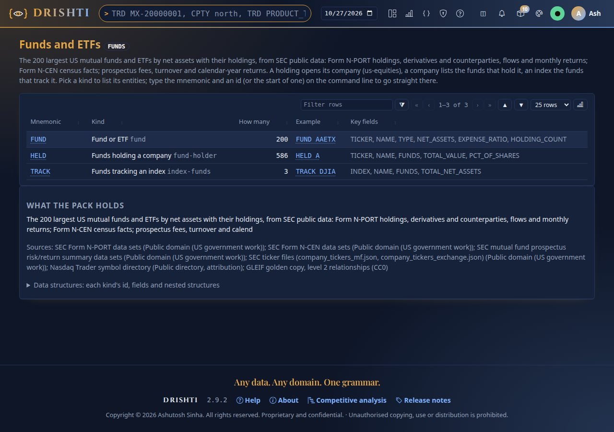
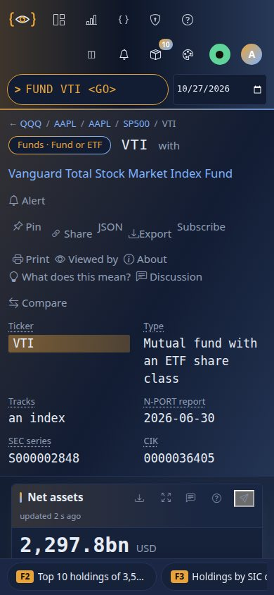

<!--
  Project Drishti · Any data. Any domain. One grammar.

  Copyright (c) 2026 Ashutosh Sinha <ajsinha@gmail.com>.
  All rights reserved.

  PROPRIETARY AND CONFIDENTIAL.

  This file is the confidential and proprietary property of Ashutosh Sinha.
  Unauthorised copying, use, modification, distribution or disclosure of this
  file, via any medium, is strictly prohibited except with the express prior
  written permission of the copyright holder.

  See the LICENSE file in the root of this repository for the full terms.
-->
# Tutorial 28 · Funds and ETFs

What does the largest Nasdaq ETF hold, who are its derivative counterparties, how far is it from its index, and which funds own
Apple? The `funds` pack answers from SEC public data for the 200 largest US mutual funds and ETFs. In this tutorial you turn the pack
on, read a fund's fact sheet, look through its holdings, set it against its index, find funds by share class and by index, see who
holds a company, and refresh the data. Each step shows the UI, the command line and the YAML behind it; the outputs were captured with
sign-in off, on a lake built on 2026-10-27. Every column, source and option is in the one reference,
[PACK_DEVELOPER_GUIDE.md](../guides/PACK_DEVELOPER_GUIDE.md#part-vi-the-funds-and-etfs-pack); each step ends with its sections.

## Time to complete

About 25 minutes.

## Before you start

- [Tutorial 1](01-first-15-minutes.md) done: a server and console you can build, start and stop.
- The demo lake built (`python3 tools/drishti.py lake demo`, or only this pack's tables:
  `python3 tools/build_demo_lakes.py --only funds`) and the packs loaded, `us-equities` with `funds`:
  `DRISHTI_PACKS=core,market-data,trading,counterparty-risk,market-risk,world-economy,news-and-markets,us-equities,gleif,funds`.
- For the command-line steps: `DRISHTI_SERVER=http://localhost:18480` and `DRISHTI_TOKEN=...` (My account → API tokens), or `--user`
  with sign-in off.

**Where this data comes from.** External, public data: the SEC's Form N-PORT, Form N-CEN and prospectus risk/return summary data sets
and its ticker files (U.S. public domain), the Nasdaq Trader symbol directory (a public file) and GLEIF's relationship records (CC0),
fetched by `tools/publicdata/funds.py` and committed as a 5.6 MB gzipped snapshot under `data/testdata/funds`. Nothing is internal-only
and no prices are used. Each source, its licence and how to refresh it: [External data](../guides/PUBLIC_DATA.md#funds) and
[the guide's Part III](../guides/PACK_DEVELOPER_GUIDE.md#12-the-sources-and-their-licences).

## What you will learn

- what the pack holds and how its three commands, `FUND`, `HELD` and `TRACK`, fit together;
- how to read a fund's fact sheet: size, cost, concentration, returns, flows and service providers;
- how to look through a fund to every holding, its derivatives and their counterparties;
- what active share against an index means here, and why the index weights are computed from SEC data;
- how to find a fund by any share class ticker, by index or by any field;
- how to see every fund that holds a company, from the company's own page too;
- how the data is refreshed, on Linux and on Windows.

## Step 1 · Turn the pack on and see what it holds

**In the UI.** With the server started as in *Before you start*, type `FUNDS` and press Enter.

**From the command line.**

```bash
python3 tools/publicdata/funds.py status
```

```text
$ python3 tools/publicdata/funds.py status
committed pack: 200 funds in 5 parts, data retrieved 2026-10-26
SOURCE   LICENCE                                           USE          LAST REFRESHED       CACHED
tickers  Public domain (U.S. Government work); SEC fair a  committable  2026-10-26T19:37:15  1.7 MB
nasdaq   Public symbol directory files (Nasdaq Trader)     committable  2026-10-26T19:37:15  871.4 KB
nport    Public domain (U.S. Government work); SEC fair a  committable  2026-10-26T19:12:40  441.0 MB
ncen     Public domain (U.S. Government work); SEC fair a  committable  2026-10-26T19:37:15  36.4 MB
rr       Public domain (U.S. Government work); SEC fair a  committable  2026-10-26T19:37:15  187.4 MB
gleif    CC0 1.0                                           committable  2026-10-26T19:37:15  23.4 MB
```

(On a fresh clone the LAST REFRESHED and CACHED columns say `never` and `-`: the committed snapshot needs no download.)

**In YAML.** The pack's commands and its Delta connector, `config/packs/funds/pack.yaml`:

```yaml
mnemonics:
  FUND:  { kind: fund, label: Fund or ETF }
  HELD:  { kind: fund-holder, label: Funds holding a company }
  TRACK: { kind: index-funds, label: Funds tracking an index }
connectors:
  funds-store:
    plugin: delta
    kinds: [fund, fund-holder, index-funds]
    settings:
      domain: funds
      layout:
        fund:
          type-ahead: [NAME, TICKERS]     # a fund is found by its name and by every share class ticker
```

You should see the pack's overview: **FUND** 200 funds, **HELD** 586 companies, **TRACK** 3 indexes, each with an example and its key
fields, and what the pack holds.



Further in the guide: [section 1](../guides/PACK_DEVELOPER_GUIDE.md#1-turning-the-pack-on).

## Step 2 · Read a fund's fact sheet

**In the UI.** Type `FUND QQQ` and press Enter: Invesco QQQ.

**From the command line.**

```bash
python3 tools/drishti.py view get fund/QQQ
```

```text
$ drishti.py view get fund/QQQ
Funds · Fund or ETF  QQQ  with Invesco QQQ Trust, Series 1   [FUND]

Key figures
  figure         value
  -------------  ----------
  Ticker         QQQ
  Type           ETF
  Tracks         Nasdaq-100
  N-PORT report  2026-06-30
  SEC series     S000101292
  CIK            0001067839

Net assets  (metric, net-assets)
  {"value": {"text": "490.1bn", ...}, "unit": "USD", "caption": "2026-06-30"}
...
Top 10 holdings of 105 (a company opens its page)  (table, top-holdings, F2)
  Holding                       Ticker  SIC division   Weight   Value
  ----------------------------  ------  -------------  ------  ------
  NVIDIA Corp.                  NVDA    Manufacturing  7.60 %  37.2bn
  Apple Inc.                    AAPL    Manufacturing  6.67 %  32.7bn
  Micron Technology, Inc.       MU      Manufacturing  5.64 %  27.6bn
  ...
```

**In YAML.** The fact sheet's layout, `config/packs/funds/sutras/fund.v1.sutra.yaml` (shortened): tiles on top, the holdings and the
fund's facts side by side, the tabs at the bottom:

```yaml
layout:
  areas:
    - "tiles tiles"
    - "main side"
    - "low low"
    - "views views"
  columns: [7, 5]
panels:
  - { id: net-assets, kind: metric, area: tiles, span: 2, value: $.NET_ASSETS, title: Net assets, fmt: compact, unit: USD }
  - id: top-holdings
    kind: table
    area: main
    rows: $.HOLDINGS
    limit: 10
    columns:
      - { label: Holding, bind: "nonblank(@.COMPANY) ? link(@.COMPANY, 'us-company', @.NAME) : @.NAME" }
      - { label: Weight, bind: "@.PCT", fmt: weight2 }
```

You should see the tiles **Net assets 490.1bn USD**, **Expense ratio 0.18 %**, **Holdings 105**, **Top 10 45.00 %**, **Last calendar
year +25.58 %** (2024) and **Turnover 7.98 %**; the ten largest holdings from NVIDIA (7.60%) down, each a link to its company; the fund
(index Nasdaq-100, exchange Nasdaq, rank 7 by net assets) and its holdings by SIC division (Manufacturing 62.74%); its calendar-year
returns from 2015 (2022 −32.51%, 2023 +54.73%); three months of flows (net +10.4bn, +7.2bn, −6.8bn); the tabs at the bottom. Click
**NVIDIA Corp.**: `USEQ NVDA` opens.


Further in the guide: [section 2](../guides/PACK_DEVELOPER_GUIDE.md#2-the-fund-page-the-fact-sheet) and [section 8](../guides/PACK_DEVELOPER_GUIDE.md#8-fund).

## Step 3 · Look through the fund

**In the UI.** On `FUND QQQ`, press F5 (or scroll down) to the tabs; **Look-through holdings** is open.

**From the command line.** The document behind the tab, its holdings and derivatives:

```bash
python3 tools/drishti.py view get fund/QQQ --json | python3 -c "import json,sys; d=json.load(sys.stdin); print([p['id'] for p in d['panels'] if p['id']=='views'])"
curl -s http://localhost:18480/api/v1/entities/fund/QQQ/raw | python3 -m json.tool | grep -A12 '"DERIVATIVES"'
```

```text
    "DERIVATIVES": [
        {
            "NAME": "CME E-Mini NASDAQ 100 Index Future",
            "DERIVATIVE": "FUT",
            "CPTY": "Chicago Mercantile Exchange Inc.",
            "CPTY_LEI": "SNZ2OJLFK8MNNCLQOF39",
            "NOTIONAL": 327348710.7,
            "EXPIRY": "2026-09-18",
            "REFERENCE": "NASDAQ 100 Stock Index",
            "TYPE": "Future",
            ...
```

**In YAML.** The tabs are one `tabs` panel over the document's `VIEWS`; each panel inside shows on its own tab (`when:`):

```yaml
  - id: views
    kind: tabs
    each: $.VIEWS                       # [{VIEW: LOOK_THROUGH, TITLE: ...}, {VIEW: VS_INDEX, TITLE: vs Nasdaq-100}]
    tabTitle: "@.TITLE"
    panels:
      - id: holdings
        kind: table
        when: "@.VIEW == 'LOOK_THROUGH'"
        rows: $.HOLDINGS
        columns:
          - { label: Issuer, bind: "nonblank(@.COMPANY) ? link(@.COMPANY, 'us-company', @.NAME) : @.NAME" }
          - { label: Also in, bind: "nonblank(@.COMPANY) ? link(@.COMPANY, 'fund-holder', fmt(@.ALSO_IN, 'amount0') + ' funds') : ''" }
```

You should see **Concentration** (top 10 45.00%, top 50 87.45%, Herfindahl 0.029, 101 of 105 holdings with an LEI), common equity
99.93% of net assets, the one derivative (the CME E-mini Nasdaq-100 future, 327.3m notional, counterparty Chicago Mercantile Exchange,
an LEI link), all 105 holdings with ticker, ISIN, CUSIP and **Also in** (NVIDIA: 86 other funds), and **Who else holds Nvidia**: the
Vanguard Total Stock Market and 500 Index funds, iShares Core S&P 500 and the others by value.


Further in the guide: [section 3](../guides/PACK_DEVELOPER_GUIDE.md#3-the-look-through-holdings-tab).

## Step 4 · Set the fund against its index

**In the UI.** Click the tab **vs Nasdaq-100**. Then try `FUND VOO` and its tab **vs S&P 500**, and `FUND AGTHX` (an active fund,
compared with the S&P 500 for reference).

**From the command line.**

```bash
python3 tools/drishti.py view get fund/VOO
```

```text
$ drishti.py view get fund/VOO
Funds · Fund or ETF  VOO  with Vanguard 500 Index Fund   [FUND]
...
The fund  (kv, the-fund)
  Type                     Mutual fund with an ETF share class
  Index                    S&P 500
  Adviser                  The Vanguard Group, Inc.
  Share classes            VOO VFINX VFIAX VFFSX
  Exchange                 NYSE Arca
  Creation unit (shares)   25,000
  Authorised participants  34
```

**In YAML.** The comparison is built with the document (`tools/packgen/funds/fundsbuild.py`, `_vs_index`) and drawn by the tab's panels:

```yaml
      - id: coverage
        kind: kv
        when: "@.VIEW == 'VS_INDEX'"
        columns:
          - { label: Active share, bind: $.VS_INDEX.ACTIVE_SHARE, fmt: weight2 }
          - { label: Index weights, bind: "$.VS_INDEX.WEIGHTING + ' (' + fmt($.VS_INDEX.MEMBERS_WEIGHTED, 'amount0') + ' members)'" }
```

You should see, for QQQ, **Members held** 98 of 99 listed members, **Active share** 11.21%, the index weights *market capitalisation
computed from SEC data, capped as the Nasdaq-100 methodology caps it (84 members)* and the members not weighted (their filed share
count cannot be compared: ABNB, APP, BKNG ...); the 25 largest weights side by side (Apple 7.9% in the fund against 9.6% in the
computed index) and the tilt by SIC division. For VOO the active share is 5.29% over 493 of 495 members; for AGTHX 44.41%; for DIA,
weighted by share price as the Dow is, 1.8%. The note at the bottom says why the index weights are computed: providers' weights are
proprietary. The members are what each index's tracking ETF (SPY, QQQ, DIA) reported holding.


Further in the guide: [section 4](../guides/PACK_DEVELOPER_GUIDE.md#4-the-fund-against-its-index).

## Step 5 · Find funds: by share class, by index, by any field

**In the UI.** Type `FUND VTSAX` without pressing Enter: the suggestion is **VTI**, Vanguard Total Stock Market (VTSAX is one of its
share classes). Press Enter: VTI opens. Then type `FUND INDEX_ID=SP500` and press Enter.

**From the command line.**

```bash
curl -s "http://localhost:18480/api/v1/command/suggest?q=FUND%20VTSAX"
curl -s "http://localhost:18480/api/v1/search?q=FUND%20INDEX_ID%3DSP500" | python3 -c "import json,sys; print([r['ref']['id'] for r in json.load(sys.stdin)['rows']])"
```

```text
[{"type":"entity","mnemonic":"FUND","kind":"fund","id":"VTI","title":"VTI","subtitle":"Vanguard Total Stock Market Index Fund · VTI VTSMX VTSAX VITSX VSMPX VSTSX · fund · funds-store","complete":"FUND VTI"}]
['FXAIX', 'IVV', 'SPY', 'SPYM', 'SWPPX', 'VINIX', 'VOO', 'WFSPX']
```

**In YAML.** The search form of the kind (`FORM funds`), `config/packs/funds/pack.yaml`:

```yaml
form:
  fund:
    - { path: TICKER, type: id, group: Identity }
    - { path: TICKERS, label: Share class tickers, type: text, group: Identity }
    - { path: INDEX_ID, label: Tracked index, type: enum, group: Fund }
    - { path: EXPENSE_RATIO, label: "Expense ratio (%)", type: number, group: Size and cost }
```

You should see **8 of 200 funds match**: FXAIX, IVV, SPY, SPYM, SWPPX, VINIX, VOO and WFSPX (a feeder of an iShares master fund,
whose one holding is that fund, so it has no index tab), each with its type and net assets.


Further in the guide: [section 7](../guides/PACK_DEVELOPER_GUIDE.md#7-commands-search-command-line-and-api).

## Step 6 · See every fund that holds a company

**In the UI.** Type `HELD AAPL`. Then open `USEQ AAPL` and click the tab **Held by funds** under its filings.

**From the command line.**

```bash
python3 tools/drishti.py view get fund-holder/AAPL
```

```text
$ drishti.py view get fund-holder/AAPL
Funds · Held by funds  AAPL  with Apple Inc.   [HELD]

Key figures
  figure               value
  -------------------  ----------
  Company              Apple Inc.
  Funds                85
  of which ETFs        26
  Value held           831.0bn
  Share of its shares  19.02 %
  Average weight       5.425 %
  Largest weight       14.57 %

Funds holding Apple Inc., by value (a fund opens its page)  (table, holders, F2)
  Fund                                    Ticker  Type                                 Weight in the fund    Value  Shares
  Vanguard Total Stock Market Index Fund  VTI     Mutual fund with an ETF share class             5.872 %  134.9bn  466.3m
  Vanguard 500 Index Fund                 VOO     Mutual fund with an ETF share class             6.590 %  110.1bn  380.6m
  ...
```

**In YAML.** The company page reads the funds pack's record as a source, `config/packs/us-equities/sutras/us-company.v1.sutra.yaml`:

```yaml
layout:
  areas: ["main right", "funds right"]
  tabs: [funds]                         # the panels of this area are tabs
panels:
  - id: held-by-funds
    kind: table
    area: funds
    source: { pack: funds, kind: fund-holder, id: $.TICKER }
    rows: $src.HOLDERS
```

You should see **85 funds** (26 ETFs) holding **831.0bn** of Apple, **19.02% of its shares**, at weights from under 1% to 14.57%; on
USEQ AAPL the tabs **Held by funds** (the same funds) and **Fund ownership**.


Further in the guide: [section 5](../guides/PACK_DEVELOPER_GUIDE.md#5-held-by-funds-held-and-the-company-page) and [section 9](../guides/PACK_DEVELOPER_GUIDE.md#9-fund-holder).

## Step 7 · See the funds that track an index

**In the UI.** Type `TRACK SP500`. Then open `IDX SP500`: the list **ETFs and funds tracking it** is on the right.

**From the command line.**

```bash
python3 tools/drishti.py view get index-funds/SP500
```

```text
$ drishti.py view get index-funds/SP500
Funds · Funds tracking an index  SP500  with S&P 500   [TRACK]
  Funds                7
  of which ETFs        4
  Net assets together  4,821.3bn
  Largest              VOO

  Fund                                     Ticker  Type                                 Net assets  Expense ratio  Members held  Active share*
  Vanguard 500 Index Fund                  VOO     Mutual fund with an ETF share class   1,671.2bn         0.03 %           493         5.29 %
  iShares Core S&P 500 ETF                 IVV     ETF                                     888.1bn         0.03 %           493         5.29 %
  Fidelity 500 Index Fund                  FXAIX   Mutual fund                             832.2bn         0.01 %           487         5.41 %
  State Street SPDR S&P 500 ETF Trust      SPY     ETF (unit investment trust)             781.2bn                          493         5.29 %
  ...
```

**In YAML.** On the index page, `config/packs/us-equities/sutras/index-membership.v1.sutra.yaml`:

```yaml
  - id: tracked-by
    kind: table
    title: "ETFs and funds tracking it (the funds pack; a fund opens its page)"
    when: "$.INDEX != 'BANKS-US' && $.INDEX != 'BANKS-CA' && $.INDEX != 'BANKS-UK'"
    source: { pack: funds, kind: index-funds, id: $.INDEX }
    rows: $src.ROWS
```

You should see **7 funds** (4 ETFs) with **4,821.3bn** together, VOO the largest; every one at an expense ratio of 0.03% or less (SPY,
a trust, files no prospectus summary) and an active share between 5.29% and 5.77% against the computed weights.


Further in the guide: [section 6](../guides/PACK_DEVELOPER_GUIDE.md#6-funds-tracking-an-index-track-and-the-index-page) and [section 10](../guides/PACK_DEVELOPER_GUIDE.md#10-index-funds).

## Step 8 · On a phone, and from the API

**In the UI.** Open `FUND VTI` on a phone (or narrow the window to 390 px): the tiles, then the holdings, the fund and the tabs stack.

**From the command line.** The page as data:

```bash
curl -s http://localhost:18480/api/v1/views/fund/VTI | python3 -c "import json,sys; v=json.load(sys.stdin); print([p['id'] for p in v['panels']][:8])"
```

```text
['net-assets', 'expense-ratio', 'holding-count', 'top-ten', 'last-year', 'turnover', 'top-holdings', 'the-fund']
```

**In YAML.** The phone order of the layout:

```yaml
layout:
  phone: [tiles, main, side, low, views]
```

You should see VTI's tiles one under the other (2,297.8bn of net assets, 3,546 holdings), then the top ten, the fund and the tabs, with
no sideways scrolling.



Further in the guide: [section 7](../guides/PACK_DEVELOPER_GUIDE.md#7-commands-search-command-line-and-api).

## Step 9 · Refresh the data

**In the UI.** Nothing to click: the data is refreshed by a script, then the lake is rebuilt and the server reads it.

**From the command line.** On Linux and macOS (on Windows, `.\tools\windows\publicdata-funds.ps1` takes the same arguments):

```bash
tools/publicdata/funds.sh refresh --dry-run      # what would be fetched; changes nothing
tools/publicdata/funds.sh refresh                # about 700 MB of downloads the first time, kept in the data folder; then make.py --check
python3 tools/drishti.py lake demo               # rebuild the lake
```

```text
$ tools/publicdata/funds.sh refresh --dry-run
dry run: funds, sources tickers, nasdaq, nport, ncen, rr, gleif
  tickers (Public domain (U.S. Government work); SEC fair access policy; committable): 2 request(s), cache <data>/publicdata/cache/funds
    https://www.sec.gov/files/company_tickers_mf.json
    https://www.sec.gov/files/company_tickers_exchange.json
  ...
  then: tools/packgen/funds/make.py -> config/packs/funds and data/testdata; then make.py --check
```

**In YAML.** The snapshot the refresh writes, listed in `data/testdata/testdata.yaml` (the fund kind in parts):

```yaml
- folder: funds/fund
  pack: funds
  kind: fund
  connector: funds-store
  key: TICKER
  snapshot: snapshot-2026-10-26.part-01.jsonl.gz
  parts:
  - snapshot-2026-10-26.part-01.jsonl.gz
  - snapshot-2026-10-26.part-02.jsonl.gz
  - ...
```

You should see the dry run name every file it would fetch and write nothing; a refresh prints each download, then *wrote
config/packs/funds ... 7 snapshot files, 5.6 MB* and *funds pack matches its generator*. Without the downloads, `python3
tools/packgen/funds/make.py --check` still checks the committed snapshot.

Further in the guide: [sections 15](../guides/PACK_DEVELOPER_GUIDE.md#15-the-refresh-script) and [16](../guides/PACK_DEVELOPER_GUIDE.md#16-the-gzipped-snapshot-and-offline-use).

## Next steps

- [The funds guide](../guides/PACK_DEVELOPER_GUIDE.md#part-vi-the-funds-and-etfs-pack): every column of every kind (Part II) and every source (Part III).
- [External data](../guides/PUBLIC_DATA.md): every public-data pack and its refresh script.
- [Tutorial 27](27-groupings-and-analytics.md): the groupings and analytics computed from the us-equities and gleif data.
