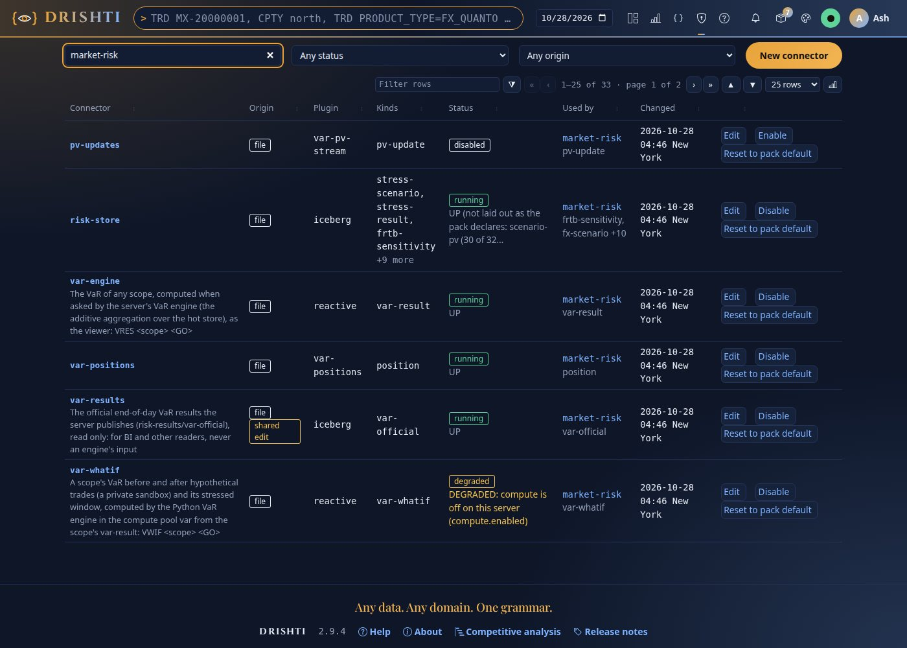
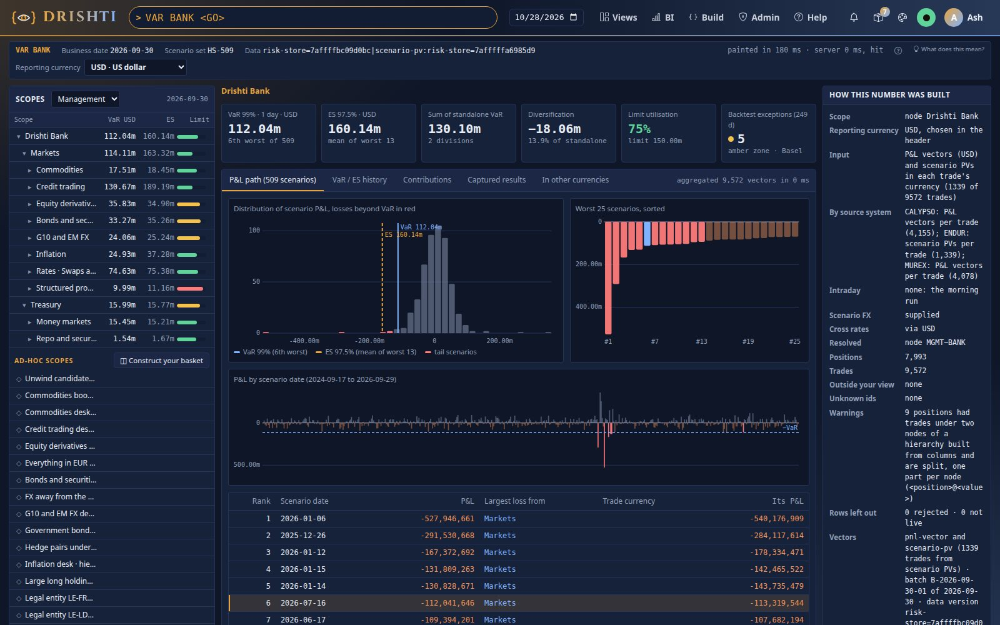
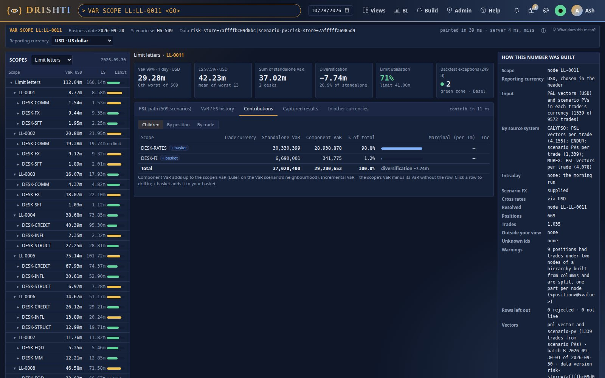
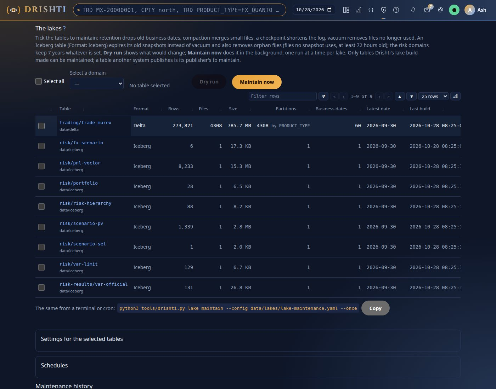
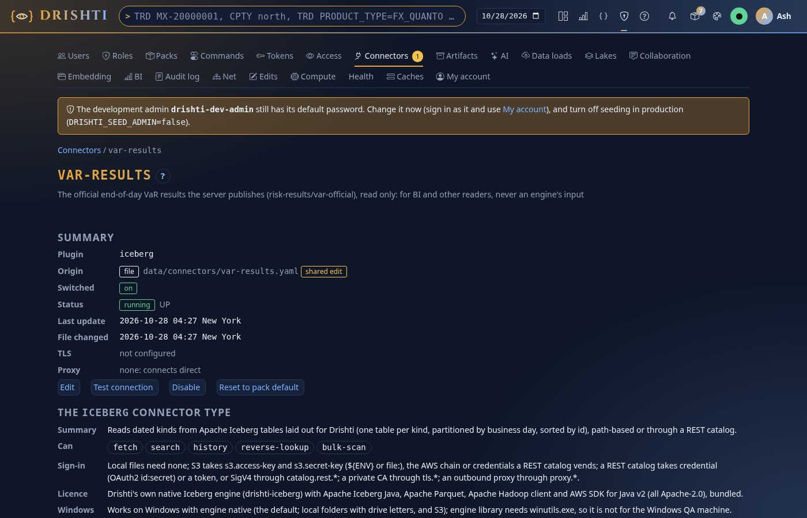

<!--
  Project Drishti · Any data. Any domain. One grammar.

  Copyright (c) 2026 Ashutosh Sinha <ajsinha@gmail.com>.
  All rights reserved.

  PROPRIETARY AND CONFIDENTIAL.

  This file is the confidential and proprietary property of Ashutosh Sinha.
  Unauthorised copying, use, modification, distribution or disclosure of this
  file, via any medium, is strictly prohibited except with the express prior
  written permission of the copyright holder.

  See the LICENSE file in the root of this repository for the full terms.
-->
# Tutorial 29 · The risk lake and the official results on Iceberg

Delta Lake is Drishti's default lake format; since 2.9.5 Apache Iceberg is a full alternative, chosen by configuration. In this
tutorial you move the market-risk pack's VaR inputs from Delta to Iceberg, publish the official end-of-day VaR results to Iceberg,
check that VaR is the same to the cent, see each table's format in Admin → Lakes, point BI's reader of the official results at the
new format, and go back to Delta. Each step shows the UI, the command line and the YAML behind it; every output was captured on the
committed test data.

## Time to complete

About 20 minutes.

## Before you start

- [Tutorial 25](25-var-from-the-bank-to-a-trade.md) step 1 done once: you know the VaR test data and `VAR BANK` (112,041,646 USD on
  2026-09-30).
- The server built (`./mvnw clean package -DskipTests`): `build_demo_lakes.py` writes Iceberg with the loader in the server's jar.
- The console's Python (`drishti-console/.venv/bin/python`; Windows `drishti-console\.venv\Scripts\python.exe`): it has `deltalake`.
- Stop the server while you build the lake; the examples use the default data folder, `data/` (`data/delta`, `data/iceberg`).

## What you will learn

- how `build_demo_lakes.py --store risk=iceberg` moves every table of the risk domain into Iceberg and switches `risk-store.yaml`;
- how to publish the official results to Iceberg (`drishti.var.official.format` and `.root`), and why a table keeps its format;
- that VaR, ES and the limit letters read from Iceberg equal Delta's;
- each table's **Format** in Admin → Lakes;
- how BI's `var-results` connector follows the official format, and how to put back a file `lake demo` wrote;
- how to go back to Delta.

## Step 1 · Build the VaR data into Iceberg

**From the command line.** The same `--only` list as tutorial 25, with `--store risk=iceberg`:

```bash
drishti-console/.venv/bin/python tools/build_demo_lakes.py --as-of data --store risk=iceberg \
  --only market-risk/pnl-vector,market-risk/scenario-pv,market-risk/fx-scenario,market-risk/scenario-set,market-risk/risk-hierarchy,market-risk/portfolio,market-risk/var-limit
```

```text
1/3 the demo lakes: only market-risk/pnl-vector,…,market-risk/var-limit, every business day, ending data → data/delta
  …
  risk/pnl-vector into Iceberg: data/delta/risk/pnl-vector -> data/iceberg/risk/pnl-vector
    iceberg: 8,233 rows read in 1 s; 1 business days of 1 tables to write
  risk/pnl-vector: 8,233 rows in Iceberg, newest business date 2026-09-30 (data/iceberg/risk/pnl-vector)
  …
  risk/var-limit: 129 rows in Iceberg, newest business date 2026-09-30 (data/iceberg/risk/var-limit)
3/3 done in 14 s.
  Risk domain: iceberg data/iceberg/risk; risk-store: now reads iceberg, was delta (data/connectors/risk-store.yaml; …);
  exposure-store: now reads iceberg, was delta (…)
```

The tables are built as Delta first (`lake demo`), then each is copied into Iceberg by Drishti's own loader and the Delta copy removed:
one store per domain. Your own `--lake` folder: the Iceberg root is the folder beside it (`<lake>/../iceberg`; `DRISHTI_ICEBERG_ROOT`
moves it).

**The YAML.** The script writes the connector file `risk-store.yaml` from the market-risk pack's template, switched to Iceberg (the
text it replaced is kept in `data/connectors/history/`), and does the same for the counterparty-risk pack's `exposure-store.yaml`:

```yaml
# Written by tools/build_demo_lakes.py --store risk=iceberg: every risk table in Iceberg (data/iceberg/risk), …
plugin: iceberg
kinds: [stress-scenario, stress-result, frtb-sensitivity, pnl-explain, trade-valuation, portfolio, pnl-vector, scenario-pv,
        fx-scenario, scenario-set, risk-hierarchy, var-limit]
settings:
  root: ${DRISHTI_ICEBERG_ROOT:${drishti.data.dir:./data}/iceberg}
  engine: native
  domain: risk
  layout:
    pnl-vector:
      columns: [VALUE_TYPE, GRAIN, TRADE_ID, …, TT_BOOK, LIMIT_LETTER, …]
      vectors: [PNL]
    …
```

**In the UI.** Nothing to do yet; step 4 shows the tables.

**You should see** `data/iceberg/risk/<kind>/metadata` and `data` folders for the seven VaR kinds, `data/delta/risk` empty, and
`plugin: iceberg` at the top of `data/connectors/risk-store.yaml`.

**Further:** [ICEBERG_CONNECTOR.md](../connectors/ICEBERG_CONNECTOR.md) (the connector, sections 18 and 19 for 2.9.5),
[DEMO_DATA.md](../connectors/DEMO_DATA.md#mixed-delta-and-iceberg-storage) (mixed storage).

## Step 2 · Publish the official results to Iceberg

The server captures every node of every hierarchy officially when a date loads, and appends the figures to
`<root>/risk-results/var-official` for other systems ([VAR_GUIDE.md section 19](../guides/VAR_GUIDE.md#19-official-end-of-day-results)).
Delta is the default; Iceberg is one setting. **A table keeps the format it was created in**, so give the Iceberg table a root of its
own; the Iceberg root of step 1 is the natural one.

**The YAML** (`application.local.yaml` in the server's working folder; [CONFIGURATION.md](../admin/CONFIGURATION.md)):

```yaml
drishti:
  var:
    official:
      format: iceberg                  # delta (the default) or iceberg; DRISHTI_VAR_OFFICIAL_FORMAT
      root: ./data/iceberg             # the table: data/iceberg/risk-results/var-official
  ccr:
    exposure:
      official:
        format: iceberg                # the same for the official exposure results (DRISHTI_EXPOSURE_OFFICIAL_FORMAT)
        root: ./data/iceberg
```

**From the command line**, the same by environment for the format (the root has no variable of its own):
`DRISHTI_VAR_OFFICIAL_FORMAT=iceberg`.

**In the UI.** None: settings are read at start.

**You should see**, if you change the format but not the root of a lake whose Delta table already exists, the capture still made and
the publish refused in words, in `drishti.py var official` and the log:

```text
"publishError": "iceberg table data/delta/risk-results/var-official: the table data/delta/risk-results/var-official is a Delta table
and the official format is iceberg: an official table keeps its format; give the new format another root (drishti.*.official.root)"
```

With the root of the YAML above it publishes (step 3). A date already captured is not published again by a restart; the new format
applies from the next capture.

**Further:** [VAR_GUIDE.md section 19](../guides/VAR_GUIDE.md#19-official-end-of-day-results),
[EXPOSURE_GUIDE.md](../guides/EXPOSURE_GUIDE.md) (section 20), on S3: [AWS_DEPLOYMENT.md section 22](../architecture/AWS_DEPLOYMENT.md#22-iceberg-on-aws-295).

## Step 3 · Start the server and look at the connectors

Start the server and the console as in tutorial 1, with the samples off (`DRISHTI_DEMO_ENABLED=false`). For Admin → Lakes to list the
Iceberg tables too, give the console both roots: `DRISHTI_LAKE_ROOTS=data/delta,data/iceberg`.

**In the UI.** **Admin → Connectors**, filter `market-risk`: `risk-store` on **iceberg**, `var-results` on **iceberg** (after step 6).



**From the command line:**

```text
$ drishti.py connector list
  name                origin  plugin         kinds                                                        state     used by
  exposure-store      file    iceberg        simulation-run,exposure-path                                 running   counterparty-risk
  risk-store          file    iceberg        stress-scenario,stress-result,frtb-sensitivity +9            running   market-risk
  trade-murex         file    delta          trade                                                        running   trading
  var-results         file    delta          var-official                                                 running   market-risk
  …
$ drishti.py var official
  … "nodes": 131 …, "published": true …
```

**The YAML** is step 1's and step 2's.

**You should see** `risk-store` on `iceberg`, the official capture of 2026-09-30 with 131 nodes **published**, and the table
`data/iceberg/risk-results/var-official` with its JSON Lines beside it (`data/iceberg/risk-results/jsonl/var-official/2026-09-30/var-official-v1.jsonl`).
`var-results` still says `delta`: step 6 is about it.

**Further:** [CONNECTOR_FILES.md](../connectors/CONNECTOR_FILES.md) (Admin → Connectors).

## Step 4 · VaR from Iceberg is the same

**In the UI.** `VAR BANK`, then **Limit letters** in the select above the tree and **LL-0011**:





**From the command line:**

```text
$ drishti.py var show BANK
VAR BANK  ·  Drishti Bank  ·  node  ·  2026-09-30
  VaR 99%   112,041,646 USD   (the 6th worst of 509)
  ES 97.5%   160,143,809 USD   (mean of the 13 worst)
  limit      150,000,000 USD   use 74.7%
  …
  9572 trades in 7993 positions
  pnl-vector and scenario-pv (1339 trades from scenario PVs) · batch B-2026-09-30-01 of 2026-09-30 · data version risk-store=7affffbb8b218c|scenario-pv:risk-store=7affffddd82bf9
  …
$ drishti.py var show LL:LL-0011
  VaR 99%   29,280,653 USD   …   limit 41,000,000 USD   use 71.4%
$ drishti.py var show BANK --ccy EUR
  VaR 99%   111,837,045 EUR   …
```

**You should see** exactly tutorial 25's figures: 112,041,646 and 160,143,809 for the bank, 29,280,653 for LL-0011, 111,837,045 EUR.
Only the data version differs: an Iceberg fingerprint of the date's files instead of Delta's. The equality is tested on every scope,
both currencies, VaR, ES, components and intraday batches (`VarFormatEqualityTest`), and for exposure (`ExposureFormatEqualityTest`).
Intraday batches on an Iceberg lake are Iceberg appends made by the pricing system's writer or by the Kafka stream (whose `pv-updates`
connector's `lake` must then name `data/iceberg`); `drishti.py var intraday --load` appends to Delta only
([VAR_GUIDE.md section 8.4](../guides/VAR_GUIDE.md#84-what-if-pricing-and-intraday-recomputes-what-if-planned-intraday-updates-as-built-in-294)).

**Further:** [VAR_GUIDE.md section 15.1](../guides/VAR_GUIDE.md#151-where-they-live) and
[section 29.3](../guides/VAR_GUIDE.md#293-how-the-lake-tools-and-the-delta-plugin-carry-a-vector-as-built).

## Step 5 · Each table's format in Admin → Lakes

**In the UI.** **Admin → Lakes**: the tables of both roots with a **Format** column.



**From the command line:** the page prints its twin under the table (*The same from a terminal or cron*: `drishti.py lake maintain
--config data/lakes/lake-maintenance.yaml --once`); add `--dry-run` to see what a run would change, changing nothing.

**The YAML** (`data/lakes/lake-maintenance.yaml`, what the page writes): a lake `format: auto` (the default) maintains each table in
its own format, Iceberg's by snapshot expiry and orphan-file removal under the 7-year floor of `risk` and `risk-results`
([LAKE_MAINTENANCE.md section 8](../admin/LAKE_MAINTENANCE.md#8-iceberg-lakes)).

**You should see** `trading/trade_murex` as **Delta**, the seven risk tables and `risk-results/var-official` as **Iceberg**. The risk
tables are maintained here like the ones `drishti.py lake build --format iceberg` writes: the copy leaves the same build record
(`<iceberg root>/_drishti-lake/tables-built.json`, with the Delta table's pack and kind).

**Further:** [LAKE_MAINTENANCE.md](../admin/LAKE_MAINTENANCE.md).

## Step 6 · BI's reader of the official results follows the format

The market-risk pack's `var-results` connector (BI's `VOFF`) is `plugin: delta` in the pack; with `format: iceberg` the server reads
that template as `plugin: iceberg` over `${drishti.var.official.root}`. The file the server generated (stamped) and nobody edited
follows by itself: nothing to do. `lake demo` and `build_demo_lakes.py` leave this file to the server; one an earlier `lake demo` wrote
(its first line *Written by drishti.py lake demo*) is moved to the history by the build of step 1, so the server writes the stamped one.
An edited file is kept, and the change of plugin is listed under **Admin → Connectors → Template updates** (**Use the pack's value**).

**In the UI.** **Admin → Connectors → var-results**:



**From the command line:**

```text
$ drishti.py connector get var-results
connector var-results   origin file   plugin iceberg   running   …
  root                         ${drishti.var.official.root:${DRISHTI_DELTA_ROOT:${drishti.data.dir:./data}/delta}}
  domain                       risk-results
  engine                       native
```

**The YAML** the server reads (the pack's template seen through the official format; `OfficialReaders`):

```yaml
plugin: iceberg
kinds: [var-official]
settings:
  root: ${drishti.var.official.root:${DRISHTI_DELTA_ROOT:${drishti.data.dir:./data}/delta}}
  domain: risk-results
  engine: native
```

**You should see** `var-results` on `iceberg` and running, and the official records read back: `VOFF HIERARCHY == 'LL'` on
2026-09-30 finds 43 of the 131 rows.

**Further:** [CONNECTOR_FILES.md "Upgrades"](../connectors/CONNECTOR_FILES.md#upgrades-295) (stamped files, edited files, Use the
pack's value).

## Step 7 · Back to Delta

**From the command line** (server stopped):

```text
$ drishti-console/.venv/bin/python tools/build_demo_lakes.py --as-of data --store risk=delta --only market-risk/pnl-vector,…,market-risk/var-limit
  the risk domain is in Delta now: its Iceberg tables are removed (data/iceberg/risk)
  Risk domain: delta data/delta/risk; risk-store: now reads delta, was iceberg (the pack's own connector; …); exposure-store: now reads delta, was iceberg (…)
```

**The YAML.** `risk-store.yaml` and `exposure-store.yaml` are removed (their text kept in the history), so the packs' own Delta
connectors serve again; remove the `official` block of step 2 to publish to Delta again (the Iceberg official table stays where it is:
a table keeps its format). A full build without `--store risk=…` also puts the risk domain back in Delta.

**In the UI.** Admin → Connectors: `risk-store` on `delta`.

**You should see** `data/iceberg/risk` gone, `data/iceberg/risk-results` kept, and `VAR BANK` still 112,041,646.

## Next steps

- Your own lake on Iceberg, Databricks or a REST catalog: [Using Drishti with Databricks Delta Lake or Apache Iceberg](../guides/EXTERNAL_LAKES.md).
- On AWS (S3, Glue, S3 Tables, the scripts in `deploy/aws/iceberg/`): [AWS_DEPLOYMENT.md section 22](../architecture/AWS_DEPLOYMENT.md#22-iceberg-on-aws-295).
- Exposure on the same lake: [tutorial 26](26-exposure-from-the-bank-to-a-trade.md) after a full `--store risk=iceberg` build.

## When something goes wrong

| You see | Do |
|---|---|
| *this Python lacks deltalake* | run the script with the console's Python (Before you start) |
| *could not find the server jar* or the copy into Iceberg fails | build the server first (`./mvnw clean package -DskipTests`) |
| `VAR BANK` answers *no P&L vectors in any connector* | the server reads another Iceberg root: set `DRISHTI_ICEBERG_ROOT` to the folder beside your `--lake` |
| `publishError` *… is a Delta table and the official format is iceberg* | give the official results another root (step 2) |
| `var-results` stays `delta` | the file was edited: Admin → Connectors → Template updates → **Use the pack's value** for `plugin` (step 6) |
| Admin → Lakes lists no Iceberg table | the console's `DRISHTI_LAKE_ROOTS` lacks `data/iceberg` (step 3) |
