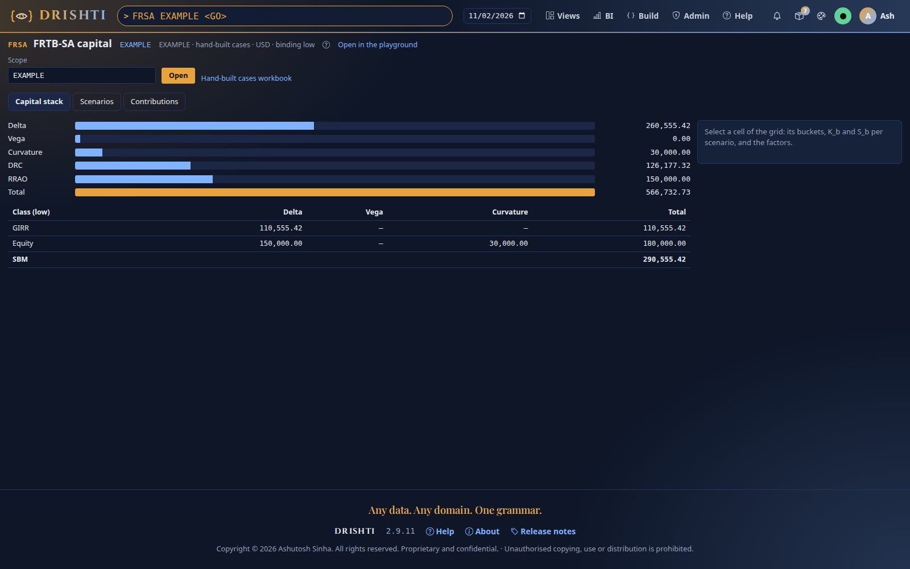
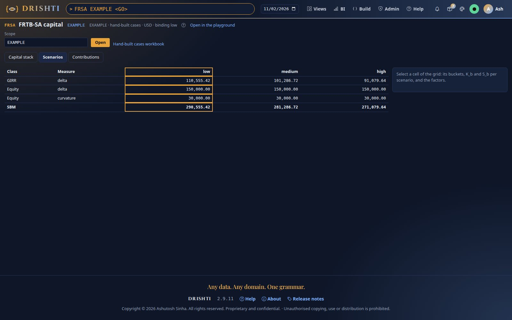
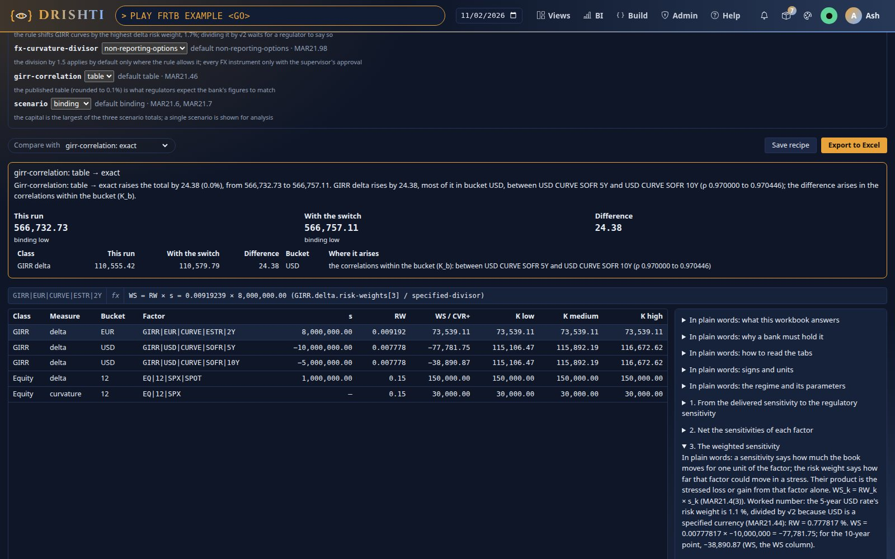
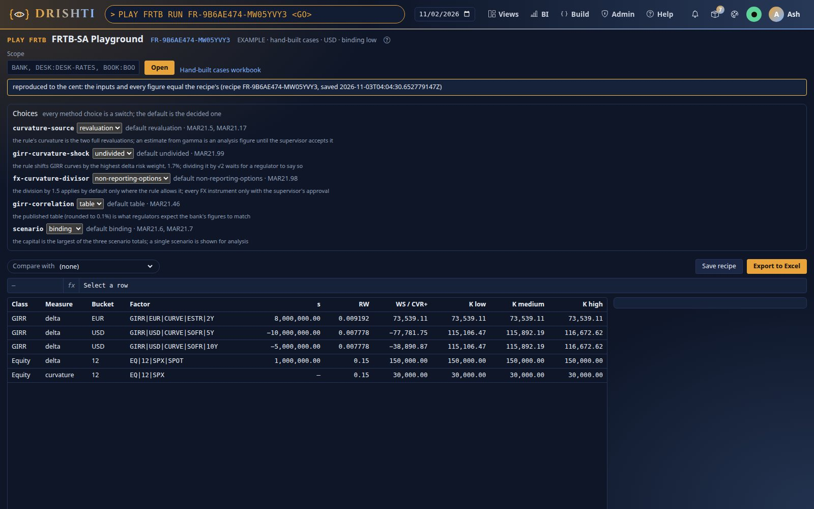
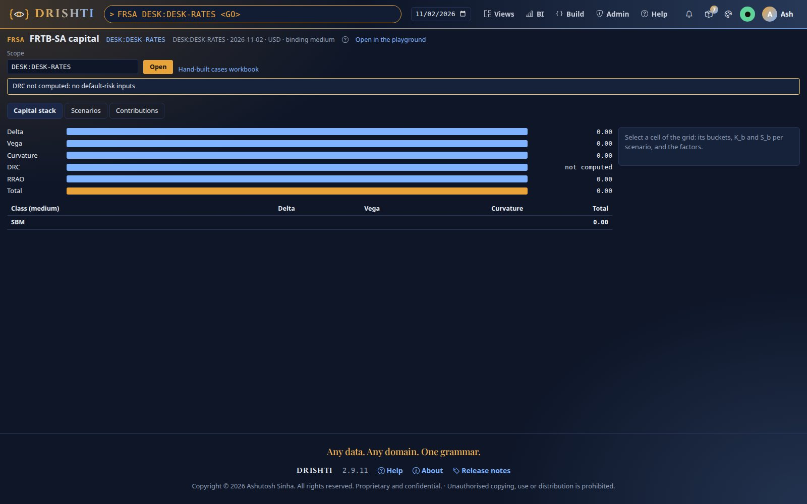
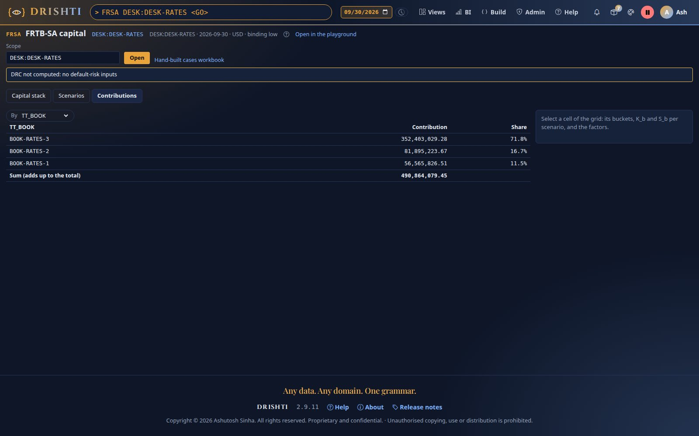

<!--
  Project Drishti · Any data. Any domain. One grammar.

  Copyright (c) 2026 Ashutosh Sinha <ajsinha@gmail.com>.
  All rights reserved.

  PROPRIETARY AND CONFIDENTIAL.

  This file is the confidential and proprietary property of Ashutosh Sinha.
  Unauthorised copying, use, modification, distribution or disclosure of this
  file, via any medium, is strictly prohibited except with the express prior
  written permission of the copyright holder.

  See the LICENSE file in the root of this repository for the full terms.
-->
# Tutorial 30 · FRTB-SA from the hand-built cases to a desk

FRTB-SA, the regulator's standard formula for market-risk capital, computed by Drishti for any scope from the positions' sensitivities.
In this tutorial you start from the design's hand-built cases (small enough to check with a calculator), read the capital stack and the
three correlation scenarios, open the playground, flip a method switch and read the difference explained by step, download the workbook
of live formulas, save a recipe and replay it to the cent, and then do the same on a desk of the demo data. Each step shows the UI, the
command line and the YAML behind it; the reference is the [FRTB-SA guide](../guides/FRTB_SA_GUIDE.md).

## Time to complete

About 25 minutes.

## Before you start

- [Tutorial 25](25-var-from-the-bank-to-a-trade.md) step 1 done once: the VaR test data in the lake, `VAR BANK` answering. FRTB-SA
  resolves scopes as VaR does.
- The position sensitivities and the factor dictionary in the lake: `drishti.py lake demo` loads `market-risk/position-sensitivity` (8,052
  records on 2026-09-30) and `market-risk/risk-factor` with the other risk kinds.
- An edition with the VaR word (Drishti Risk or Drishti Trading) and a role that sees positions.

## What you will learn

- how the capital is built: weighted sensitivities, buckets, classes, three scenarios, the binding one, DRC and RRAO;
- the capital screen (`FRSA`): the stack, the scenarios, the bucket drill and the contributions;
- the playground (`PLAY FRTB`): every method choice a switch, a comparison in words, the workbook of live formulas;
- recipes: a run saved and replayed to the cent (`PLAY FRTB RUN <id>`);
- where the parameters live and how an override is marked.

## Step 1 · The hand-built cases

The `EXAMPLE` scope runs the design's cases 1 to 5 with no data: a USD swap's DV01 at 5 and 10 years, a EUR hedge at 2 years, an equity
index option (delta 10,000 per 1 %, revalued up and down), a bond and a CDS on one obligor with a second obligor short, an FX barrier and a
weather derivative.

**In the UI.** Type `FRSA EXAMPLE <GO>`. The header reads *EXAMPLE · the hand-built cases · USD · binding low*. The capital stack:

| Bar | Value |
|---|---|
| Delta | 260,555.42 (GIRR 110,555.42 and the index's own delta 0.15 × 1,000,000 = 150,000) |
| Vega | 0.00 |
| Curvature | 30,000.00 |
| DRC | 126,177.32 |
| RRAO | 150,000.00 |
| Total | 566,732.73 |

**From the command line.**

```bash
python3 tools/drishti.py frtb sa EXAMPLE
```

```text
FRTB-SA EXAMPLE · the hand-built cases · USD · binding low
class      measure                   low             medium               high
GIRR       delta              110,555.42         101,286.72          91,079.64
EQ         delta              150,000.00         150,000.00         150,000.00
EQ         curvature           30,000.00          30,000.00          30,000.00
SBM                           290,555.42         281,286.72         271,079.64
SBM 290,555.42 · DRC 126,177.32 · RRAO 150,000.00 · total 566,732.73
```

**The YAML.** Nothing to configure: the parameters are the market-risk pack's `capital/frtb-sa-sbm.yaml` and `frtb-sa-drc-rrao.yaml`.

```yaml
GIRR:
  delta:
    tenors: [0.25, 0.5, 1, 2, 3, 5, 10, 15, 20, 30]                 # MAR21.8(1)
    risk-weights: [0.017, 0.017, 0.016, 0.013, 0.012, 0.011, 0.011, 0.011, 0.011, 0.011]   # MAR21.42
    use-specified-divisor: true                                     # MAR21.44: USD's weights divided by √2
```

Check one figure by hand: the USD bucket holds WS −77,781.75 (5Y) and −38,890.87 (10Y) with ρ 0.970 from MAR21.46's table, so
K = √(77,781.75² + 38,890.87² + 2 × 0.970 × 77,781.75 × 38,890.87) = 115,892.19 in the medium scenario.

**You should see** the header *EXAMPLE · the hand-built cases · USD · binding low*, the six bars of the stack with a total of 566,732.73, and, with GIRR delta selected, the buckets EUR and USD in the drill on the right.



## Step 2 · The three scenarios and the binding one

**In the UI.** Open the **Scenarios** tab. Each class and measure in the low, medium and high scenarios; the low column is outlined: the
EUR position hedges the USD ones, and the low scenario, trusting the hedge least, binds (GIRR 110,555.42 low against 91,079.64 high).
Select GIRR delta on the **Capital stack** tab: the drill on the right lists bucket EUR (K 73,539.11) and bucket USD (K 115,892.19,
S −116,672.62).

**From the command line.**

```bash
python3 tools/drishti.py frtb explain EXAMPLE --class GIRR --json
```

The answer lists each bucket's `K` and `S` per scenario and each factor's `s`, `rw` (with the parameter it came from) and `ws`.

**The YAML.** The scenario multipliers (MAR21.6):

```yaml
scenarios:
  high: {multiplier: 1.25, cap: 1.0}                          # min(1.25 × ρ, 1)
  low: {multiplier: 2.0, minus: 1.0, floor-multiplier: 0.75}  # max(2 × ρ − 1, 0.75 × ρ)
```

**You should see** three columns (low, medium, high) for every class and measure, the low column outlined as the binding one, and GIRR delta at 110,555.42 low against 91,079.64 high.



## Step 3 · The playground: flip a switch and read why the figure moved

**In the UI.** Type `PLAY FRTB EXAMPLE <GO>`. The **Choices** panel lists every method choice with its default, its rule and why the
default was chosen. In **Compare with**, pick `girr-correlation: exact`. Both runs appear side by side:

> Girr-correlation: table → exact raises the total by 24.38 (0.0%), from 566,732.73 to 566,757.11. GIRR delta rises by 24.38, most of it
> in bucket USD, between USD CURVE SOFR 5Y and USD CURVE SOFR 10Y (ρ 0.970000 to 0.970446); the difference arises in the correlations
> within the bucket (K_b).

Now pick `curvature-source: gamma`: the comparison says the switch *leaves the total unchanged*, because no position of the cases
delivers a gamma. Where a source sends one (case 10 of the guide's section 10), the index's curvature becomes the estimate 22,500 beside the
revalued 30,000 and the header says the figure *contains curvature estimated from gamma*, an analysis figure.

Select a row of the grid: the formula bar shows `WS = RW × s` with its numbers and the explanation opens the step that produced it.

**From the command line.**

```bash
python3 tools/drishti.py play frtb EXAMPLE --compare girr-correlation=exact
python3 tools/drishti.py frtb sa EXAMPLE --girr-correlation exact          # the alternative on its own: NOT THE REGULATORY FIGURE
python3 tools/drishti.py frtb sa EXAMPLE --override GIRR.delta.across-buckets=0.6
```

**The YAML.** A switch is a request parameter, never a configuration change; the defaults are the product owner's decisions. An override
names a parameter path of the files and marks every figure *not the regulatory figure*.

**You should see** both runs side by side, the comparison in words above the grid (*raises the total by 24.38*), and the formula bar filled when you select a row.



## Step 4 · The workbook of live formulas

**In the UI.** **Export to Excel** (or **Hand-built cases workbook** above the scope). Open it in Excel, LibreOffice or Google Sheets.
Main's band reads **ALL CHECKS PASS**: every charge beside the engine's, to the cent. Go to **Config** and set `girr-correlation` to
`exact` in its drop-down: the workbook recomputes on its own, Main's band reads *SWITCHES CHANGED: SEE THE ALTERNATIVES*, and the row
`girr-correlation = exact` in the alternatives block checks the workbook's new total, 566,757.11, against the engine's: ✓.

Follow a figure back: Main → Classes (γ and the terms) → Buckets (the ρ matrix as formulas on the tenors, the scenario terms) → WS
(`SUMIFS` over Data, the risk weight by `INDEX/MATCH` into Config) → Data.

**From the command line.**

```bash
python3 tools/drishti.py play frtb EXAMPLE --xlsx frtb-cases.xlsx
```

```text
wrote frtb-cases.xlsx (51,000 bytes): the FRTB-SA Playground workbook, every figure a formula and every switch a cell of Config (a recipe was saved with it: its id is on Main and Provenance)
```

**The YAML.** The workbook's limits are settings:

```yaml
drishti:
  frtb:
    max-factors: 2000                # the most factors one playground grid and workbook holds
    playground-template: ""          # a bank's workbook template folder; blank: the built-in one
```

**You should see** Main's band read **ALL CHECKS PASS** when the workbook opens, and *SWITCHES CHANGED: SEE THE ALTERNATIVES* with a ✓ on the `girr-correlation = exact` row after you change Config.

## Step 5 · Save a recipe and replay it to the cent

**In the UI.** In the playground with `girr-correlation: exact`, press **Save recipe**. The notice gives the id and the command, for
example *Saved as recipe FR-1A2B3C4D-MH8Q2: PLAY FRTB RUN FR-1A2B3C4D-MH8Q2 computes it again to the cent*. Type that command: the page
opens on the recorded scope, date and switches and says *reproduced to the cent: the inputs and every figure equal the recipe's*.

**From the command line.**

```bash
python3 tools/drishti.py play frtb EXAMPLE --girr-correlation exact --save
python3 tools/drishti.py play frtb --recipe FR-1A2B3C4D-MH8Q2
```

The replay exits 1 when it does not reproduce, naming what differs (an input read differently, a figure).

**The YAML.** Recipes are kept under the data folder; each holds the parameter files' bytes and SHA-256, so it reproduces even after
the parameters change:

```yaml
drishti:
  frtb:
    recipes-dir: ${drishti.data.dir:./data}/frtb/recipes
```

**You should see** the notice *Saved as recipe FR-…* after **Save recipe**, and on the replay the notice *reproduced to the cent: the inputs and every figure equal the recipe's*.



## Step 6 · A desk of the demo data

**In the UI.** Type `FRSA DESK:DESK-RATES <GO>`. The rates desk on 2026-09-30, binding low:

| Class | Measure | Low | Medium | High |
|---|---|---|---|---|
| GIRR | delta | 316,835,232.43 | 311,176,481.11 | 305,412,901.30 |
| GIRR | vega | 79,787,491.10 | 71,774,421.05 | 62,746,245.30 |
| GIRR | curvature | 40,702,784.86 | 36,314,465.57 | 31,317,153.82 |
| SBM | | **437,325,508.39** | 419,265,367.73 | 399,476,300.42 |

*DRC not computed: no default-risk inputs* (the demo has none; the DRC appears when a connector serves `default-risk`). The RRAO line shows
the add-on derived from the positions' product types and the VaR book's notionals. The **Contributions** tab by `TT_BOOK` adds up to
the SBM: BOOK-RATES-3 75.7 %, BOOK-RATES-2 15.2 %, BOOK-RATES-1 9.1 %.

Open the playground and compare `girr-correlation: exact`: *Girr-correlation: table → exact lowers the total by 12,925.12 … GIRR delta
falls by 12,925.12, most of it in bucket CHF, between CHF CURVE SARON 6M and CHF CURVE SARON 3M (ρ 0.970000 to 0.970446)*. Here the
table's rounding (0.970 against 0.970446) lowers a hedge's credit, the opposite direction to the cases.

**From the command line.**

```bash
python3 tools/drishti.py sens show DESK:DESK-RATES --by BUCKET
python3 tools/drishti.py frtb sa DESK:DESK-RATES
python3 tools/drishti.py frtb contributions DESK:DESK-RATES --by TT_BOOK
```

```text
DESK:DESK-RATES · 2026-09-30 · USD · 1349 records
GIRR AUD                                         CURVATURE_DOWN          10,616,762.86    103 positions
GIRR AUD                                         CURVATURE_UP           -23,717,714.73    103 positions
GIRR AUD                                         DV01                    -1,118,399.59    205 positions
GIRR AUD                                         VEGA                       235,628.77    103 positions
…
```

**The YAML.** The kinds the engine reads, and where:

```yaml
drishti:
  frtb:
    sensitivity-kind: position-sensitivity   # served by risk-store (config/packs/banking/market-risk/pack.yaml)
    factor-kind: risk-factor
    default-risk-kind: default-risk          # none served: "DRC not computed", never 0
    rrao-from-positions: true
```

**You should see** the rates desk's SBM of 437,325,508.39 in the low scenario, *DRC not computed: no default-risk inputs*, and on **Contributions** by `TT_BOOK` the three books adding up to the SBM.





## What you did

- read the capital of the hand-built cases and checked a bucket by hand;
- saw the low scenario bind on a hedged book;
- flipped a method switch and read the difference by step, in the playground and on the command line;
- recomputed the workbook in a spreadsheet, a switch flipped in Config;
- saved a recipe and replayed it to the cent;
- did the same on the rates desk of the demo data, with its contributions.

## Next steps

- The [FRTB-SA guide](../guides/FRTB_SA_GUIDE.md): every formula, rule and setting.
- The data contract: [FRTB.md](../contracts/FRTB.md).
- [Tutorial 32](32-simm-from-the-examples-to-a-netting-set.md): SIMM from the same sensitivities.

## When something goes wrong

- *DRS-5329 the FRTB-SA parameter files are not in …*: `drishti.frtb.parameters-dir` names a folder without `frtb-sa-sbm.yaml`
  and `frtb-sa-drc-rrao.yaml`; blank it to read the market-risk pack's `capital/`.
- `FRSA` answers *engine off* (`DRS-1020`): turn FRTB-SA on in Admin → Engines (it needs VaR and sensitivities).
- A desk shows no sensitivities: run `drishti.py lake demo` again so `market-risk/position-sensitivity` is in the lake.
