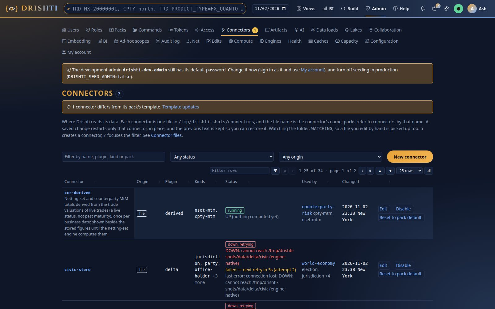
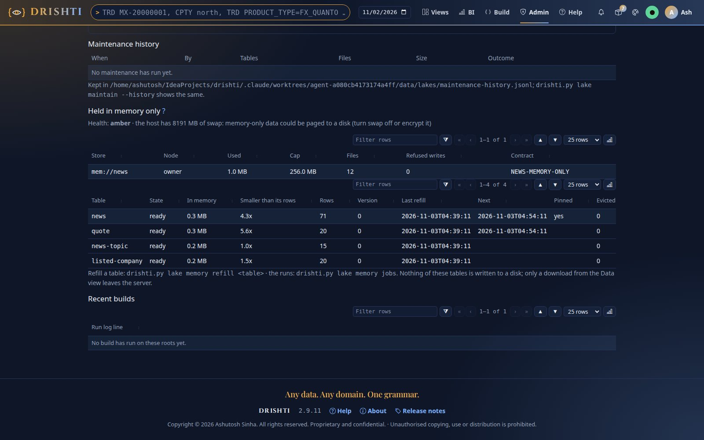
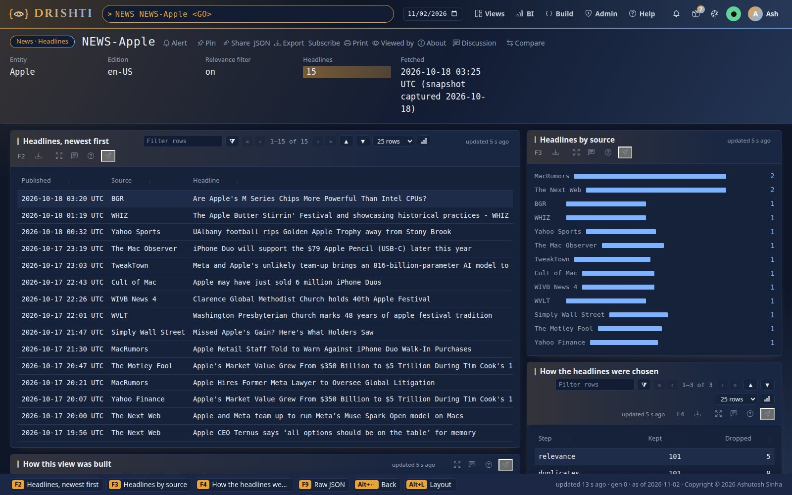
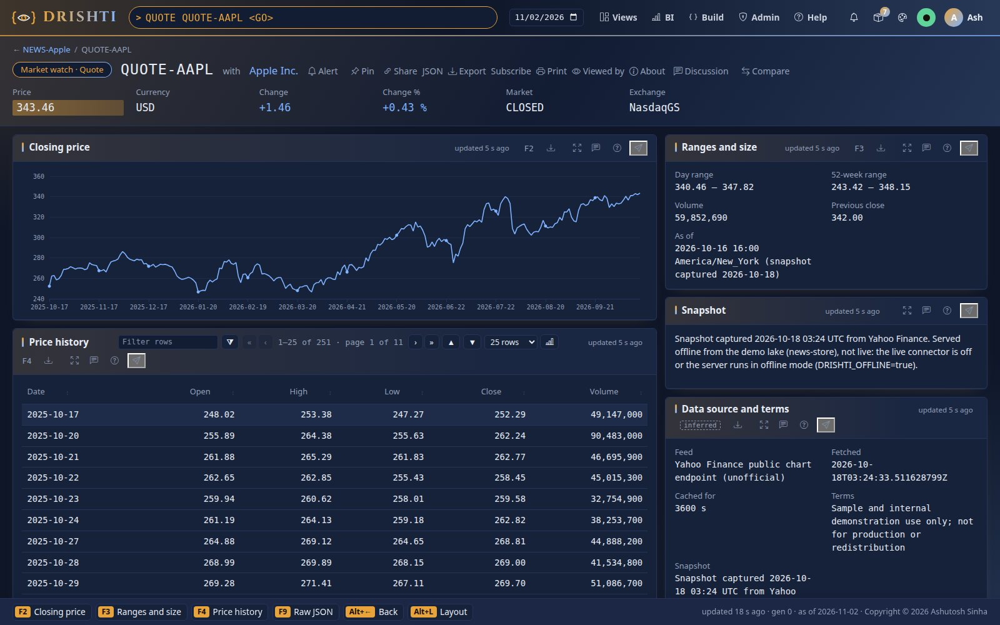
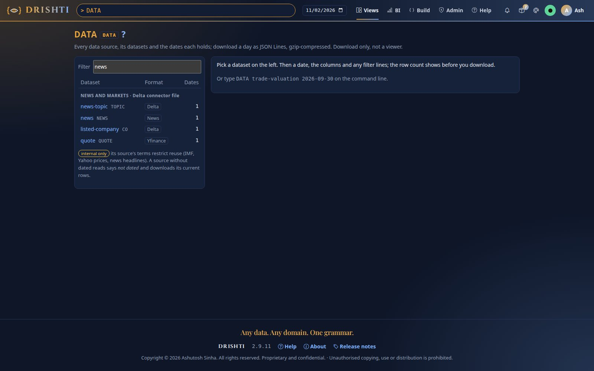
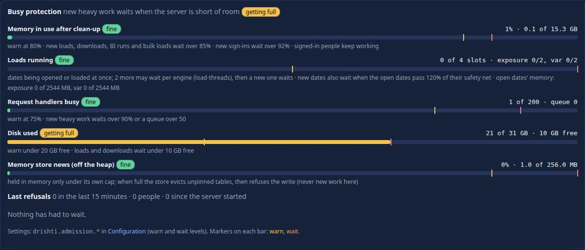

<!--
  Project Drishti · Any data. Any domain. One grammar.

  Copyright (c) 2026 Ashutosh Sinha <ajsinha@gmail.com>.
  All rights reserved.

  PROPRIETARY AND CONFIDENTIAL.

  This file is the confidential and proprietary property of Ashutosh Sinha.
  Unauthorised copying, use, modification, distribution or disclosure of this
  file, via any medium, is strictly prohibited except with the express prior
  written permission of the copyright holder.

  See the LICENSE file in the root of this repository for the full terms.
-->
# Tutorial 31 · News held in memory only

Some feeds may not, by contract, be saved on a disk. In this tutorial you move the news-and-markets pack (headlines, quotes, news topics,
listed companies) from the disk lake into the server's memory, watch the replenish jobs fill it, read it as before, see what the guard
refuses and what it allows, and go back. Each step shows the UI, the command line and the YAML behind it. The figures are those of the
committed snapshot (71 headline sets, 20 quotes, 15 topics, 20 companies).

## Time to complete

About 15 minutes.

## Before you start

- The server built (`./mvnw clean package -DskipTests`) and the demo data in place (`drishti.py lake demo`, [tutorial 1](01-first-15-minutes.md)).
- The news-and-markets pack enabled (it is by default) and `NEWS Apple` opening a page.
- Sign in as an administrator (Admin → Lakes and the `lake memory` commands are for administrators).

## What you will learn

- how a connector reads a lake in memory (`root: mem://news`) and how a memory store and its tables are configured;
- how the replenish jobs fill the tables (warm-up, schedule, signal, refill) and what their runs record;
- what stays the same (pages, search, Export data) and what is refused (`DRS-5219`);
- how the store's cap, eviction and compaction show on Admin → Lakes and Health;
- how to go back to the disk lake.

## Step 1 · Point the news connector at memory

**The YAML.** The store is a lake of its own (docs/guides/LAKE_GUIDE.md section 6): copy its lake file, and the example connector over
the pack's own:

```bash
cp config/lakes.examples/memory/news.yaml config/lakes/news.yaml
cp config/connectors.examples/memory/news-store.yaml config/connectors/news-store.yaml
```

```yaml
# config/lakes/news.yaml
lake: news
format: delta
root: mem://news
memory: {max-mb: '${DRISHTI_NEWS_MEMORY_MB:256}', chunk-kb: 64, contract: '${DRISHTI_NEWS_CONTRACT:NEWS-MEMORY-ONLY}'}
tables:
  news.news-topic: {path: news-topic}      # the tables sit at mem://news/<kind>
  news.listed-company: {path: listed-company}
  news.news: {path: news}
  news.quote: {path: quote}
```

```yaml
# config/connectors/news-store.yaml
plugin: delta
kinds: [news-topic, listed-company, news, quote]
settings:
  lake: news
  lake-tables: news.news-topic,news.listed-company,news.news,news.quote
```

**The UI.** Admin → Connectors → `news-store` shows the same text and its origin *your file*. Until the store exists the connector's health
reads *mem://news is held in memory only and is empty now*.

**You should see** `news-store` with root `mem://news` and its origin *your file*; until the store exists its health reads *mem://news is held in memory only and is empty now*.



## Step 2 · Define the four tables' replenish jobs

**The YAML.** The store's cap and contract are in its lake file (step 1). Append the jobs that fill its tables to `application.local.yaml`
in the server's working folder (the repository, for the scripts):

```bash
cat config/examples/in-memory-lake.yaml >> application.local.yaml
```

```yaml
drishti:
  lake:
    memory:
      tables:                     # the store news: config/lakes/news.yaml
        - { name: news,  store: news, source: { file: data/testdata/news-and-markets/news/news.2026-10-18.jsonl.gz },  key: [NEWS_ID],  every: 15m, warm-up: 1, pin: true }
        - { name: quote, store: news, source: { file: data/testdata/news-and-markets/quote/quote.2026-10-18.jsonl.gz }, key: [QUOTE_ID], every: 15m, warm-up: 2 }
        - { name: news-topic,     store: news, source: { file: config/packs/news-and-markets/samples/news-topic.jsonl },     key: [TOPIC_ID],   warm-up: 3 }
        - { name: listed-company, store: news, source: { file: config/packs/news-and-markets/samples/listed-company.jsonl }, key: [COMPANY_ID], warm-up: 4 }
```

A live site points `source` at its feed instead: `url:` (a vendor's REST feed answering JSON Lines, `headers:` with `${ENV}` secrets), or
the news connector entity by entity (`{ connector: news, kind: news, ids-from: listed-company.NEWS_ID }`).

**The command line.** The launcher raises the JVM's direct-memory limit by the store's cap; see what it will use:

```bash
python3 tools/lake/memory_caps.py
```

```text
512
```

(256 MB for the server's own buffers plus the store's 256 MB.) Restart the server with its start script.

**You should see** `memory_caps.py` print 512 (the server's own 256 MB plus the store's 256 MB) and the server start again with no error about the direct-memory limit.

## Step 3 · Watch the warm-up fill the tables

**The command line.**

```bash
python3 tools/drishti.py lake memory status
```

```text
MEMORY STORES (1)
  news             owner        1.4 MB of      256.0 MB (1%)  files 22  refusals 0  contract NEWS-MEMORY-ONLY

TABLES (4)
  news                 ready          0.4 MB  rows        71  v0  ratio 4.2x   pinned evictions 0  refusals 0  compactions 0
    mem://news/news  ←  file data/testdata/news-and-markets/news/news.2026-10-18.jsonl.gz  (replace)  last 2026-11-02T14:42:42Z  next 2026-11-02T14:57:42Z
  quote                ready          0.4 MB  rows        20  v0  ratio 5.2x   evictions 0  refusals 0  compactions 0
  …
HEALTH  green
```

```bash
python3 tools/drishti.py lake memory jobs
```

```text
RUNS (4)
  2026-11-02T14:42:42  listed-company       warm-up          ok       rows        20      0.0 MB  v0  58 ms
  2026-11-02T14:42:42  news-topic           warm-up          ok       rows        15      0.0 MB  v0  20 ms
  2026-11-02T14:42:42  quote                warm-up          ok       rows        20      0.1 MB  v0  77 ms
  2026-11-02T14:42:42  news                 warm-up          ok       rows        71      0.1 MB  v0  1,580 ms
```

**The UI.** Admin → Lakes, *Held in memory only*: the store (used against its cap, the contract) and the four tables with their state,
memory, how much smaller they are than their rows, the version and the next refill.

**You should see** the store `news` owned by this node with its contract `NEWS-MEMORY-ONLY`, and the four tables *ready* with 71, 20, 15 and 20 rows, each a warm-up run in `lake memory jobs`.



## Step 4 · Read it as before

**The UI.** Type `NEWS Apple`, `QUOTE AAPL`, `CO AAPL`: the pages are the same. Export data (`DATA`) lists the four datasets and
downloads a day as `.jsonl.gz`, streamed from memory with no temporary file, audited as `data.download … memory-only data`.

**The command line.**

```bash
python3 tools/drishti.py view get listed-company/CO-AAPL
```

**You should see** the same pages as on the disk lake, and the four datasets in Export data.







## Step 5 · What the guard refuses

**The UI.** Save a scheduled report on `NEWS where COUNT > 1` (My reports → New): it is refused, in words:

```text
DRS-5219 This report uses NEWS data held in memory only (contract NEWS-MEMORY-ONLY); it cannot be delivered by a scheduled report.
Only a download by you may leave the server.
```

A share of a news page is sent as a link; with a picture or by e-mail it is refused the same way; *Ask about this page* is refused; a BI
run on the news is not stored (it is computed again when opened). Nothing of the news is written to the data folder: no document cache,
no id-map files, no index segments for this connector.

**The API.**

```bash
curl -s -X PUT -H "Authorization: Bearer $DRISHTI_TOKEN" -H 'Content-Type: application/json' \
  -d '{"query":"NEWS where COUNT > 1","schedule":"business-days 18:30"}' http://localhost:18480/api/v1/me/reports/news-daily
```

**You should see** the save refused with `DRS-5219` and the contract named, and nothing of the news under the data folder.

## Step 6 · Refill on demand, and after a restart

```bash
python3 tools/drishti.py lake memory refill news
python3 tools/drishti.py lake memory jobs --table news --limit 2
```

```text
news: a refill is queued (drishti.py lake memory jobs --table news shows its run)
RUNS (2)
  2026-11-02T14:44:10  news                 by drishti-dev-admin ok  rows        71      0.1 MB  v1  95 ms
  2026-11-02T14:42:42  news                 warm-up          ok       rows        71      0.1 MB  v0  1,580 ms
```

Stop and start the server: the store is empty at start, by design, and the warm-up fills it again in order (`news` first, it is
pinned); while it runs the connector's health and the table's state say *refilling*.

**You should see** a new run *by* you with the table's version one higher, and after a restart the warm-up runs again with `news` first.

## Step 7 · The cap, eviction and Health

**The YAML.** Lower the cap to see the ladder: `max-mb: 1`. On the next refill the store frees old versions first, then evicts whole
unpinned tables, least recently read first (`quote: held in memory only; evicted at 14:52 to make room, a refill is queued`), and
refuses a write only when nothing more can go; the table then stays at its version.

**The UI.** Admin → Health, *In-memory lake*: amber with the refused write; the host checks (swap, heap dumps, JFR, the temporary folder
on a RAM disk); red if the server was started with a direct-memory limit below the caps. Busy protection shows a gauge for the store.

Put `max-mb: 256` back.

**You should see** with `max-mb: 1` an eviction or a refused write in `lake memory status` and Admin → Health turn amber; with 256 back, green again.



## Step 8 · Go back to the disk lake

```bash
rm config/connectors/news-store.yaml       # the pack's own connector reads data/delta/news again
# and remove the drishti.lake.memory block from application.local.yaml
```

Restart. `NEWS Apple` reads the disk lake; Admin → Lakes no longer shows *Held in memory only*.

**You should see** `NEWS Apple` open from the disk lake and no *Held in memory only* section on Admin → Lakes.

## What you did

You held a whole pack in memory only, filled by server jobs from its feed, read through the same connector, guarded at every place
Drishti writes, measured and compacted by itself, and went back. The reference is the
[in-memory lake guide](../guides/IN_MEMORY_LAKE_GUIDE.md); the design is [IN_MEMORY_LAKE.md](../architecture/IN_MEMORY_LAKE.md).

## Next steps

- The [in-memory lake guide](../guides/IN_MEMORY_LAKE_GUIDE.md): every setting, the replenish sources and the guard.
- The design: [IN_MEMORY_LAKE.md](../architecture/IN_MEMORY_LAKE.md).

## When something goes wrong

- The connector's health stays *empty now*: the in-memory lake engine is off (Admin → Engines, then restart) or the
  `drishti.lake.memory` block is not in the `application.local.yaml` of the server's working folder.
- Admin → Health is red about the direct-memory limit: start the server with its start script, which raises the limit by the caps
  (`tools/lake/memory_caps.py`).
