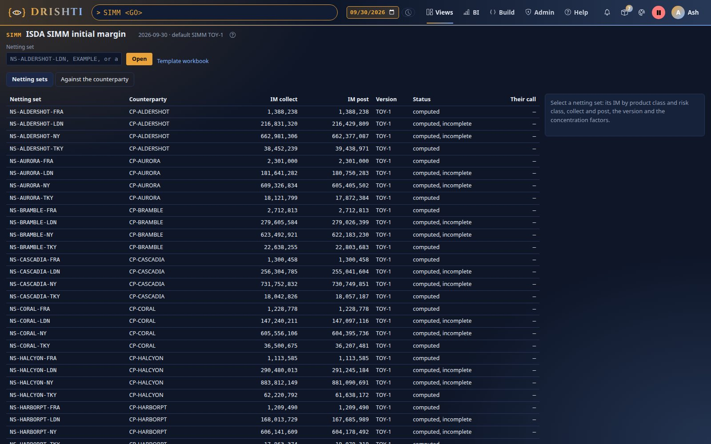
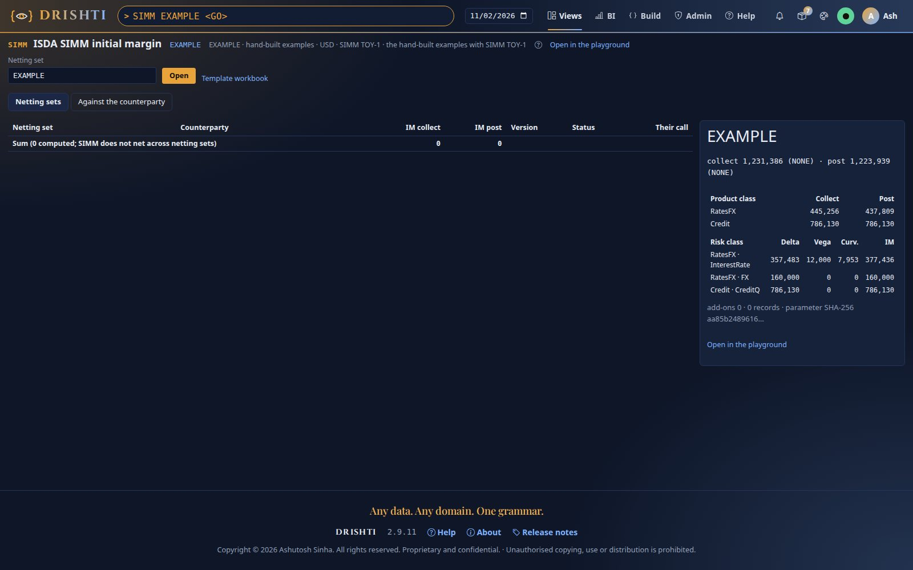
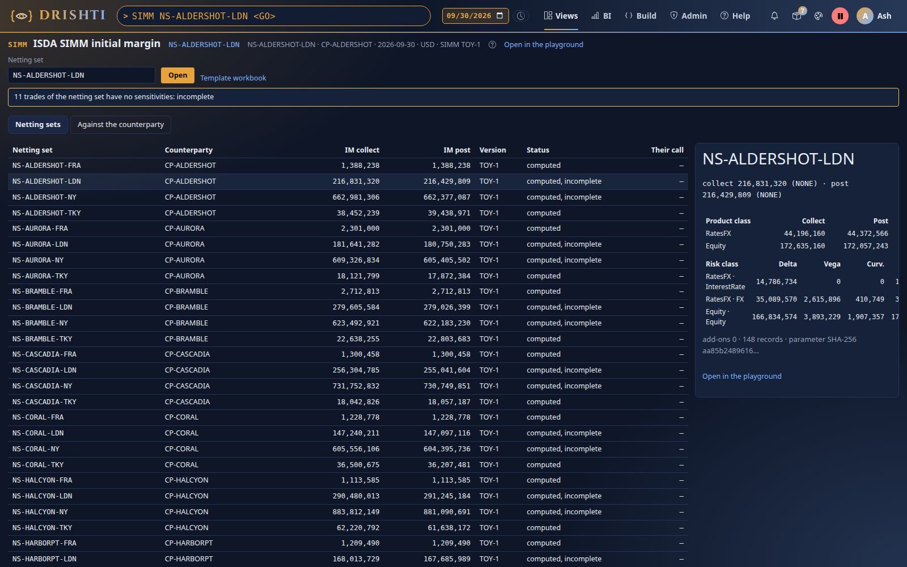
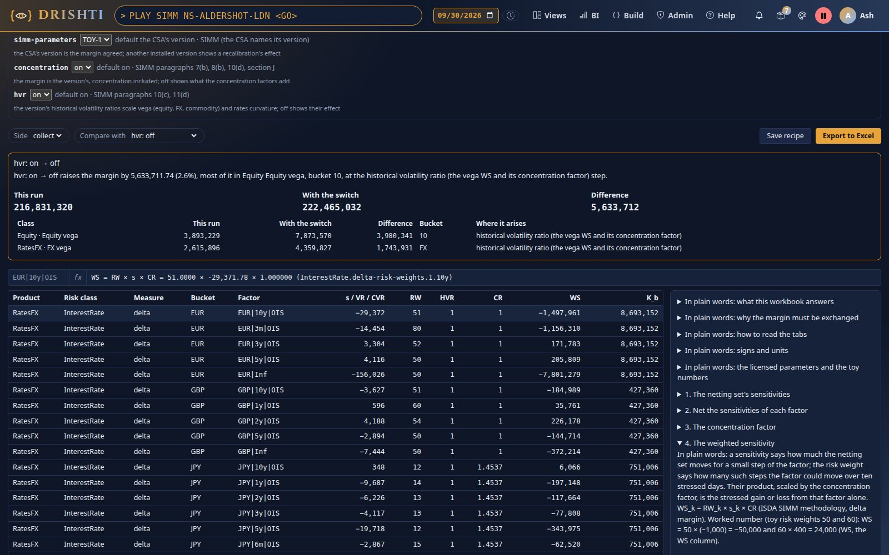
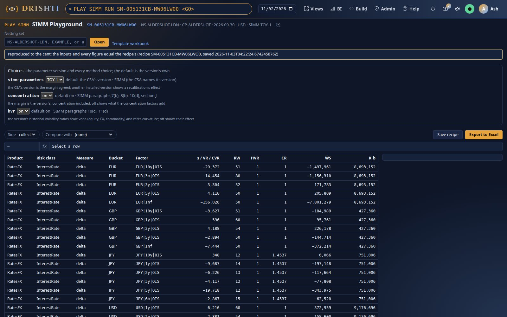
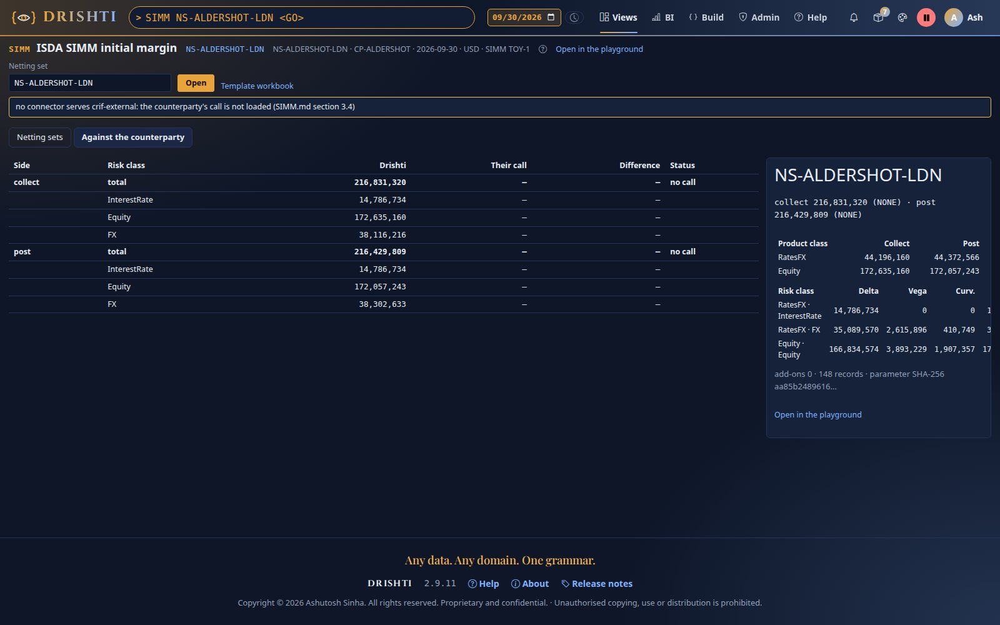

<!--
  Project Drishti · Any data. Any domain. One grammar.

  Copyright (c) 2026 Ashutosh Sinha <ajsinha@gmail.com>.
  All rights reserved.

  PROPRIETARY AND CONFIDENTIAL.

  This file is the confidential and proprietary property of Ashutosh Sinha.
  Unauthorised copying, use, modification, distribution or disclosure of this
  file, via any medium, is strictly prohibited except with the express prior
  written permission of the copyright holder.

  See the LICENSE file in the root of this repository for the full terms.
-->
# Tutorial 32 · SIMM from the hand-built examples to a netting set

ISDA SIMM, the initial margin each side of uncleared derivatives holds against the other, computed by Drishti per netting set, collect
and post, from the same sensitivities FRTB-SA reads. In this tutorial you install a parameter version, run the hand-built examples (small
enough to check with a calculator), open a demo netting set both ways, read what concentration adds, flip a switch in the playground and
read the difference explained, download the workbook of live formulas and flip the side in it, save a recipe and replay it to the cent,
and put the margin beside the counterparty's call. Each step shows the UI, the command line and the YAML behind it; the reference is the
[SIMM guide](../guides/SIMM_GUIDE.md).

**About the numbers.** ISDA's SIMM parameters are licensed and Drishti ships none. This tutorial uses the **toy** parameter file of
Drishti's tests (round illustrative numbers, not ISDA's), so every figure below proves the arithmetic, never a real margin. With the
bank's licensed file installed the same steps give that version's margin.

## Time to complete

About 25 minutes.

## Before you start

- The position sensitivities and the factor dictionary in the lake (`drishti.py lake demo` loads `market-risk/position-sensitivity` and
  `market-risk/risk-factor` with the other risk kinds), and the counterparty-risk pack's netting sets and CSAs.
- An edition with the SIMM word and a role that sees the counterparty-risk and market-risk kinds.

## What you will learn

- where a SIMM version comes from and how the engine refuses an incomplete one;
- how the margin is built: netted sensitivities, concentration at the rules' grain, buckets, risk classes, product classes added;
- the SIMM screen (`SIMM`): every netting set with its IM to collect and post, a netting set's breakdown, the counterparty's call;
- the playground (`PLAY SIMM`): the switches, a comparison in words, the workbook with the side and the switches as live cells;
- recipes: a run saved and replayed to the cent (`PLAY SIMM RUN <id>`).

## Step 1 · Install a parameter version

**In the UI.** Type `SIMM <GO>`. With no version installed the screen says *no SIMM version is installed: the netting sets show the
stored figures until the bank's licensed parameter file is installed*, and each netting set with sensitivities reads *not computed:
DRS-5333 no SIMM version is installed …*.

**From the command line.** Install the toy file as a version (a bank copies its licensed file instead) and restart the server:

```bash
mkdir -p config/simm
cp drishti-compute/src/test/resources/simm/simm-toy.yaml config/simm/
python3 tools/drishti.py simm versions
```

```text
/…/config/simm · default TOY-1
  TOY-1            simm-toy.yaml                installed, SHA-256 …
ISDA's SIMM parameters are licensed: Drishti ships none; the bank installs one file a version (docs/guides/SIMM_GUIDE.md section 4)
```

Copy the shipped structure `docs/architecture/capital-parameters/simm.yaml` beside it and restart: it is listed *refused: DRS-5333 SIMM (no
version) is refused: … is missing* (every number is empty on purpose); the server runs and TOY-1 stays the default.

**The YAML.** The folder is a setting; the file's numbers are keyed by the axes it names:

```yaml
drishti:
  simm:
    parameters-dir: ./config/simm        # one licensed file a SIMM version
    default-version: ""                  # blank: the installed version with the latest effective date
```

```yaml
InterestRate:
  tenors: [2w, 1m, 3m, 6m, 1y, 2y, 3y, 5y, 10y, 15y, 20y, 30y]
  delta-risk-weights:                    # per bucket, one per tenor (per bp): TOY, not ISDA's
    1: [100, 90, 80, 70, 60, 54, 52, 50, 51, 52, 53, 55]
  concentration-thresholds:
    delta: {1: 1000000, 2: 1000000, other: 20000}
```

**You should see** `TOY-1` listed as installed and the default in `simm versions`, and, after the restart, the SIMM screen's meta line reading *default SIMM TOY-1* above every netting set.



## Step 2 · The hand-built examples

`EXAMPLE` runs the contract's worked netting set (USD 5y +10,000 and 10y −6,000 per bp, EUR 2y +4,000, FX EUR +20,000 per 1 %), the
explanation's swaption (VEGA 2,000 per point at 20 %, one year to expiry) and the design's case 11 (two issuers in one credit bucket).

**In the UI.** Type `SIMM EXAMPLE <GO>`: the breakdown on the right reads collect 1,231,385.86, post 1,223,938.71.

**From the command line.**

```bash
python3 tools/drishti.py simm show EXAMPLE
```

```text
SIMM EXAMPLE · the hand-built examples with SIMM TOY-1 · the hand-built examples · USD · SIMM TOY-1
IM collect 1,231,385.86 (NONE) · IM post 1,223,938.71 (NONE) · add-ons 0.00 / 0.00
product class               collect                 post
RatesFX                  445,256.10           437,808.95
Credit                   786,129.76           786,129.76
product · risk class                  delta             vega        curvature                 IM
RatesFX · InterestRate           357,483.43        12,000.00         7,952.79         377,436.22
RatesFX · FX                     160,000.00             0.00             0.00         160,000.00
Credit · CreditQ                 786,129.76             0.00             0.00         786,129.76
```

Check two figures by hand. The USD bucket: WS 50 × 10,000 = 500,000 and 51 × (−6,000) = −306,000 with ρ 0.94, so
K = √(500,000² + 306,000² − 2 × 0.94 × 500,000 × 306,000) = 236,634.74; with EUR's K 216,000 and γ 0.30 on the capped nets 194,000 and
216,000, Delta_IR = 357,483.43. Case 11: issuer X nets −4,000 per bp against a threshold of 1,000, so CR_X = √4 = 2 and its WS doubles to
−800,000; with Y's 100,000, ρ 0.4 and f = 1/2, K = 786,129.76. The product classes add: 445,256.10 + 786,129.76 = 1,231,385.86. Collect and
post differ by the swaption's curvature (7,952.79 collect; posted, θ = −1 and λ = 1 make it 0) and RatesFX's ψ combination.

**The YAML.** Nothing to configure: `EXAMPLE` needs no data.

**You should see** collect 1,231,385.86 and post 1,223,938.71, RatesFX and Credit as the product classes, and the risk classes InterestRate, FX and CreditQ beneath.



## Step 3 · A netting set, both ways

**In the UI.** Type `SIMM <GO>`: every netting set of 2026-09-30, its IM to collect and post and its status. Select **NS-ALDERSHOT-LDN**:

| | Collect | Post |
|---|---|---|
| RatesFX | 44,196,160.25 | 44,372,565.60 |
| Equity | 172,635,159.90 | 172,057,243.48 |
| IM | 216,831,320.15 | 216,429,809.08 |

The status reads *computed, incomplete*: 11 of its 159 trades have no sensitivities. Each trade's risks stay in its product class
(paragraph 6): an equity trade's rates or FX sensitivity would be margined inside `Equity`, never offset against `RatesFX`.

**From the command line.**

```bash
python3 tools/drishti.py simm show NS-ALDERSHOT-LDN
python3 tools/drishti.py simm explain NS-ALDERSHOT-LDN --class FX --json
```

```text
SIMM NS-ALDERSHOT-LDN · CP-ALDERSHOT · 2026-09-30 · USD · SIMM TOY-1
IM collect 216,831,320.15 (NONE) · IM post 216,429,809.08 (NONE) · add-ons 0.00 / 0.00
product class               collect                 post
RatesFX               44,196,160.25        44,372,565.60
Equity               172,635,159.90       172,057,243.48
product · risk class                  delta             vega        curvature                 IM
RatesFX · InterestRate        14,786,733.98             0.00             0.00      14,786,733.98
RatesFX · FX                  35,089,570.30     2,615,896.04       410,749.46      38,116,215.80
Equity · Equity              166,834,574.41     3,893,228.65     1,907,356.84     172,635,159.90
11 trades of the netting set have no sensitivities: incomplete
```

The explanation's `concentration` list shows where the toy thresholds bind: FX EUR (net −539,871.57 per 1 % against 100,000: CR 2.323514),
CHF (CR 3.831517), CAD (CR 2.014499), and JPY's rates (net −42,267.16 per bp against 20,000: CR 1.453739, one factor for every JPY vertex).

**The YAML.** The CSA's SIMM terms, when its record carries them (here it does not: the version is the default, the regime `NONE`):

```yaml
# a csa record's SIMM terms (docs/contracts/SIMM.md section 4)
SIMM_VERSION: TOY-1
IM_COLLECT_REGIMES: [CFTC]
IM_POST_REGIMES: [EMIR]
IM_CALCULATION_CURRENCY: USD
IM_FIXED_ADDON: 1000000
IM_PRODUCT_MULTIPLIERS: {Equity: 1.1}
```

**You should see** NS-ALDERSHOT-LDN's IM of 216,831,320.15 to collect and 216,429,809.08 to post, RatesFX and Equity, and the status *computed, incomplete*.



## Step 4 · The playground: a switch flipped and explained

**In the UI.** Type `PLAY SIMM NS-ALDERSHOT-LDN <GO>`. The Choices panel holds `simm-parameters` (TOY-1), `concentration` and `hvr`, each
with its default, rule and why; the grid lists every weighted sensitivity with RW, HVR, CR, WS and its bucket's K. Select the first row:
the formula bar reads *WS = RW × s × CR = 51.0000 × -29,371.78 × 1.000000 (InterestRate.delta-risk-weights.1.10y)*. Choose **Compare with
→ hvr: off**:

*"hvr: on → off raises the margin by 5,633,711.74 (2.6%), most of it in Equity Equity vega, bucket 10, at the historical volatility ratio
(the vega WS and its concentration factor) step."*

**From the command line.**

```bash
python3 tools/drishti.py play simm NS-ALDERSHOT-LDN --compare concentration=off
```

The last line: *concentration: on → off lowers the margin by 158,874,416.12 (73.3%), most of it in Equity Equity delta, bucket 8, at the
concentration factor (WS) step.* The toy thresholds are small on purpose, so concentration dominates.

**The YAML.** An override is any key of the version, typed for analysis and marked *not the regulatory figure*:

```bash
python3 tools/drishti.py simm show EXAMPLE --override InterestRate.concentration-thresholds.delta.1=3000
```

USD's single concentration factor becomes √(4,000 / 3,000) = 1.154701, g(USD, EUR) = 0.866025, Delta_IR 382,700.58 and RatesFX
450,195.27.

**You should see** the Choices panel, the grid of weighted sensitivities, the formula bar filled for the selected row, and the comparison with `hvr: off` in words above the grid.



## Step 5 · The workbook of live formulas

**In the UI.** In the playground, **Export to Excel**. Open the workbook: Main's band reads **ALL CHECKS PASS**; each charge, each product
class, SIMM and IM stand beside the engine's collect and post figures. On Config, set **side** to `post`: Data negates every sensitivity,
the curvature recomputes, and Main's checks now compare against the engine's post column (still passing). Set **concentration** to `off`:
every CR becomes 1, the band reads *SWITCHES CHANGED: SEE THE ALTERNATIVES*, and the alternatives block's `concentration = off` row checks
the workbook's IM against the engine's own figure for that switch.

**From the command line.**

```bash
python3 tools/drishti.py play simm NS-ALDERSHOT-LDN --side post --xlsx aldershot-ldn.xlsx
```

**The YAML.** The template the workbook is built from is a setting (blank: the built-in one); its explanation is
`drishti-server/src/main/resources/playground/simm/template/explain.txt`:

```yaml
drishti:
  simm:
    max-factors: 1500                    # the most factors one grid and workbook holds
    playground-template: ""              # a bank's workbook template folder
```

The playground's **Template workbook** link downloads the same workbook on the hand-built examples with every parameter cell empty: the
shared template never holds a licensed number.

**You should see** **ALL CHECKS PASS** on Main, still passing with the side set to `post`, and *SWITCHES CHANGED: SEE THE ALTERNATIVES* once concentration is off.

## Step 6 · A recipe, replayed to the cent

**In the UI.** In the playground, **Save recipe**: *Saved as recipe SM-…: PLAY SIMM RUN SM-… computes it again to the cent*. Type
`PLAY SIMM RUN SM-… <GO>`: the notice reads *reproduced to the cent: the inputs and every figure equal the recipe's*. The recipe kept the
parameter file itself, so it reproduces even after the version is replaced.

**From the command line.**

```bash
python3 tools/drishti.py play simm NS-ALDERSHOT-LDN --concentration off --save
python3 tools/drishti.py play simm --recipe SM-…        # exit 0 when reproduced, 1 otherwise
```

**The YAML.** Recipes are kept under the data folder:

```yaml
drishti:
  simm:
    recipes-dir: ${drishti.data.dir:./data}/simm/recipes
```

**You should see** the notice *Saved as recipe SM-…* and, on the replay, *reproduced to the cent*.



## Step 7 · Against the counterparty's call

**In the UI.** On the SIMM screen open the **Against the counterparty** tab with NS-ALDERSHOT-LDN selected: Drishti's IM to collect and
post and, per risk class, the counterparty's figure, the difference and the status. Without a `crif-external` connector it reads *no call*
and says the call is not loaded.

**From the command line.**

```bash
python3 tools/drishti.py simm against NS-ALDERSHOT-LDN
python3 tools/drishti.py simm list --counterparty CP-ALDERSHOT
```

**The YAML.** The counterparty's call is a kind of its own (SIMM.md section 3.4), one `HEADER` row per netting set and direction:

```yaml
NETTING_SET: NS-ALDERSHOT-LDN
SOURCE: COUNTERPARTY
DIRECTION: COLLECT
ROW_TYPE: HEADER
IM_TOTAL: 216500000
IM_EQUITY: 172400000
```

**You should see** Drishti's IM to collect and post beside the counterparty's figure per risk class, or, with no `crif-external` connector, *no call* and the note that the call is not loaded.



## Next steps

- The [SIMM guide](../guides/SIMM_GUIDE.md): every formula, the parameter file's keys, the refusal codes and what is not built yet.
- The [data contract](../contracts/SIMM.md): the CRIF mapping, the CSA's terms and the computed kind `simm-result`.
- [Tutorial 30](30-frtb-sa-from-the-cases-to-a-desk.md): FRTB-SA from the same sensitivities.
