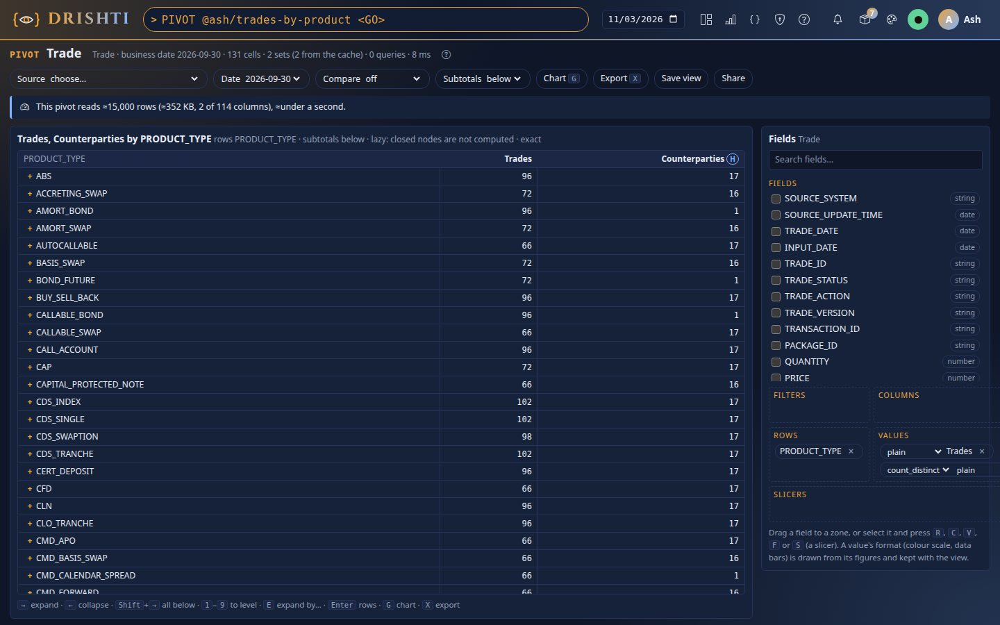
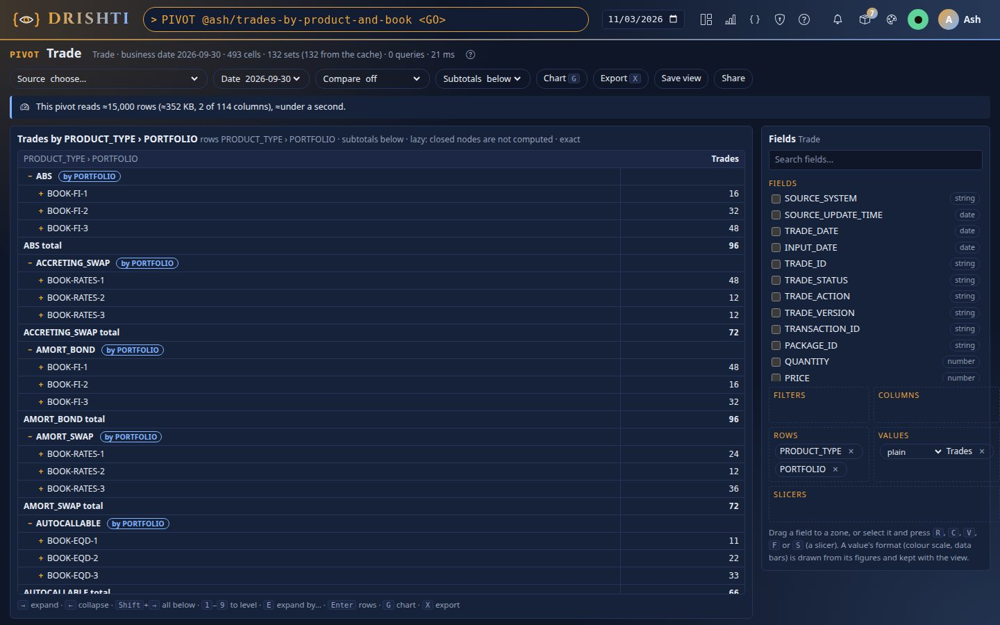
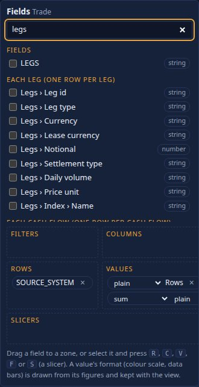
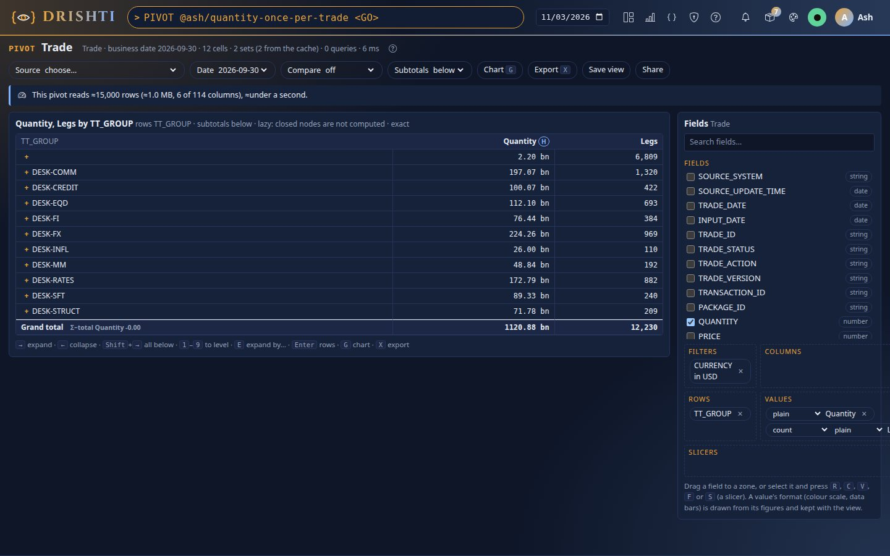
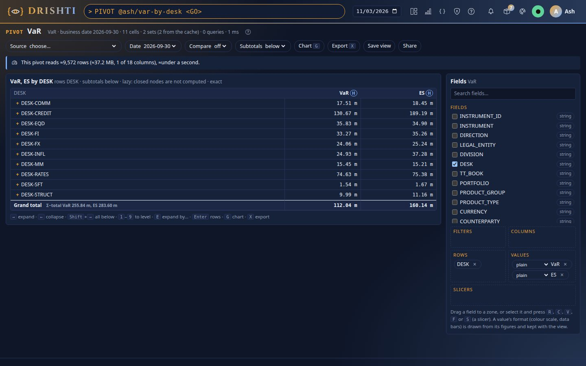

<!--
  Project Drishti · Any data. Any domain. One grammar.

  Copyright (c) 2026 Ashutosh Sinha <ajsinha@gmail.com>.
  All rights reserved.

  PROPRIETARY AND CONFIDENTIAL.

  This file is the confidential and proprietary property of Ashutosh Sinha.
  Unauthorised copying, use, modification, distribution or disclosure of this
  file, via any medium, is strictly prohibited except with the express prior
  written permission of the copyright holder.

  See the LICENSE file in the root of this repository for the full terms.
-->
# Tutorial 33 · The pivot engine: trades by product, legs by desk, then VaR by desk

A pivot is "these measures, broken down by these fields, under these filters, on this date". In this tutorial you pivot the demo trades,
open a row lazily and another by a different field, check a top N's Others by hand, read a cell's provenance and rows, pivot the trades'
legs with a document path, pivot VaR by desk and see that the bank's VaR is not the sum of the desks', chart a selection, and save, share
and export a view to Excel. Each step shows the UI, the command line and the view's JSON or YAML. The guide is
[PIVOT_GUIDE.md](../guides/PIVOT_GUIDE.md).

## Time to complete

About 25 minutes.

## Before you start

- The server and console running on the demo lake (`drishti.py lake demo`, [tutorial 1](01-first-15-minutes.md)); `DATA trade <GO>` lists
  the trades. The figures below are those of the demo lake on business date 2026-09-30.
- For step 6, the VaR engine on with the demo risk lake (`VAR BANK <GO>` answers).
- A token for the command line in `DRISHTI_TOKEN` or a `--token-file` ([TOOLS.md](../guides/TOOLS.md)).

## What you will learn

- how a view is built from the field list and its four zones, and what the server computes;
- why only open rows are computed, and how "expand by" breaks one member down by another field;
- why Others and every total are made from their own members;
- where a cell's figures come from (provenance, rows, a reference);
- how a document's lists (a trade's legs) are pivoted with Rachana paths, and why a trade's figure is counted once per trade;
- why a non-additive total (VaR) is never a sum, and how the chart and the Excel export respect it.

## Step 1 · A first pivot of the trades

**UI.** Type `PIVOT trade <GO>`. The screen opens with the first text field on Rows and `count()` in Values. Put `PRODUCT_TYPE` on Rows
(double-click it), and drop `COUNTERPARTY` on Values: a text field arrives as a count; change its function to `count_distinct`. The
estimate bar says what the view reads; the grid shows one row per product type and the grand total.



You should see 131 product types, **15,000** trades in the grand total and **24** distinct counterparties.

**CLI.**

```
drishti.py pivot fields trade
drishti.py pivot run --source trade --rows PRODUCT_TYPE --values "count()" --values "count_distinct(COUNTERPARTY)"
```

**JSON** (what the screen sent to `POST /api/v1/pivot/query`):

```json
{"source": "trade", "rows": ["PRODUCT_TYPE"], "values": [{"measure": "count()", "as": "Trades"}, {"measure": "count_distinct(COUNTERPARTY)", "as": "Counterparties"}]}
```

Check: the grand total's `count()` equals the Data view's row count (`DATA trade`, "Rows").

## Step 2 · Open a row, then expand another by a different field

**UI.** Add `PORTFOLIO` to Rows (after `PRODUCT_TYPE`). Nothing below level one is computed yet: the grid shows product types with **+**.
Press **+** on a product (or select its first cell and press `→`): it becomes a header with its portfolios and a total below them. The meta
line says how many sets were computed and how many came from the cache: only that product's children were asked. Now select another
product's row, press `E` and type `TRADE_DATE`: that product opens by date while the first stays by portfolio.



You should see each opened product's top 5 portfolios, an *Others* row and the product's total; the grand total is still 15,000.

**CLI.**

```
drishti.py pivot run --source trade --rows PRODUCT_TYPE,PORTFOLIO --values "count()" --level 2 --top PORTFOLIO=5
```

**JSON.**

```json
{"source": "trade", "rows": ["PRODUCT_TYPE", "PORTFOLIO"], "values": [{"measure": "count()", "as": "Trades"}],
 "expandTo": {"rows": 2}, "top": {"PORTFOLIO": {"n": 5}}}
```

## Step 3 · The top N and its Others

**UI.** Keep the top 2 product types by count (the CLI below, or `"top"` in the view). The grid shows the two and "Others (k of n)". Click
Others' count cell: its provenance counts its members. Check by hand: Others' count is the grand total less the two shown (for a count that
adds up); for a `median(...)`, Others is the median of Others' own rows, which no subtraction gives.

You should see two product types and Others (129 of 131), whose count is 15,000 less the two shown.

**CLI.**

```
drishti.py pivot run --source trade --rows PRODUCT_TYPE --values "count()" --values "median(PRICE)" --top PRODUCT_TYPE=2
```

**JSON.** `"top": {"PRODUCT_TYPE": {"n": 2, "by": "Trades"}}`

## Step 4 · A cell's provenance and its rows

**UI.** Click a product's total cell. The popover shows the figure, exact, the function and how its totals are made ("each cell and total
from its own rows' state"), the members counted, the condition (`PRODUCT_TYPE = '…'`), the data version and what was computed. Press
**Rows**: that product's trades, as you may see them. Press `Enter` on any cell for the same.

You should see the cell's count equal to the number of rows listed.

**CLI.** `drishti.py pivot export --source trade --rows PRODUCT_TYPE --values "count()" --what rows --cell PRODUCT_TYPE=IRS --format csv -o irs.csv`

**JSON** (`POST /api/v1/pivot/rows`): `{"view": {...}, "coords": {"PRODUCT_TYPE": "IRS"}, "limit": 50}`

## Step 5 · The legs of the trades: a document path

**UI.** A trade's record holds its legs. In the field list, under **Each leg (one row per leg)**, are the legs' fields (*Legs › Notional*,
*Legs › Leg type* …); type `$.LEGS[0].CURRENCY` into the search box and it is offered as *Your path*.



Put `TT_GROUP` (the desk) on Rows, filter `CURRENCY` to USD, and drop *Legs › Leg id* and `QUANTITY` on Values (a count of legs and a sum
of quantity). The legs make the view's grain, one row per leg, and each trade's quantity is added **once**, not once per leg.



You should see **12,230** USD legs and a quantity total of **1,120,878,590,423.65**: exactly the sum over the 8,562 USD trades at the trade
grain (put `count()` alone in Values to see 8,562 trades). DESK-COMM has 1,320 legs of 990 trades. Now put *Events › Event type* on Columns:
the view is refused, because legs and events are separate lists that would multiply each other.

**CLI.**

```
drishti.py pivot run --source trade --rows '$.TT_GROUP' --filter '$.CURRENCY=USD' --values 'sum($.QUANTITY)' --values 'count($.LEGS[*].LEG_ID)'
```

**YAML** (the saved view):

```yaml
source: trade
rows: [$.TT_GROUP]
filters: {$.CURRENCY: {in: [USD]}}
values:
  - {measure: sum($.QUANTITY), as: Quantity}
  - {measure: count($.LEGS[*].LEG_ID), as: Legs}
```

More worked examples, each with its real figures: [PIVOT_GUIDE.md, Documents](../guides/PIVOT_GUIDE.md#documents-paths-lists-and-grains).

## Step 6 · VaR by desk: the total is not a sum

**UI.** Choose the source **VaR** (or type `PIVOT var <GO>`). The view opens with `var()` and `es()`; put `DESK` on Rows. Each cell's
popover shows its **scope** (`WHERE:DESK == 'DESK-X'`) and **Ask the VaR engine** opens it in VAR: the figure is the same to the cent. The
grand total is the bank's own VaR; the desks' VaRs add up to more, and the grand total row shows the gap as **Σ−total** (the
diversification).



You should see the bank's VaR of **112,041,645.93** (ES 160,143,809.24), less than DESK-CREDIT (130,670,864.00) and DESK-RATES
(74,633,680.00) together.

**CLI.**

```
drishti.py pivot run --source var --rows DESK --values "var()" --values "es()"
drishti.py var show BANK
```

**JSON.** `{"source": "var", "rows": ["DESK"], "values": [{"measure": "var()", "as": "VaR"}, {"measure": "es()", "as": "ES"}]}`

## Step 7 · Chart the selection

**UI.** With nothing selected, press `G`: the desks' VaR as bars **beside** the bank's, with the diversification as its own bar, and a line
saying why it is not stacked. Go back to the trades pivot of step 1 and press `G`: a count adds up, so its bars sum to the total. Click a
bar to open that member in the grid.

You should see the VaR bars side by side, never stacked, and the trades' bars adding up to 15,000.

**CLI.** A chart is drawn on the screen; `drishti.py pivot export --format csv` writes the figures it draws.

## Step 8 · Save, share and export to Excel

**UI.** Press **Share**, name the view `desk-var` and share it with `role:risk`. The title becomes `you/desk-var @1`; a cell's popover now
shows its reference (`pivot://you/desk-var@1/VaR[DESK=DESK-X]`). Press `X`, keep "The pivot as shown" and press **Excel**. Open the file:
the rows are grouped with Excel's own + and −; in a trades pivot, a `count()` or `sum()` total is a `SUM` formula of its parts, while VaR
and any median are values; the Provenance sheet lists who exported, the data and how every measure's totals are made.

You should see `you/desk-var` in `drishti.py pivot views` and, in the workbook, VaR totals as values, not formulas.

**CLI.**

```
drishti.py pivot save desk-var --source var --rows DESK --values "var()" --share role:risk
drishti.py pivot export --view you/desk-var --format xlsx -o desk-var.xlsx
drishti.py pivot views
```

**JSON** (`POST /api/v1/pivot/views`): `{"name": "desk-var", "view": {...}, "sharedWith": ["role:risk"]}`

## What you learned

Every figure in a pivot is the server's, made from its cell's own members: a mergeable total from its own rows' state, a holistic one
(VaR, a median) from its own members, Others from its own rows. A document's lists are pivoted at their own grain with Rachana paths, a
coarser figure is counted once per parent, and two lists are never crossed. Open rows are computed on demand and the rest come from the
cache. A chart and an Excel file never add up what does not add up.

## Next steps

- The worked examples over documents, each with its figures, picture, command and saved view:
  [PIVOT_GUIDE.md, Documents](../guides/PIVOT_GUIDE.md#documents-paths-lists-and-grains).
- Every setting, the API and the refusals: [PIVOT_GUIDE.md](../guides/PIVOT_GUIDE.md) sections 14 to 17.
- Make a path a column read for everyone: promote it in the connector's `layout.<kind>.columns`
  ([CONNECTORS.md](../connectors/CONNECTORS.md)) or add it to a BI dataset as a `path:` column ([BI_GUIDE.md](../guides/BI_GUIDE.md)).
