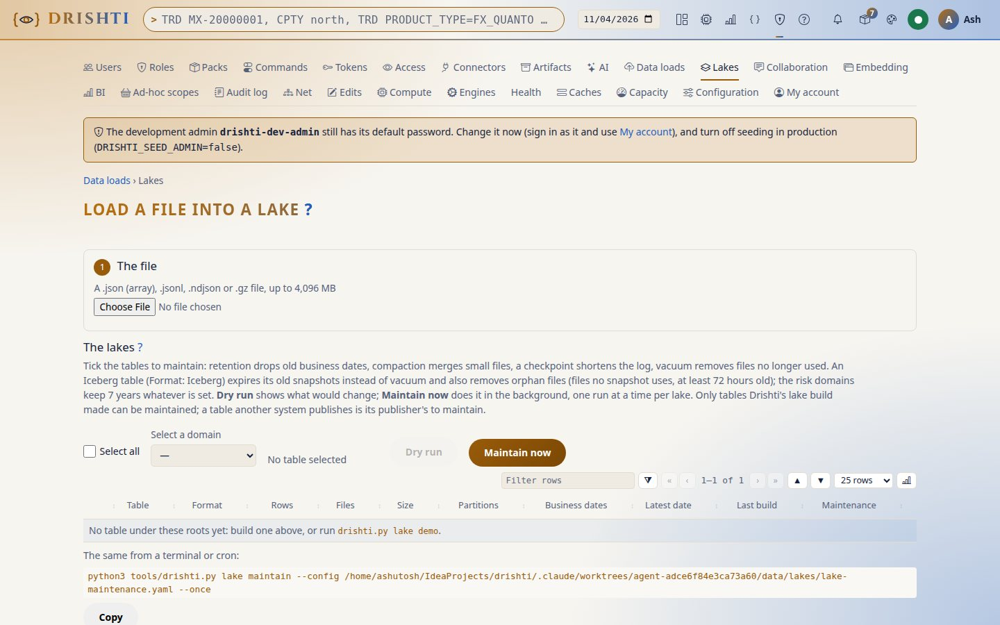
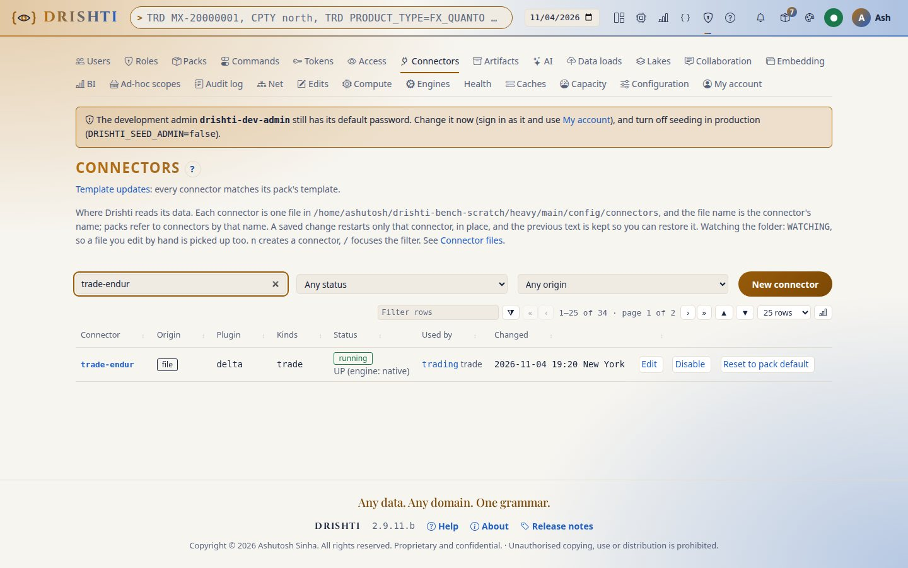
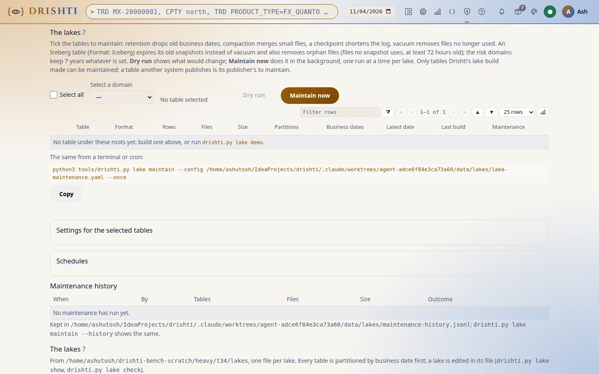

<!--
  Project Drishti · Any data. Any domain. One grammar.

  Copyright (c) 2026 Ashutosh Sinha <ajsinha@gmail.com>.
  All rights reserved.

  PROPRIETARY AND CONFIDENTIAL.

  This file is the confidential and proprietary property of Ashutosh Sinha.
  Unauthorised copying, use, modification, distribution or disclosure of this
  file, via any medium, is strictly prohibited except with the express prior
  written permission of the copyright holder.

  See the LICENSE file in the root of this repository for the full terms.
-->
# Tutorial 34 · One file per lake

A lake is described once, in its own file, and everyone refers to it: the connectors that read it, the loader and the data inbox that
write it, `lake build` and the demo lakes. In this tutorial you read the demo lake's file, see a connector name it, load a day through
it, watch a load that contradicts it being refused, add an append table and load the same batch twice, check the lake files against the
tables on disk, and migrate an older connector file. Each step shows the UI, the command line and the YAML behind it. The guide is
[LAKE_GUIDE.md](../guides/LAKE_GUIDE.md).

## Time to complete

About 20 minutes.

## Before you start

- The server built (`./mvnw clean package -DskipTests`) and the demo data in place (`drishti.py lake demo`, [tutorial 1](01-first-15-minutes.md)).
- Sign in as an administrator (Admin → Lakes and the `lake check` command are for administrators).
- A scratch folder for steps 4 to 6, so nothing under `data/` changes: `export SCRATCH=$(mktemp -d)` (remove it at the end).

## What you will learn

- what a lake file holds, and that `business_date` is always the first partition;
- how a connector names a lake (`lake:`, `lake-tables:`) and keeps only reading concerns;
- how a load takes its layout from the lake file, and why a contradicting `--partition-by` is refused;
- replace and append, and how a batch is never appended twice;
- the checks, Admin → Lakes, and migrating an older connector file.

## Step 1 · Read the demo lake's file

**The YAML.** `config/lakes/demo.yaml` describes the demo lake: its root and every table in it.

```yaml
lake: demo
format: delta
root: ${DRISHTI_DELTA_ROOT:${drishti.data.dir:./data}/delta}
defaults: {load-mode: replace}
tables:
  trading.trade_endur:
    kind: trade
    partition-by: [PRODUCT_TYPE]          # after business_date, which is always first
    promote: [TRADE_ID, SOURCE_SYSTEM, PRODUCT_TYPE, ...]
    id: TRADE_ID
    sort-by: [id]
    file-rows: 250000
    row-group-rows: 1000
  risk.pnl-vector:
    promote: [VALUE_TYPE, GRAIN, TRADE_ID, ...]
    vectors: [PNL]
  ...
```

**The command line.**

```bash
python3 tools/drishti.py lake show
```

```text
lakes in .../config/lakes: 3
  ccr-official: delta at .../data/delta, 1 tables
    risk-results.exposure-official-cpty      risk-results/exposure-official-cpty      partitioned by business_date; 26 promoted
  demo: delta at .../data/delta, 89 tables
    compute-demo.path-book                   compute-demo/path-book                   partitioned by business_date; 4 promoted
    ...
    risk.pnl-vector                          risk/pnl-vector                          partitioned by business_date; 32 promoted, vectors PNL
    risk.scenario-pv                         risk/scenario-pv                         partitioned by business_date; 32 promoted, vectors SCENARIO_PV
    ...
    trading.trade_endur                      trading/trade_endur                      partitioned by business_date, PRODUCT_TYPE; 18 promoted
    trading.trade_calypso                    trading/trade_calypso                    partitioned by business_date, PRODUCT_TYPE; 18 promoted
    trading.trade_murex                      trading/trade_murex                      partitioned by business_date, PRODUCT_TYPE; 18 promoted
    ...
  var-official: delta at .../data/delta, 1 tables
    risk-results.var-official                risk-results/var-official                partitioned by business_date; 17 promoted
```

**The UI.** Admin → Lakes → **The lakes**: one line per lake file; open **demo** for its tables (kind, path, partitioned by, promoted,
vectors, id, loads).



**You should see** three lake files (the demo lake and the two official-results lakes, `ccr-official` and `var-official`, on the same root),
every table partitioned by `business_date` first; the three trade tables also by `PRODUCT_TYPE`.

## Step 2 · A connector names the lake

**The YAML.** The trading pack's connector `trade-endur` names the lake and its entry; nothing of the table is written here.

```yaml
# config/packs/trading/pack.yaml (the template written to config/connectors/trade-endur.yaml)
trade-endur:
  plugin: delta
  kinds: [trade]
  settings:
    lake: demo
    lake-tables: trading.trade_endur      # the kind trade has three tables: the entry is named
    union: true
    source-name: trade-endur
```

The pack recommends the entry in its own `lake:` block; it is copied into a lake file the first time a writer meets the kind.

**The UI.** Admin → Connectors → `trade-endur`: the file as above, health green.



**You should see** `TRADE ENDUR` trades open as before: the connector's root, table folder and promoted columns now come from the lake file.

## Step 3 · Check the lake files against the tables

**The command line.**

```bash
python3 tools/drishti.py lake check
```

```text
  note  demo/risk.position-sensitivity: no table yet at .../data/delta/risk/position-sensitivity (a writer creates it as the lake file says)
  note  demo/risk.risk-factor: no table yet at .../data/delta/risk/risk-factor (a writer creates it as the lake file says)
lake check: 3 lakes, 0 errors
```

**The UI.** Admin → Lakes → The lakes lists the lake files the check compares; the screen does not run the check itself. The same
comparison as JSON is `GET /api/v1/admin/lakes/files?check=true`.


**You should see** no error: the tables `lake demo` built are partitioned as the file says. A *note* names a table the lake file
describes that no writer has made yet; it is not an error.

## Step 4 · Load a day through the lake file, and see a contradiction refused

**The command line.** Into the scratch folder, with the demo lake's layout:

```bash
python3 tools/drishti.py lake build --from data/testdata/trades/endur/trade_endur.2026-07-08.jsonl.gz --as-of 2026-07-08 \
    --pack config/packs/trading --connector trade-endur --lake demo --lake-root $SCRATCH/lake
```

```text
engine: drishti (Drishti's Java writer in drishti-server-2.9.11.b-exec.jar)
business date  PRODUCT_TYPE           rows
2026-07-08     CallNot                  50
2026-07-08     Cash                    723
2026-07-08     ComFut                  883
2026-07-08     ComSwap                1994
2026-07-08     Commodity               757
documents read: 4407, rows written: 4407, rejected: 0
  business date 2026-07-08 from the command line: trade_endur.2026-07-08.jsonl.gz
summary: $SCRATCH/lake/_drishti-lake/runs/20261104T191809.840-257432.json
2026-11-04T19:18:13-05:00 lake-build ok exit=0 run=20261104T191809.840-257432 domain=trading kind=trade engine=drishti mode=overwrite-dates rows=4407 rejected=0 dates=1 partitions=5 seconds=4.114
```

Now ask for another partition:

```bash
python3 tools/drishti.py lake build --from data/testdata/trades/endur/trade_endur.2026-07-08.jsonl.gz --as-of 2026-07-08 \
    --pack config/packs/trading --connector trade-endur --lake demo --lake-root $SCRATCH/lake --partition-by DESK
```

```text
lake build: --partition-by ['DESK'] differs from ['PRODUCT_TYPE'], the --partition-by of table trading.trade_endur in lake demo (config/lakes/demo.yaml): the lake file decides; drop --partition-by or correct the lake file
...
2026-11-04T19:18:24-05:00 lake-build failed exit=1 run=20261104T191823.542-258032 seconds=0.617 error="--partition-by ['DESK'] differs from ['PRODUCT_TYPE'], ..."
(exit code 1)
```

**The UI.** Admin → Lakes → The lakes: `trading.trade_endur` partitioned by `business_date`, `PRODUCT_TYPE`, the layout the load followed (the scratch copy under `$SCRATCH` is not one of the server's lakes, so it is not listed).



**You should see** the first load written partitioned by `business_date` and `PRODUCT_TYPE` (five partitions of 2026-07-08, one per
product type), and the second refused with both values named and nothing written.

## Step 5 · An append table: each batch once

**The YAML.** A lake of your own in a scratch lake folder (`DRISHTI_LAKES_DIR`), with one append table:

```bash
mkdir -p $SCRATCH/lakes && cp config/lakes/demo.yaml $SCRATCH/lakes/
cat > $SCRATCH/lakes/intraday.yaml <<EOF
lake: intraday
root: $SCRATCH/intraday
tables:
  risk.scenario-pv:
    load-mode: append
    id: SCENARIO_PV_ID
    date: BUSINESS_DATE
    promote: [POSITION_ID, DESK, CURRENCY]
    vectors: [SCENARIO_PV]
EOF
export DRISHTI_LAKES_DIR=$SCRATCH/lakes
```

**The command line.** The parallel loader appends and records the batch; the Python path refuses an append (it does not record batches):

```bash
python3 tools/drishti.py lake build --engine java --from data/testdata/market-risk/scenario-pv --pack config/packs/market-risk \
    --kind scenario-pv --lake intraday --batch-id intraday-0915
python3 tools/drishti.py lake build --engine java --from data/testdata/market-risk/scenario-pv --pack config/packs/market-risk \
    --kind scenario-pv --lake intraday --batch-id intraday-0915      # the same batch again
```

```text
  table scenario-pv: ok, 2026-09-28 1349 rows, 2026-09-29 1342 rows, 2026-09-30 2678 rows
2026-11-04T19:18:45-05:00 lake-build ok exit=0 run=20261104T191842.533-259227 seconds=3.083
  table scenario-pv: ok, 2026-09-28 1349 rows, 2026-09-29 1342 rows, 2026-09-30 2678 rows
2026-11-04T19:18:52-05:00 lake-build ok exit=0 run=20261104T191849.989-259751 seconds=2.198
```
The two runs print the same line: the rows each date's batch holds. What differs is the table: the first run made three commits (one
append per business date, each recorded as `drishti-batch:intraday-0915:<date>` in the Delta log); the second made none. Its summary
(`$SCRATCH/intraday/_drishti-lake/runs/<run>.json`) says so for each date:

```json
"dates": {
  "2026-09-28": {"skipped": "batch appended already", "files": 0, "rows": 0, "bytes": 0},
  ...
```

**The UI.** Admin → Lakes lists the lake files the server reads (`config/lakes/`, or the server's own `DRISHTI_LAKES_DIR`); a table whose file says `load-mode: append` shows it in its row. The scratch lake of this step is read by the command line only.


**You should see** the same batch never appended twice; a new `--batch-id` adds its rows, the earlier ones kept.

## Step 6 · Migrate an older connector file

**The YAML.** A connector that still describes its lake itself:

```bash
mkdir -p $SCRATCH/connectors && cat > $SCRATCH/connectors/old-store.yaml <<EOF
plugin: delta
kinds: [pnl-vector]
settings:
  root: $SCRATCH/lake
  domain: risk
  layout.pnl-vector.columns: VALUE_TYPE,TRADE_ID
  layout.pnl-vector.vectors: PNL
EOF
```

**The command line.** A dry run first, then write:

```bash
python3 tools/drishti.py lake migrate-config --connectors-dir $SCRATCH/connectors --dir $SCRATCH/lakes
python3 tools/drishti.py lake migrate-config --connectors-dir $SCRATCH/connectors --dir $SCRATCH/lakes --write
```

```text
  old-store.yaml: now lake: lake (1 tables)

--- $SCRATCH/lakes/lake.yaml (would be written)
# lake.yaml: written by drishti.py lake migrate-config from the connector files (docs/guides/LAKE_GUIDE.md); edit here from now on
lake: lake
format: delta
root: $SCRATCH/lake
tables:
  risk.pnl-vector:
    promote:
    - VALUE_TYPE
    - TRADE_ID
    vectors:
    - PNL


--- $SCRATCH/connectors/old-store.yaml (would be written)
plugin: delta
kinds:
- pnl-vector
settings:
  lake: lake


lake migrate-config: a dry run; nothing written (add --write)

  old-store.yaml: now lake: lake (1 tables)
lake migrate-config: wrote 1 lake files and rewrote 1 connector files; restart the server (or let it reload the connectors) and run drishti.py lake check
```
**The UI.** Admin → Lakes shows the same lake once the server reads the written lake file (`config/lakes/`); on a real installation the dry run is the place to read what `--write` will do.


**You should see** the connector file keep only `lake:` (and its own reading settings); nothing in the lake's folder changed.

## Clean up

```bash
unset DRISHTI_LAKES_DIR
rm -rf "$SCRATCH"
```

## Next steps

- [LAKE_GUIDE.md](../guides/LAKE_GUIDE.md): every key, a Delta lake in S3, an Iceberg lake over REST, an in-memory store.
- [Tutorial 31](31-news-in-memory-only.md): a lake held in memory only.
