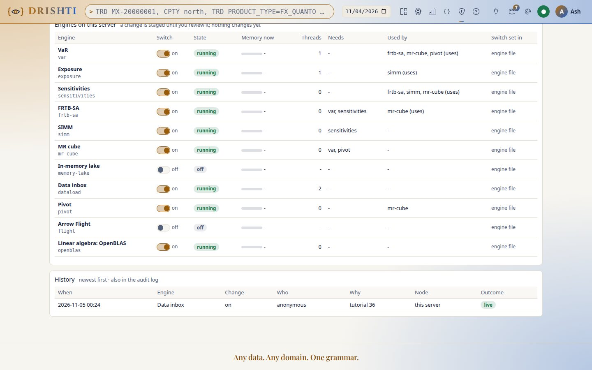
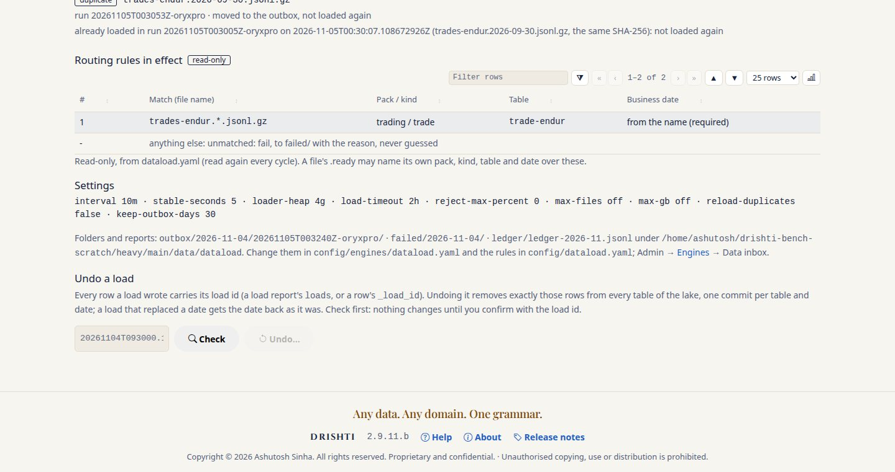
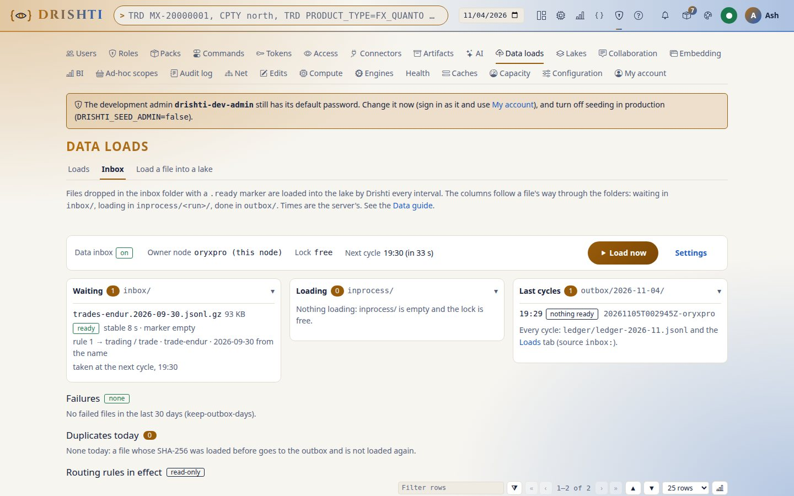
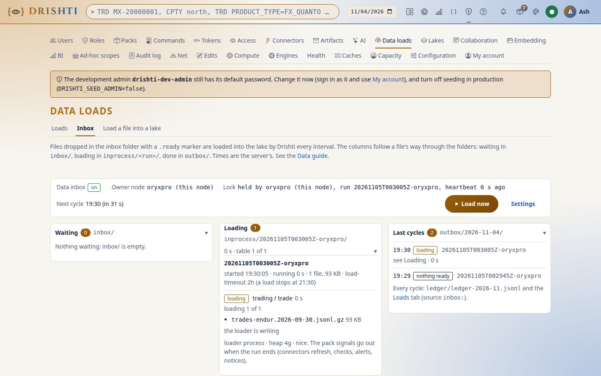
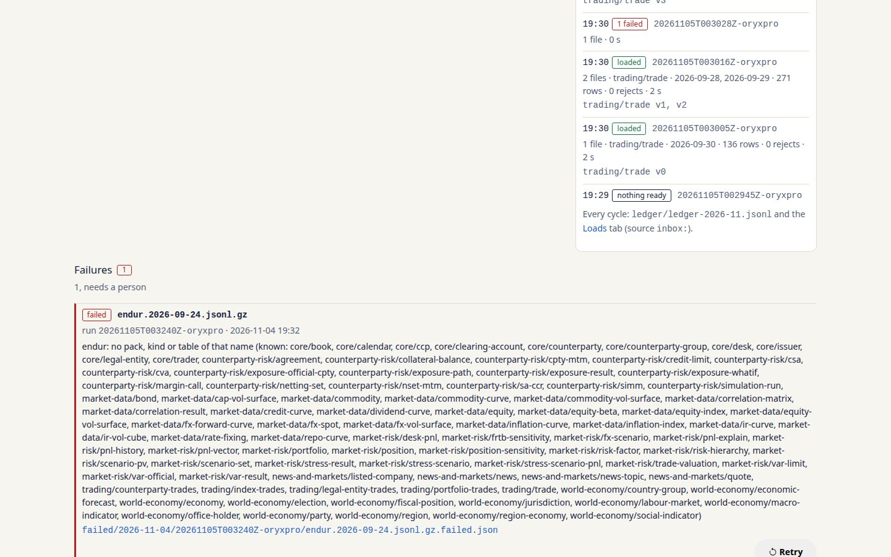
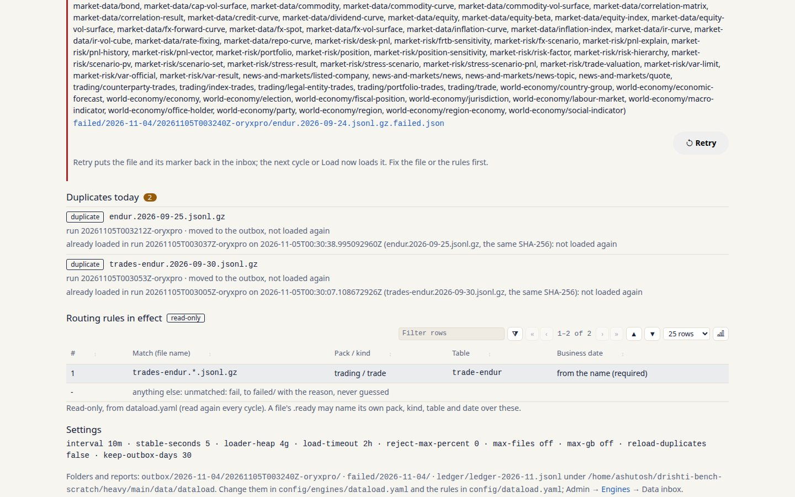

<!--
  Project Drishti · Any data. Any domain. One grammar.

  Copyright (c) 2026 Ashutosh Sinha <ajsinha@gmail.com>.
  All rights reserved.

  PROPRIETARY AND CONFIDENTIAL.

  This file is the confidential and proprietary property of Ashutosh Sinha.
  Unauthorised copying, use, modification, distribution or disclosure of this
  file, via any medium, is strictly prohibited except with the express prior
  written permission of the copyright holder.

  See the LICENSE file in the root of this repository for the full terms.
-->
# Tutorial 36 · Load files automatically with the data inbox

Your ETL writes JSON Lines files; Drishti can load them by itself. In this tutorial you turn the data inbox on, write a routing rule,
drop a day of Endur trades with its `.ready` marker, watch it on the Inbox screen (Admin → Data loads → Inbox) from *waiting* through
*loading* to *loaded*, release two files at once with `ready.all`, see a file fail, fix the rules and Retry it, and read the outbox's
reports. Each step shows the UI, the command line (`drishti.py dataload status|run|retry`) and the YAML behind it.

## Time to complete

About 20 minutes.

## Before you start

- The server built (`./mvnw clean package -DskipTests`) and the demo data in place (`drishti.py lake demo`, [tutorial 1](01-first-15-minutes.md)).
- Sign in as an administrator: Admin → Engines, Admin → Data loads → Inbox and the `dataload` commands are for administrators (a
  personal token needs `loads:write` for `run` and `retry`). Put your token in `DRISHTI_TOKEN`.
- Run the commands from the server's working folder (the repository, for the scripts): the inbox's folder is `data/dataload` under it.

## What you will learn

- how the inbox is switched on and configured (`config/engines/dataload.yaml`) and where its folders are;
- how a routing rule in `config/dataload.yaml` sends a file to a pack, a kind and a table, and why a file is never guessed;
- the hand-shake: a data file, its `.ready` marker, or one `ready.all` for every file;
- what one cycle does, and how the Inbox screen shows each file's way through `inbox/`, `inprocess/` and `outbox/`;
- what a failure looks like, how Retry puts a file back, and what the outbox and the ledger keep.

The reference is the [data guide, section 7](../guides/DATA_GUIDE.md#7-the-data-inbox-drop-files-and-they-load); the design is
[DATA_LAKE_GUIDE.md](../guides/DATA_LAKE_GUIDE.md#31-the-data-inbox).

## Step 1 · Turn the inbox on

The inbox is an engine, off as shipped.

**The UI.** Admin → Engines → **Data inbox** → On, with a reason (*tutorial 36*). The row says whether it took effect at once or needs
a restart; once on, **Admin → Data loads** gets an **Inbox** tab.

**The command line.**

```bash
python3 tools/drishti.py server engines on dataload --reason "tutorial 36"
python3 tools/drishti.py dataload status
```

```text
dataload on (live). Written to ./config/engines/dataload.yaml.
data inbox on, node oryxpro, every PT10M, folder .../data/dataload
  next cycle at 2026-11-05T00:25:39.723058862Z
waiting: none
failed: none
last cycles: none since the server started
```

The node is your server's own name (`oryxpro` on the machine these outputs come from); the interval is printed as an ISO-8601
duration (`PT10M`, ten minutes).

**The YAML.** The switch is written to `config/engines/dataload.yaml`; every other key is edited there by hand. For this tutorial shorten
the wait before a file is taken, so you do not wait half a minute at each step:

```yaml
drishti:
  engines:
    dataload:
      enabled: true                  # written by Admin -> Engines (or DRISHTI_DATALOAD_ENABLED=true)
      changed: { by: "admin", at: "...", reason: "tutorial 36" }
  dataload:
    owner: true                      # this node runs the cycles (in a cluster: one node only)
    dir: ./data/dataload             # inbox/, inprocess/, outbox/, failed/, ledger/
    interval: 10m                    # a cycle every ten minutes; Load now starts one at once
    stable-seconds: 5                # tutorial only: the shipped 30 is the safe value for a real landing folder
```

The switch takes effect at once, but the other keys of this file are read when the server starts: **restart the server** after
changing `stable-seconds` (until then the inbox waits the shipped 30 seconds: *not stable yet: changed less than 30 s ago*).

**You should see** the engine on and the Inbox tab on Admin → Data loads. The folders are made by the inbox's cycles, not by the
switch: run one cycle now (**Load now**, or the command below; with nothing to load it makes `inbox/` and `ledger/`); `inprocess/`,
`outbox/` and `failed/` appear the first time a file goes through them:

```bash
python3 tools/drishti.py dataload run
ls data/dataload
```

```text
Load now: a cycle started (drishti.py dataload status shows it).
inbox  ledger
```



## Step 2 · Write a routing rule

A file goes to the table its rule names. The shipped `config/dataload.yaml` has no rules (`rules: []`), so every file would fail: a
file is **never guessed**.

**The YAML.** Edit `config/dataload.yaml`. So that the demo lake stays as `lake demo` built it, the rule writes to a scratch lake of
its own (`lake:`); without that key the file loads into the demo lake and replaces that business date there.

```yaml
dataload:
  rules:
    - match: "trades-endur.*.jsonl.gz"     # a glob on the file's name
      pack: trading
      kind: trade
      connector: trade-endur               # the table that connector reads (trading/trade_endur)
      date-from: name                      # the YYYY-MM-DD in the name is every row's business date
      lake: ./data/tutorial-36/delta       # tutorial only: a lake of its own
  unmatched: fail
```

The rules are read again at every cycle: no restart. With `date-from: name` the file's name must be `<name>.<YYYY-MM-DD>.jsonl.gz`
(the date after a dot): a file named `trades-endur-2026-09-30.jsonl.gz` carries no date the inbox reads and fails with *... carries none
(<table>.<YYYY-MM-DD>.jsonl.gz): rename it, or give business-date: in its .ready file*.

**The UI.** Admin → Data loads → Inbox, **Routing rules in effect** (read-only) shows the rule as a row: *1 · trades-endur.\*.jsonl.gz ·
trading / trade · trade-endur · from the name (required)*, then *anything else: unmatched: fail, to failed/ with the reason, never guessed*.

**You should see** your rule listed, numbered 1, and *unmatched: fail* under it.



## Step 3 · Drop a file, then its marker

**The command line.** Copy one day of Endur trades from the demo data into the inbox under a name the rule matches:

```bash
cp data/testdata/trades/endur/trade_endur.2026-09-30.jsonl.gz data/dataload/inbox/trades-endur.2026-09-30.jsonl.gz
python3 tools/drishti.py dataload status
```

```text
data inbox on, node oryxpro, every PT10M, folder .../data/dataload
  next cycle at 2026-11-05T00:30:37.588670713Z
waiting (1):
  trades-endur.2026-09-30.jsonl.gz               93.5 KB  no trades-endur.2026-09-30.jsonl.gz.ready (or trades-endur.2026-09-30.ready) yet
                                                          business date: 2026-09-30 from the name
failed: none
last cycles:
  ...
```

**The UI.** The **Waiting** column shows the file, its size and *no marker*: a file without its `.ready` is never taken, however long
it sits there. Now say it is complete:

```bash
touch data/dataload/inbox/trades-endur.2026-09-30.jsonl.gz.ready
```

The state becomes *not stable yet* for a few seconds, then *ready*; `dataload status` then says:

```text
waiting (1):
  trades-endur.2026-09-30.jsonl.gz               93.5 KB  ready: the next cycle takes it
                                                          business date: 2026-09-30 from the name
```

**The YAML.** The marker may stay empty, or say how to load this one file, over the rules; with `rows` or `sha256` a file cut short is
refused before anything is written:

```yaml
# data/dataload/inbox/trades-endur.2026-09-30.jsonl.gz.ready (optional content)
pack: trading
kind: trade
connector: trade-endur
business-date: 2026-09-30
```

**You should see** the file go from *no marker* to *ready*, with its business date from the name beside it.



## Step 4 · Load now and watch it load

A cycle runs every ten minutes; you need not wait.

**The UI.** Press **Load now**. The file leaves **Waiting**; **Loading** shows the run (its id, the start time and node:
`20261103T150000Z-drishti-main`), its table *loading 1 of 1 · trading / trade* and the loader's heap, then *committed 1 of 1* with the
date's version and rows. The page redraws itself every 5 seconds while a run loads. **Last cycles** then shows the run *loaded*: files,
tables, dates, rows, rejects, time.

**The command line.**

```bash
python3 tools/drishti.py dataload run
python3 tools/drishti.py dataload status
```

```text
Load now: a cycle started (drishti.py dataload status shows it).
data inbox on, node oryxpro, every PT10M, folder .../data/dataload
  next cycle at 2026-11-05T00:30:37.588670713Z
waiting: none
failed: none
last cycles:
  2026-11-05 00:30:05  20261105T003005Z-oryxpro           done     1 loaded
  ...
```

Press **Load now** again while a run still loads and the answer is *skipped: run … still loading*: runs never overlap, and the waiting
files stay for the next cycle.

**You should see** the run go from *loading* to *loaded* with one table, one date (2026-09-30) and its rows, and a new load on
Admin → Data loads made by `dataload` (*inbox:* and its file).



## Step 5 · Release several files at once with ready.all

**The command line.** Drop two days without markers, then one `ready.all`:

```bash
cp data/testdata/trades/endur/trade_endur.2026-09-28.jsonl.gz data/dataload/inbox/trades-endur.2026-09-28.jsonl.gz
cp data/testdata/trades/endur/trade_endur.2026-09-29.jsonl.gz data/dataload/inbox/trades-endur.2026-09-29.jsonl.gz
touch data/dataload/inbox/ready.all
python3 tools/drishti.py dataload status
```

```text
data inbox on, node oryxpro, every PT10M, folder .../data/dataload
  next cycle at 2026-11-05T00:30:37.588670713Z
  ready.all is in the inbox: every file there loads at the next cycle
waiting (2):
  trades-endur.2026-09-28.jsonl.gz               87.7 KB  ready: the next cycle takes it
                                                          business date: 2026-09-28 from the name
  trades-endur.2026-09-29.jsonl.gz              107.2 KB  ready: the next cycle takes it
                                                          business date: 2026-09-29 from the name
failed: none
...
```

**The UI.** **Waiting** shows both files *ready via ready.all* and since when `ready.all` is there. Press **Load now**: both files go
to one loader run (one table), each business date one commit. `ready.all` moves to that run's outbox folder, so it applies once.

**You should see** one run with two files and two dates in **Last cycles**, and `ready.all` gone from the inbox.

## Step 6 · A file that fails, and Retry

**The command line.** Drop a file whose name no rule matches:

```bash
cp data/testdata/trades/endur/trade_endur.2026-09-25.jsonl.gz data/dataload/inbox/endur.2026-09-25.jsonl.gz
touch data/dataload/inbox/endur.2026-09-25.jsonl.gz.ready
python3 tools/drishti.py dataload run
python3 tools/drishti.py dataload status
```

```text
Load now: a cycle started (drishti.py dataload status shows it).
data inbox on, node oryxpro, every PT10M, folder .../data/dataload
  next cycle at 2026-11-05T00:30:37.588670713Z
waiting: none
failed (1; drishti.py dataload retry <file>):
  endur.2026-09-25.jsonl.gz                   2026-11-04  endur: no pack, kind or table of that name (known: core/book, core/calendar, ...)
last cycles:
  2026-11-05 00:30:28  20261105T003028Z-oryxpro           done     1 failed
  2026-11-05 00:30:16  20261105T003016Z-oryxpro           done     2 loaded
  2026-11-05 00:30:05  20261105T003005Z-oryxpro           done     1 loaded
```

A name no rule matches is read as `<table>.<YYYY-MM-DD>.jsonl.gz`, so the reason names what the inbox looked for (a pack, kind or
table called `endur`) and lists the known ones. **The UI.** Before the cycle, **Waiting** shows the file *ready*: the route is decided
by the cycle. After it, **Failures** shows the file with its
run, time, the reason in words, a link to its `.failed.json`, and **Retry**; the Inbox tab carries the count of failed files.

**The YAML.** Fix the cause first: add a second rule to `config/dataload.yaml` (read again at the next cycle):

```yaml
    - match: "endur.*.jsonl.gz"
      pack: trading
      kind: trade
      connector: trade-endur
      date-from: name
      lake: ./data/tutorial-36/delta
```

Then press **Retry** on the failure, or:

```bash
python3 tools/drishti.py dataload retry endur.2026-09-25.jsonl.gz
python3 tools/drishti.py dataload run
```

```text
endur.2026-09-25.jsonl.gz: back in the inbox (from failed/2026-11-04/20261105T003028Z-oryxpro/endur.2026-09-25.jsonl.gz); the next cycle loads it (or Load now).
Load now: a cycle started (drishti.py dataload status shows it).
```

**You should see** the file back in **Waiting**, then loaded in the next run (*1 loaded*) and gone from **Failures**. Drop
the first file again (Step 3) and it is not loaded twice: it goes straight to the outbox as *already loaded in run …*, listed under
**Duplicates today**.



## Step 7 · The outbox, the reports and the ledger

Every loaded file ends in `outbox/<day>/<run>/` with its marker and its report; a failed one in `failed/<day>/<run>/` with
`<file>.failed.json`; every step of every file is a line of the ledger.

```bash
ls data/dataload/outbox/*/*/
python3 -m json.tool data/dataload/outbox/<day>/<the first run>/trades-endur.2026-09-30.jsonl.gz.loaded.json | head -30
tail -n 5 data/dataload/ledger/ledger-*.jsonl
```

```text
data/dataload/outbox/2026-11-04/20261105T003005Z-oryxpro/:
loads
trades-endur.2026-09-30.jsonl.gz
trades-endur.2026-09-30.jsonl.gz.loaded.json
trades-endur.2026-09-30.jsonl.gz.ready

data/dataload/outbox/2026-11-04/20261105T003016Z-oryxpro/:
loads
ready.all
trades-endur.2026-09-28.jsonl.gz
trades-endur.2026-09-28.jsonl.gz.loaded.json
trades-endur.2026-09-29.jsonl.gz
trades-endur.2026-09-29.jsonl.gz.loaded.json
...
{
    "file": "trades-endur.2026-09-30.jsonl.gz",
    "run": "20261105T003005Z-oryxpro",
    "node": "oryxpro",
    "at": "2026-11-05T00:30:07.114400276Z",
    "outcome": "loaded",
    "sha256": "679c41cdac138f3f5ab50c979b702c08678d705207bd5f63010e3962a337d96f",
    "size": 95702,
    "route": {
        "pack": "trading",
        "kind": "trade",
        "lake": "./data/tutorial-36/delta",
        "format": "delta",
        "by": "the rule trades-endur.*.jsonl.gz",
        "batch": "inbox:20261105T003005Z-oryxpro#1",
        "connector": "trade-endur",
        ...
        "dateBy": "2026-09-30 from the name",
        "mode": "append"
    },
    ...
{"at":"2026-11-05T00:30:34.132354270Z","run":"20261105T003028Z-oryxpro","file":"endur.2026-09-25.jsonl.gz","outcome":"retried","by":"anonymous","reason":"moved back to the inbox by anonymous"}
{"at":"2026-11-05T00:30:37.591508403Z","run":"20261105T003037Z-oryxpro","file":"endur.2026-09-25.jsonl.gz","outcome":"claimed","size":112425,"node":"oryxpro"}
{"at":"2026-11-05T00:30:38.995092960Z","run":"20261105T003037Z-oryxpro","file":"endur.2026-09-25.jsonl.gz","outcome":"loaded","sha256":"698f371c...","size":112425,"route":{...}}
{"at":"2026-11-05T00:30:53.531960260Z","run":"20261105T003053Z-oryxpro","file":"trades-endur.2026-09-30.jsonl.gz","outcome":"claimed","size":95702,"node":"oryxpro"}
{"at":"2026-11-05T00:30:53.533526624Z","run":"20261105T003053Z-oryxpro","file":"trades-endur.2026-09-30.jsonl.gz","outcome":"duplicate","sha256":"679c41cd...","size":95702,"reason":"already loaded in run 202..."}
```

**The UI.** On **Last cycles** and **Failures**, a file's report opens from its link (`GET /api/v1/admin/dataload/report?path=...`);
**Settings** shows every setting in one line and today's outbox, failed and ledger folders.

**You should see** each loaded file with its `.loaded.json` in the outbox, the failed file's first `.failed.json` in `failed/`, and the
ledger listing every step of all four files.



## Step 8 · Tidy up

```bash
rm -rf data/tutorial-36                    # the scratch lake
```

Remove the two rules from `config/dataload.yaml` (back to `rules: []`), put `stable-seconds: 30` back, and switch the engine off if you
do not want it: Admin → Engines → Data inbox → Off, or `python3 tools/drishti.py server engines off dataload --reason "tutorial 36 done"`.
The Inbox tab then disappears and `/admin/loads/inbox` answers 404.

**You should see** `data/tutorial-36` gone, Admin → Data loads → Inbox showing no rules (*unmatched: fail* only), or, with the engine
off, no Inbox tab and `drishti.py dataload status` exiting 3 (`DRS-1020`).

## What you did

You turned the data inbox on, routed a file by a rule, handed it over with its `.ready` marker, watched it load on the Inbox screen,
released a batch with `ready.all`, fixed a failure and retried it, saw a duplicate skipped, and read the reports the outbox and the ledger
keep. The reference is the [data guide, section 7](../guides/DATA_GUIDE.md#7-the-data-inbox-drop-files-and-they-load); the design is
[DATA_LAKE_GUIDE.md](../guides/DATA_LAKE_GUIDE.md#31-the-data-inbox).

## Next steps

- [the data lake guide, section 3.1](../guides/DATA_LAKE_GUIDE.md#31-the-data-inbox): every part of the Inbox screen and where each figure comes from.
- [Data guide, section 1](../guides/DATA_GUIDE.md#1-telling-drishti-new-data-has-landed): the data-load signal each load sends, expectations and late data.
- The parallel lake loader the inbox runs: [CLI_REFERENCE.md, section 4.13](../guides/CLI_REFERENCE.md#713-the-parallel-lake-loader).

## When something goes wrong

- A file stays *no marker* or *not yet stable*: its `.ready` is missing, or the file or the marker is still changing (`stable-seconds`).
- A file fails with *<name>: no pack, kind or table of that name*: no rule's `match` fits it and its marker names no pack and kind; add a rule and Retry.
- A file fails with *... carries none (<table>.<YYYY-MM-DD>.jsonl.gz)*: its rule says `date-from: name` but the name has no date after a dot; rename it, or give `business-date:` in its `.ready`.
- A file fails because it holds *lake rows* or *loader rows*: the inbox loads documents only (data guide, section 7.3).
- **Load now** answers *skipped*: a run is still loading, or busy protection says the server is short of memory or disk; the files wait.
- `drishti.py dataload` exits 3 (`DRS-1020`): the inbox is off on every server; turn it on (Step 1).
