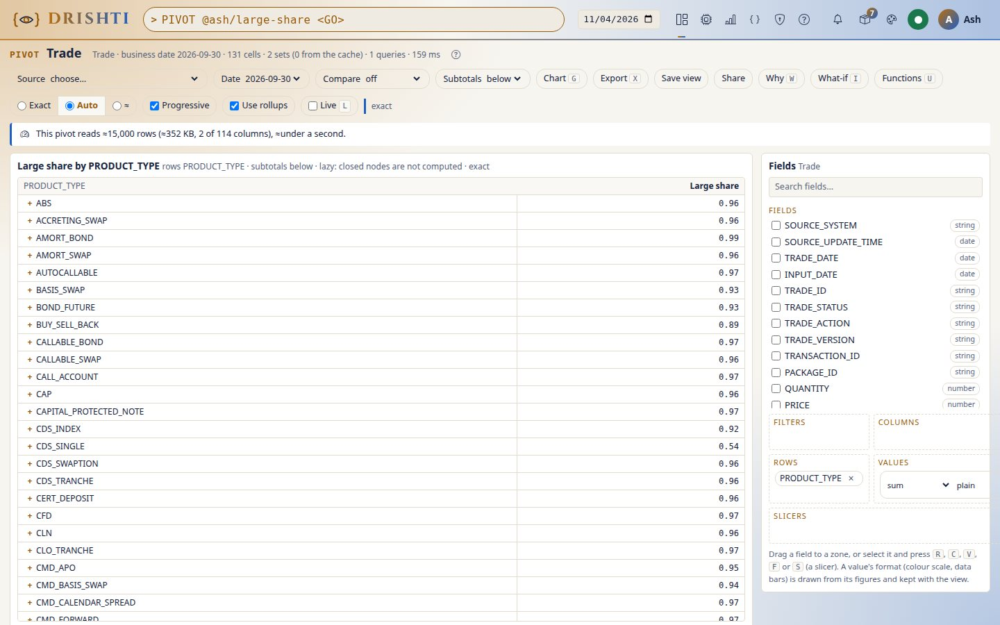
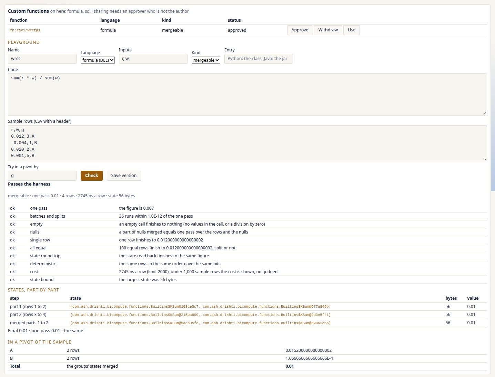
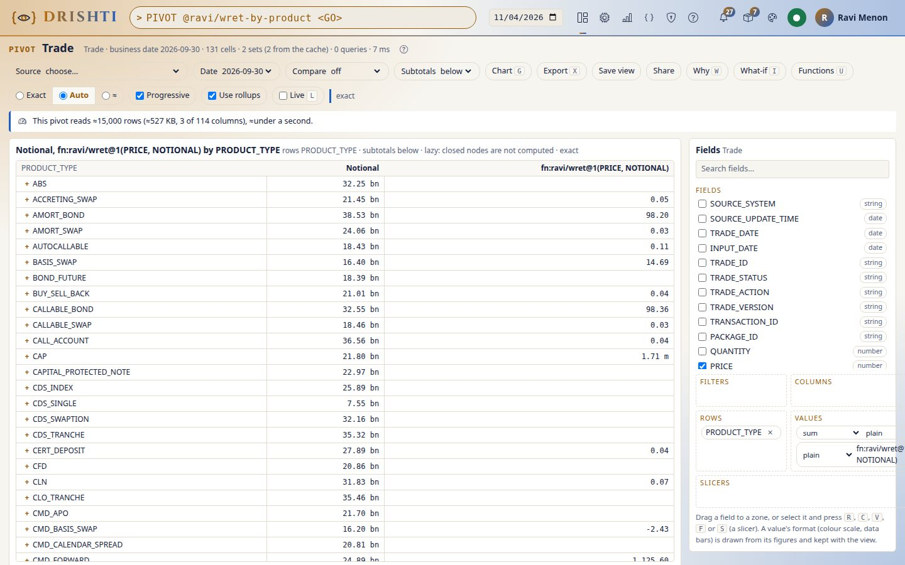
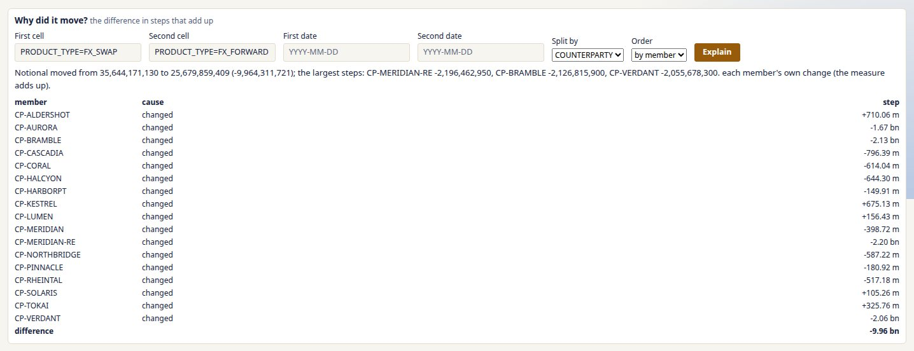
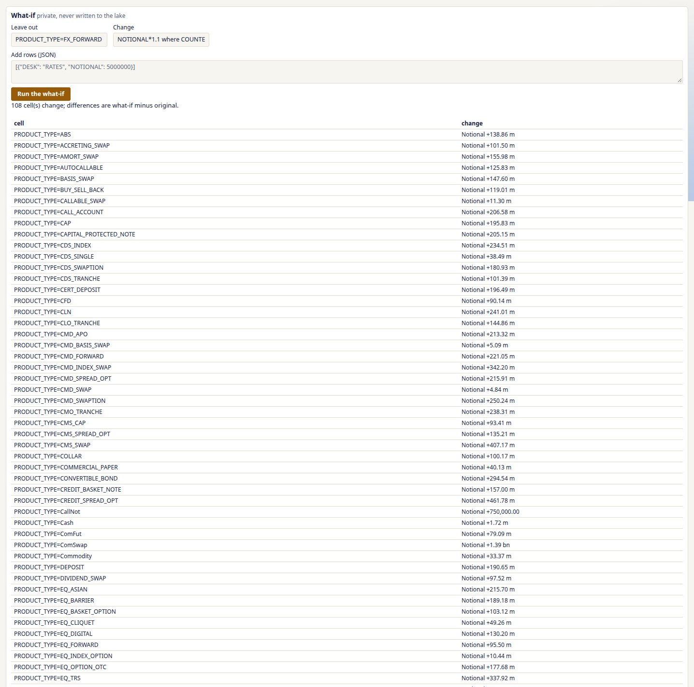

<!--
  Project Drishti · Any data. Any domain. One grammar.

  Copyright (c) 2026 Ashutosh Sinha <ajsinha@gmail.com>.
  All rights reserved.

  PROPRIETARY AND CONFIDENTIAL.

  This file is the confidential and proprietary property of Ashutosh Sinha.
  Unauthorised copying, use, modification, distribution or disclosure of this
  file, via any medium, is strictly prohibited except with the express prior
  written permission of the copyright holder.

  See the LICENSE file in the root of this repository for the full terms.
-->
# Tutorial 37 · Custom functions, "why did it move" and what-if

The built-in measures cover most questions; the rest you write yourself. In this tutorial you put a formula straight into a pivot, write a
weighted-return function in the playground and watch the harness prove that its split-and-merge answer equals one pass, save it, have
someone else approve it and use it in a view, withdraw it, then explain why one product's notional differs from another's in steps that
add up, and try a what-if. Each step shows the UI, the command line and the JSON or YAML. The guide is
[PIVOT_GUIDE.md, sections 19 to 22](../guides/PIVOT_GUIDE.md#19-custom-functions).

## Time to complete

About 25 minutes.

## Before you start

- [Tutorial 33](33-the-pivot-engine.md) done: `PIVOT trade <GO>` answers with the demo trades.
- Two users: you (an analyst) and a second user who may approve: an administrator, or a member of the role named by
  `drishti.pivot.functions.approver-role` (`pivot-approver`, one of the built-in roles as shipped: give it to the second user in
  Admin → Users). See [USER_MANAGEMENT.md](../admin/USER_MANAGEMENT.md#2-roles).
- A token for the command line in `DRISHTI_TOKEN` or a `--token-file` ([TOOLS.md](../guides/TOOLS.md)).

## What you will learn

- how a formula of built-ins is one function whose totals are made from states, never from the figures shown;
- what the harness checks before a function is saved, shared or used;
- why sharing needs an approver who is not the author, and what a withdrawn function looks like;
- how a difference is split into steps that add up, for sums, ratios and holistic measures;
- how a what-if overlay changes only the cells it touches, each change listed against the original.

## Step 1 · A formula in a view

**UI.** `PIVOT trade <GO>`, `PRODUCT_TYPE` on Rows. In Values, edit a value's text to `sum(NOTIONAL, where=NOTIONAL > 100000000) / sum(NOTIONAL)`
(the share of notional in trades over 100 million). Every row and the grand total show the ratio; the grand total is the ratio over all the trades, not
an average of the rows' ratios.

**CLI.**

```
drishti.py pivot run --source trade --rows PRODUCT_TYPE --values "sum(NOTIONAL, where=NOTIONAL > 100000000) / sum(NOTIONAL)"
```

**JSON.**

```json
{"source": "trade", "rows": ["PRODUCT_TYPE"], "values": [{"measure": "sum(NOTIONAL, where=NOTIONAL > 100000000) / sum(NOTIONAL)", "as": "Large share"}]}
```



**You should see** one ratio per product type and a grand total that equals the sum of the notional of trades over 100 million divided by the sum of all notional (`EXPORT trade`, filter and sum).

## Step 2 · The playground: a function and its harness

**UI.** Press `U` (or **Functions**). Name `wret`, language **formula (DEL)**, inputs `r, w`, code `sum(r * w) / sum(w)`; leave the sample
rows and the group column `g`. Press **Check**. You see *Passes the harness*, the checks (one pass; batches of 1, 7, 1,000 and 65,536;
2, 3 and 16 random parts merged left-deep and balanced under five seeds; an empty cell; a part of nulls; one row; equal rows; infinities;
the state read back; the same bits twice; the cost; the state's size), the state after each part and after each merge (two sums, `[Σrw, Σw]`
as the engine keeps them) with the final figure beside the one-pass figure, and the little pivot of the sample by `g` whose total is made
from the groups' states.

**CLI.** Write `wret.yaml` and `rows.csv`:

```yaml
name: wret
language: formula
code: sum(r * w) / sum(w)
inputs: [r, w]
description: the weighted mean of returns
```

```
r,w,g
0.012,3,A
-0.004,1,B
0.020,2,A
0.001,5,B
```

```
drishti.py pivot functions test wret.yaml --sample rows.csv --group g
```

```text
PASSED: fn:ravi/wret@0 (mergeable), one pass 0.007, 4 rows, 2245.0 ns a row, state 56 bytes
  ok  one pass             the figure is 0.007
  ok  batches and splits   36 runs within 1.0E-12 of the one pass
  ok  empty                an empty cell finishes to nothing (no values in the cell, or a division by zero)
  ok  nulls                a part of nulls merged equals one pass over the rows and the nulls
  ok  single row           one row finishes to 0.012000000000000002
  ok  all equal            100 equal rows finish to 0.012000000000000002, split or not
  ok  state round trip     the state read back finishes to the same figure
  ok  deterministic        the same rows in the same order gave the same bits
  ok  cost                 2245 ns a row (limit 2000); under 1,000 sample rows the cost is shown, not judged
  ok  state bound          the largest state was 56 bytes
  part 1 (rows 1 to 2)               0.008  (56 bytes)
  part 2 (rows 3 to 4)               0.0064285714285714285  (56 bytes)
  merged parts 1 to 2                0.007  (56 bytes)
```

(The author here is `ravi`: a function is named after the person who writes it, `fn:<you>/<name>@<version>`; `@0` is the unsaved draft.)

**JSON** (`POST /api/v1/pivot/functions/test`): the YAML's keys, plus `"sample": [{"r": 0.012, "w": 3, "g": "A"}, ...]` and `"group": "g"`.



**You should see** *Passes the harness*; the final figure is (0.012·3 − 0.004·1 + 0.020·2 + 0.001·5) / 11 = 0.077 / 11 = 0.007.

## Step 3 · An SQL macro: rewritten into states, or holistic

**UI.** Language **SQL macro**, code `CREATE MACRO wret2(r, w) AS sum(r * w) / sum(w)`, **Check**: the kind is *mergeable* (the engine
rewrote the macro into the states of its sums). Now `CREATE MACRO slope(r, w) AS regr_slope(r, w)`: the kind is *holistic* (no merge;
each cell's figure is computed by DuckDB from its own rows) and the harness runs only the checks that apply.

**CLI.** The same with `language: sql` and `code: "CREATE MACRO slope(r, w) AS regr_slope(r, w)"`.

**You should see** *mergeable* for `wret2` and *holistic* for `slope`; a macro that names a table or a file (`read_csv(...)`) is refused in words (DRS-5710): a macro is SQL over its inputs only.

## Step 4 · Save, approve, use

**UI.** Back to `wret` (formula), **Save version**: `fn:you/wret@1`, private. As yourself, **submit** it for sharing; as the second user, open
**Views → Approvals**, choose `fn:you/wret@1` (or *In Approvals* beside it in **Functions**) and press **Approve**, with the comment
"reviewed: a weighted mean". As yourself, in Values add
`fn:you/wret@1(PRICE, NOTIONAL)` (the trades' price and notional): the column header is the call itself, `fn:ravi/wret@1(PRICE, NOTIONAL)`
for the author `ravi`.

**CLI.**

```
drishti.py pivot functions save wret.yaml --sample rows.csv
drishti.py approvals approve function you:wret@1 --comment "reviewed: a weighted mean"      # as the approver
drishti.py pivot run --source trade --rows PRODUCT_TYPE --values "fn:you/wret@1(PRICE, NOTIONAL)"
```

```text
saved fn:ravi/wret@1 (mergeable): private until an approver who is not you approves it
drishti: the server said 403 DRS-5712: an author never approves their own function (fn:ravi/wret@1): another approver must ...
fn:ravi/wret@1: approved
```

The refusal is the author's own `approve`; the approval is the second user's (`vera`, with her own token).

**JSON.** `POST /api/v1/approvals/function/you:wret@1/approve` with `{"comment": "reviewed: a weighted mean", "params": {"scope": "everyone"}}`; the view's
value is `{"measure": "fn:you/wret@1(PRICE, NOTIONAL)"}`.

```text
Trade · 2026-09-30 · 131 cells · 2 sets, 0 from the cache · 1 queries · 267 ms · exact
PRODUCT_TYPE                        fn:ravi/wret@1(PRICE, NO
+ ABS                                                      ·
+ ACCRETING_SWAP                                        0.05
+ AMORT_BOND                                           98.20
+ AMORT_SWAP                                            0.03
...
```



**You should see** the new column in every row and the total; approving your own function is refused (DRS-5712: "an author never approves their own function"); Admin → Audit shows
`pivot.function.save`, `pivot.function.approve` and `pivot.function.use`, with the version.

## Step 5 · Withdraw

**UI.** As the approver, **Withdraw** `fn:you/wret@1` with a reason. Run your view again: every cell of that column says "function withdrawn
by … on …: reason", with no figure; the other values answer as before.

**CLI.** `drishti.py pivot functions revoke you/wret@1 --reason "superseded"`.

**You should see** "function withdrawn by …" in each cell of the column and no figure; the function's list marks it *withdrawn*.

## Step 6 · Why did it move?

**UI.** In the `PRODUCT_TYPE` pivot with `sum(NOTIONAL)`, put `COUNTERPARTY` on Columns (**Split by** offers the view's own rows and
columns), select two product rows (click one, Shift-click the other) or type them as **First cell** and **Second cell**, and press `W`.
**Split by** `COUNTERPARTY`, **Explain**. The words say how much the second differs from the first and the largest steps; below them one
step per counterparty (its cause: new, gone or changed) and the steps add up to the difference. Change the value to `avg(NOTIONAL)` and explain again: each
step is now that counterparty's effect on the average given the steps before it, the order is shown (switch **Order** to "largest first"
and the same difference splits differently), and they still add up.

**CLI.**

```
drishti.py pivot explain --source trade --rows PRODUCT_TYPE --values "sum(NOTIONAL)" --cell PRODUCT_TYPE=FX_SWAP --other-cell PRODUCT_TYPE=FX_FORWARD --by COUNTERPARTY
```

```text
sum(NOTIONAL) moved from 35,644,171,130 to 25,679,859,409 (-9,964,311,721); the largest steps: CP-MERIDIAN-RE -2,196,462,950, CP-BRAMBLE -2,126,815,900, CP-VERDANT -2,055,678,300.
  each member's own change (the measure adds up)
  CP-ALDERSHOT                 changed     710,057,225.0000   cumulative 710,057,225.0000
  CP-AURORA                    changed   -1,669,308,280.0000   cumulative -959,251,055.0000
  CP-BRAMBLE                   changed   -2,126,815,900.0000   cumulative -3,086,066,955.0000
  ...
```

**JSON** (`POST /api/v1/pivot/explain`):

```json
{"view": {"source": "trade", "rows": ["PRODUCT_TYPE"], "values": ["sum(NOTIONAL)"]},
 "from": {"PRODUCT_TYPE": "FX_SWAP"}, "to": {"PRODUCT_TYPE": "FX_FORWARD"}, "by": "COUNTERPARTY"}
```



**You should see** the words and the steps; the sum of the steps plus the residual equals `difference`; the residual is named ("rounding"). For a cell on two dates, give
`fromDate` and `toDate` (`--from`, `--to`) instead of a second cell.

## Step 7 · What-if

**UI.** Press `I`. **Leave out** `PRODUCT_TYPE=FX_FORWARD`, **Change** `NOTIONAL*1.1 where COUNTERPARTY=CP-ALDERSHOT`, **Run the what-if**. The list
shows each cell that changes and by how much (what-if minus original); nothing was written anywhere.

**CLI.**

```
drishti.py pivot whatif --source trade --rows PRODUCT_TYPE --values "sum(NOTIONAL)" --exclude PRODUCT_TYPE=FX_FORWARD --scale NOTIONAL=1.1@COUNTERPARTY=CP-ALDERSHOT
```

```text
108 cell(s) change; differences are what-if minus original
  PRODUCT_TYPE=ABS|*                       sum(NOTIONAL) +138,863,064.00
  PRODUCT_TYPE=ACCRETING_SWAP|*            sum(NOTIONAL) +101,499,900.00
  PRODUCT_TYPE=AMORT_SWAP|*                sum(NOTIONAL) +155,982,800.00
  ...
```

**JSON** (`POST /api/v1/pivot/whatif`):

```json
{"view": {"source": "trade", "rows": ["PRODUCT_TYPE"], "values": ["sum(NOTIONAL)"]},
 "whatIf": {"exclude": {"PRODUCT_TYPE": ["FX_FORWARD"]}, "changes": [{"field": "NOTIONAL", "scale": 1.1, "where": {"COUNTERPARTY": ["CP-ALDERSHOT"]}}]}}
```



**You should see** *108 cell(s) change; differences are what-if minus original* and each changed cell with its change: FX_FORWARD's
cell is gone from the what-if, and the grand total moved by 10 % of CP-ALDERSHOT's notional less FX_FORWARD's.

## Step 8 · Python (an administrator turns it on)

Python functions are off as shipped. With `drishti.pivot.functions.python.enabled: true` in `config/engines/pivot.yaml` (and a restart),
language **Python** takes a class decorated with `@function` ([PIVOT_GUIDE.md section 19](../guides/PIVOT_GUIDE.md#19-custom-functions));
it runs in the node's sandboxed `pivot-fn` workers (no network, no files, no processes), fed Arrow batches over a pipe, and passes the same
harness. Python functions never read memory-only data.

**You should see** **Python** offered in the language list once it is on (and, while it is off, refused in words: DRS-5713).

## Step 9 · BI's totals are the engine's

Open a BI report with a matrix (the sample *trades overview*). Every total and subtotal row comes from the pivot engine's
one statement over the model's rows: the average's total is the average over all the trades, a sum's total is the engine's sum. A
year-to-date measure shows a dash in the total row; the answer's warnings say why ([BI_GUIDE.md section 3.2](../guides/BI_GUIDE.md#32-true-totals)).

**You should see** the matrix's totals and subtotals as before (the figures are the same: `BiParityTest`) and a dash, with its reason,
where a measure has no total.

## Next steps

- [PIVOT_GUIDE.md](../guides/PIVOT_GUIDE.md) sections 19 to 22: the languages, the harness, approval, explain, what-if, BI's totals.
- [PIVOT_ENGINE.md](../architecture/PIVOT_ENGINE.md) sections 8, 10 and 12: the design.
