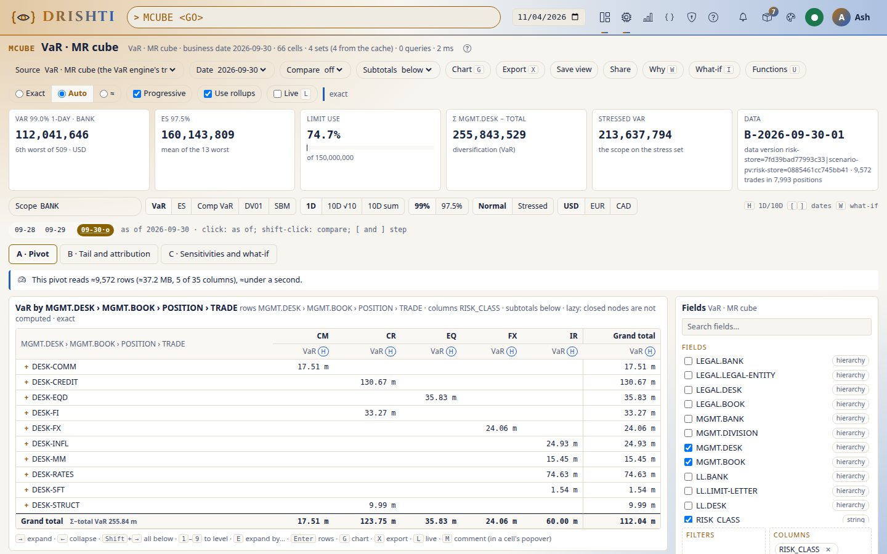
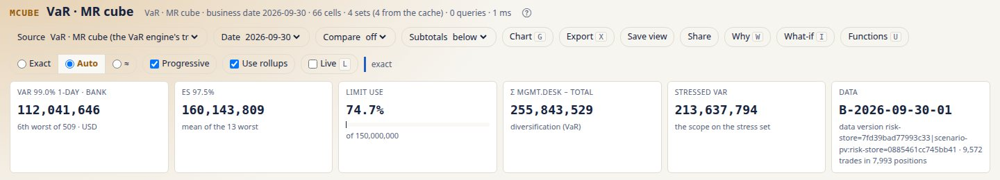
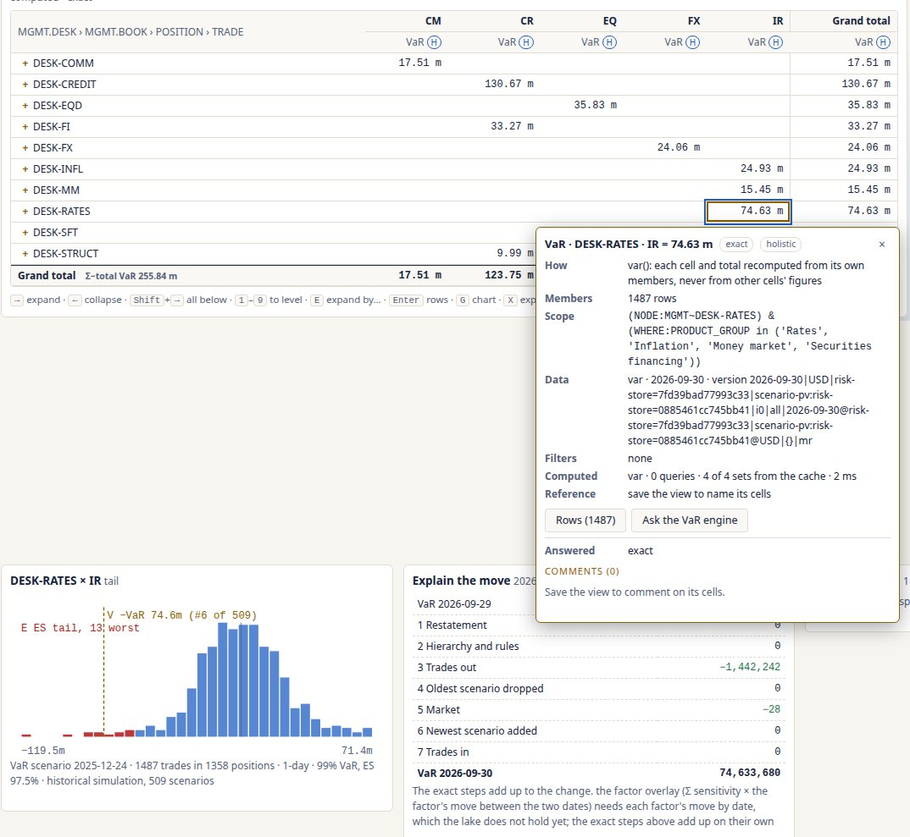
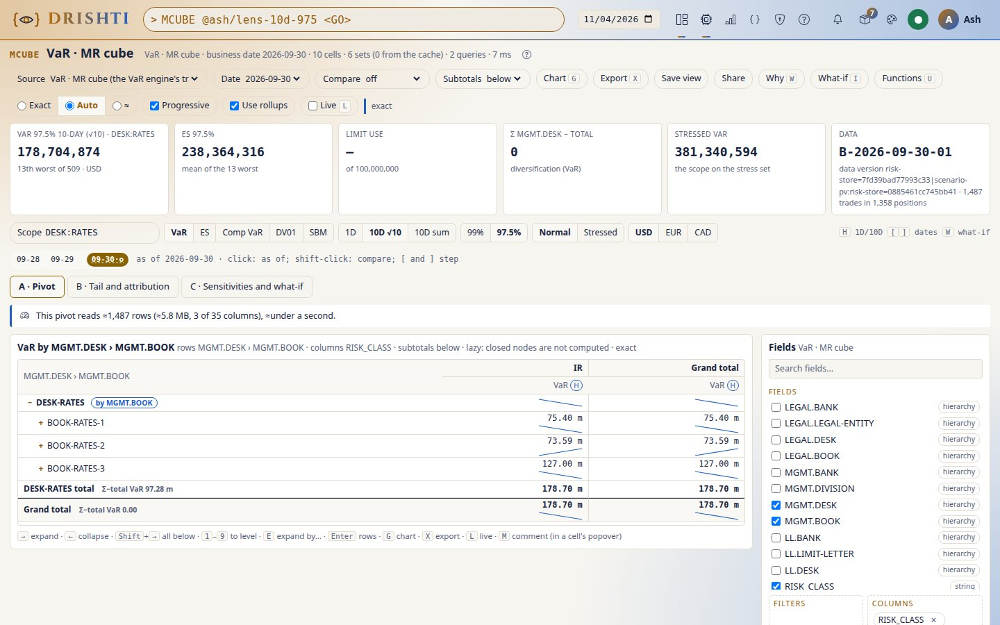
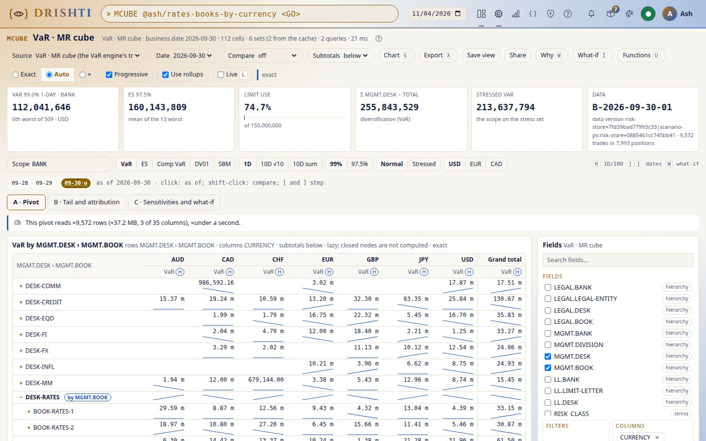
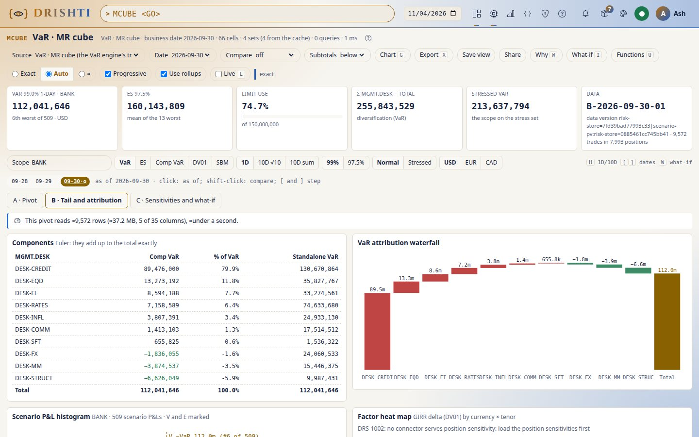
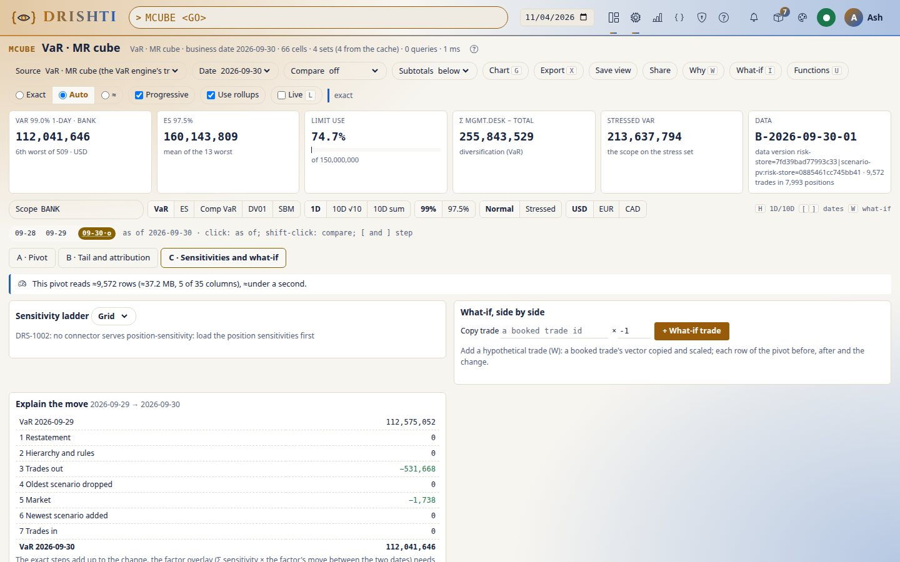
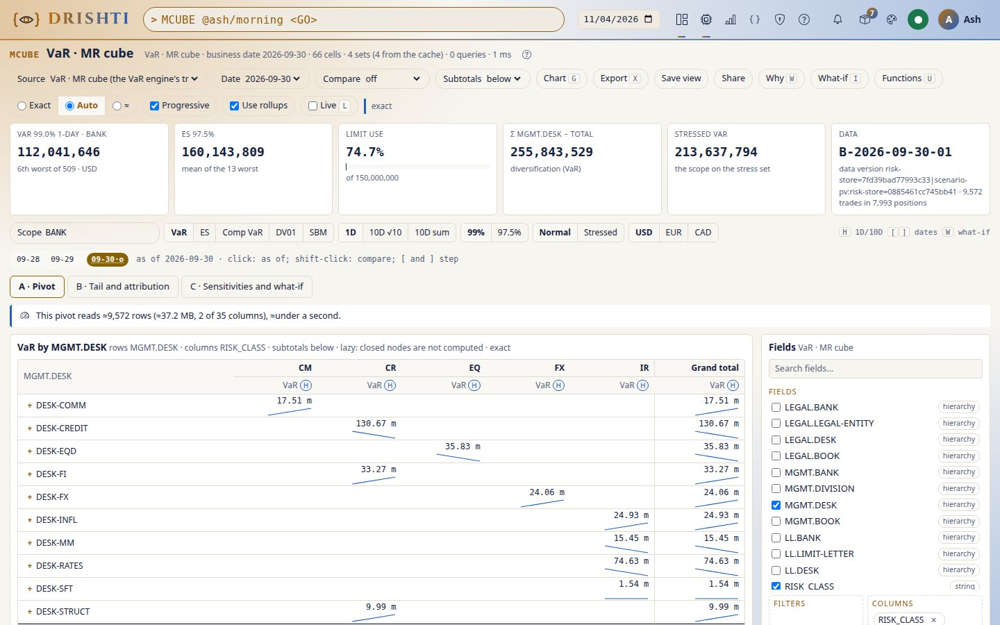

<!--
  Project Drishti · Any data. Any domain. One grammar.

  Copyright (c) 2026 Ashutosh Sinha <ajsinha@gmail.com>.
  All rights reserved.

  PROPRIETARY AND CONFIDENTIAL.

  This file is the confidential and proprietary property of Ashutosh Sinha.
  Unauthorised copying, use, modification, distribution or disclosure of this
  file, via any medium, is strictly prohibited except with the express prior
  written permission of the copyright holder.

  See the LICENSE file in the root of this repository for the full terms.
-->
# Tutorial 38 · The MR cube: desks by risk class, with the right totals

The MR cube is the pivot engine on the VaR source with the market-risk lens around it. In this tutorial you open the landing (desks by risk
class), check its totals against `VAR BANK` and see the diversification, read a cell's tail and why it moved, change the lens (10 days,
97.5%, stressed), re-pivot by currency and open a desk down to its trades, read the components and their waterfall, the DV01 ladder and a
what-if side by side, and save, share and export a view. Each step shows the UI, the command line and the view's JSON. The guide is
[MR_CUBE_GUIDE.md](../guides/MR_CUBE_GUIDE.md); the pivot screen itself is [tutorial 33](33-the-pivot-engine.md).

## Time to complete

About 25 minutes.

## Before you start

- The server and console running with the demo risk lake ([tutorial 25](25-var-from-the-bank-to-a-trade.md)): `VAR BANK <GO>` answers.
- The engines `var`, `pivot` and `mr-cube` on (Admin → Engines; `mr-cube` is on by default). For step 6, `sensitivities` and `frtb-sa` on too.
- A token for the command line in `DRISHTI_TOKEN` or a `--token-file` ([TOOLS.md](../guides/TOOLS.md)).

## What you will learn

- why every cell and every total of the cube is the VaR of its own trades, and what diversification is in money;
- where a cell's number comes from: its scope, its tail, why it moved;
- how the lens (horizon, confidence, scenario set, currency) and the scope are options of one view;
- how components add up exactly where VaR does not;
- how the ladder and the what-if read the same view.

## Step 1 · The landing: desks by risk class

**UI.** Type `MCUBE <GO>` (or **VaR → MR cube**). The pivot screen opens with the MR lens: the headline strip (VaR, ES, limit use, Σ desks −
total, stressed VaR, the data), the lens controls, the slider, tabs A, B and C, and the pivot: one row per desk of the management hierarchy,
one column per risk class, each cell its VaR with a sparkline when earlier dates are open.

**CLI.**

```
drishti.py pivot fields var
drishti.py pivot run --source var --rows MGMT.DESK --cols RISK_CLASS --values "var()"
drishti.py pivot mr headline --source var
```

**JSON** (the catalogue's `defaultView`, sent to `POST /api/v1/pivot/query`):

```json
{"source": "var", "rows": ["MGMT.DESK", "MGMT.BOOK", "POSITION", "TRADE"], "columns": ["RISK_CLASS"],
 "values": [{"measure": "var()", "as": "VaR"}], "options": {"scope": "BANK"}, "expandTo": {"rows": 1, "columns": 1}}
```



**You should see** desks by risk class with a grand total; the grand total equals `VAR BANK` to the cent, and the headline's VaR is the same number.

## Step 2 · Totals are never sums: the diversification

**UI.** Add up the desks' VaR in the *Grand total* column by hand: it is more than the bank's. The headline's **Σ desks − total** tile is
that difference, in money; the grand total row carries it too (`Σ−total` beside it).

**CLI.**

```
drishti.py pivot run --source var --rows MGMT.DESK --values "var()" --json | jq '.rows[] | select(.kind=="grand") | .diversification'
```

**JSON.** The answer's grand row: `{"kind": "grand", "diversification": {"VaR": <Σ desks − bank>}}`.



**You should see** a grand total below the desks' sum and the difference in the Σ desks − total tile; pick one desk's cell and run `VAR <its scope>` (the scope is in the cell's provenance, step 3): the same VaR to the cent.

## Step 3 · A cell's tail, provenance and why it moved

**UI.** Click the RATES × IR cell. The provenance popover shows its scope (`(NODE:MGMT~DESK-RATES) & (WHERE:PRODUCT_GROUP in (…))`), its
trades and how the figure is made. The rail under the pivot shows its scenario P&L histogram (the VaR scenario marked **V**, the ES tail
**E**) and *Explain the move*: the cell's VaR on the date before, each exact step, and today's VaR. Shift-click an earlier date on the slider
to explain against it instead.

**CLI.**

```
drishti.py pivot mr cell --source var --rows MGMT.DESK --cols RISK_CLASS --cell MGMT.DESK=DESK-RATES,RISK_CLASS=IR
drishti.py pivot mr explain --scope "(NODE:MGMT~DESK-RATES) & (WHERE:PRODUCT_GROUP in ('Rates'))"
```

**JSON** (`POST /api/v1/pivot/mr/detail`):

```json
{"view": {"source": "var", "rows": ["MGMT.DESK"], "columns": ["RISK_CLASS"], "values": [{"measure": "var()"}]},
 "coords": {"MGMT.DESK": "DESK-RATES", "RISK_CLASS": "IR"}}
```



**You should see** the cell's scope, its scenario P&L histogram with V and E marked and its steps; the detail's `var` equals the cell's VaR, and its `k` says which worst loss it is (the 6th of 509 at 99%).

## Step 4 · The lens: 10 days, 97.5%, stressed, another currency

**UI.** Press **H** (or click *10D √10*): every cell is computed again at 10 days. Click *97.5%*, then *Stressed*: the stress set's VaR
(USD). Click *Normal* and *EUR*: the bank in euros. Type `DESK:RATES` in *Scope* and press Enter: the view starts from the rates desk.

**CLI.**

```
drishti.py pivot run --source var --rows MGMT.DESK --values "var()" --option horizon=10d --option confidence=0.975
drishti.py pivot run --source var --rows MGMT.BOOK --values "var()" --option scope=DESK:RATES --option ccy=EUR
```

**JSON.** The options of the view: `"options": {"scope": "DESK:RATES", "horizon": "10d", "confidence": "0.975", "ccy": "EUR"}`.



**You should see** every cell computed again for the lens; `VAR DESK:RATES H 10D` on the VaR explorer gives the total of the 10-day view.

## Step 5 · Re-pivot and open a desk down to its trades

**UI.** Drag `CURRENCY` onto Columns in place of `RISK_CLASS`. Open RATES with →: its books are computed, nothing else. Open a book: its
positions; a position: its trades. Select a book and press **E**, type `COUNTERPARTY`: that book alone is broken down by counterparty.
Press Enter on a cell: its trades, as the VaR engine holds them.

**CLI.**

```
drishti.py pivot run --source var --rows MGMT.DESK,MGMT.BOOK --cols CURRENCY --values "var()" --open MGMT.DESK=DESK-RATES
drishti.py pivot export --source var --rows MGMT.DESK --values "var()" --what rows --cell MGMT.DESK=DESK-RATES -o rates-trades.csv
```

**JSON.** The node opened: `"expanded": [{"axis": "rows", "path": [["MGMT.DESK", "DESK-RATES"]], "by": "MGMT.BOOK"}]`.



**You should see** RATES's books and nothing else computed; each book's VaR is its own (`VAR BOOK:<book>`), and the desk's subtotal is not their sum.

## Step 6 · Components, the waterfall, the ladder and a what-if

**UI.** Open tab **B**: each desk's component VaR and its share; a negative one is a hedge; they add up to the bank's VaR exactly. The
waterfall draws them, the total last; the histogram is the bank's; the heat map is DV01 by currency × tenor. Open tab **C**: the DV01 ladder
by currency and bucket (*Grid* switches between the bank's buckets and FRTB's vertices). In *What-if*, copy a booked trade with × -1 and add
it: every desk and the total, before, after and the change.

**CLI.**

```
drishti.py pivot run --source var --rows MGMT.DESK --values "comp_var()" --values "var()"
drishti.py pivot mr ladder --scope BANK --grid BANK-IR-TENOR
drishti.py pivot mr whatif --source var --rows MGMT.DESK --copy <a trade id> --factor -1
```

**JSON** (`POST /api/v1/pivot/mr/what-if`): `{"view": {...}, "items": [{"copyOf": "<a trade id>", "factor": -1}]}`.





**You should see** the components with the hedges negative, the ladder and the what-if before and after; the components' sum equals the bank's VaR to the cent; the what-if's *Total* row's *before* equals the grand total.

## Step 7 · Save, share and export

**UI.** **Save view** (name it `morning`), **Share** with `role:risk`. A colleague opens `MCUBE @you/morning <GO>` with their own rights.
**Export → Excel**: the outline of the rows, `SUM` formulas only for the measures that add up (`comp_var()`, `pv()`, `trades()`), the server's
values for VaR and ES, a Provenance sheet.

**CLI.**

```
drishti.py pivot save morning --source var --rows MGMT.DESK --cols RISK_CLASS --values "var()" --share role:risk
drishti.py pivot export --view you/morning --format xlsx -o morning.xlsx
```

**JSON.** The saved view is the view itself, options included; never its numbers.



**You should see** the view in your saved views and its workbook; open the workbook: the VaR column's totals are values, not formulas; a Comp VaR total is a `SUM`.

## Next steps

- The guide: [MR_CUBE_GUIDE.md](../guides/MR_CUBE_GUIDE.md) (every measure, option, setting and code).
- The pivot screen: [PIVOT_GUIDE.md](../guides/PIVOT_GUIDE.md); the VaR engine: [VAR_GUIDE.md](../guides/VAR_GUIDE.md).
