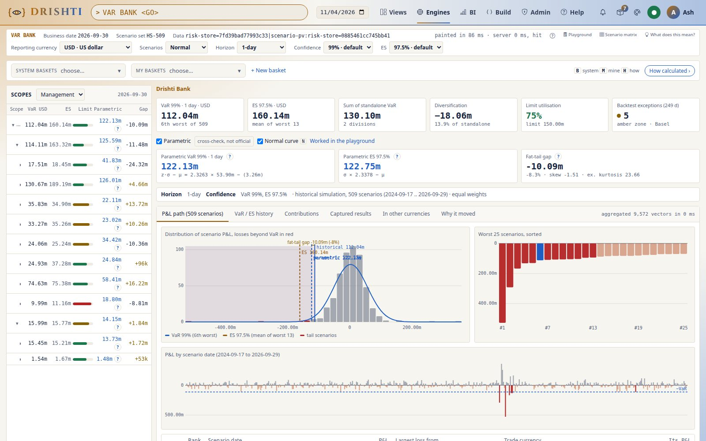
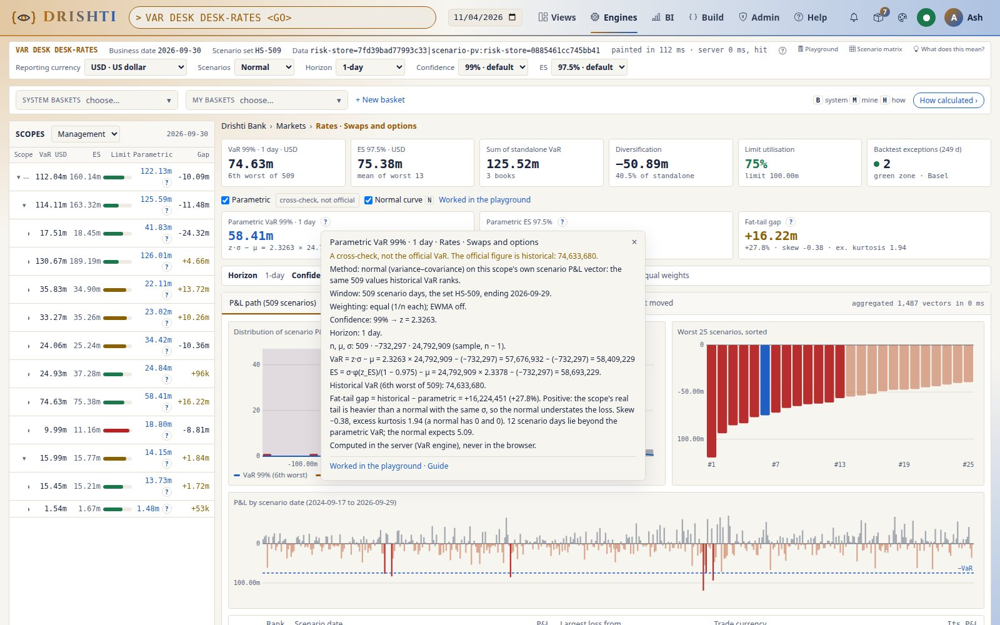
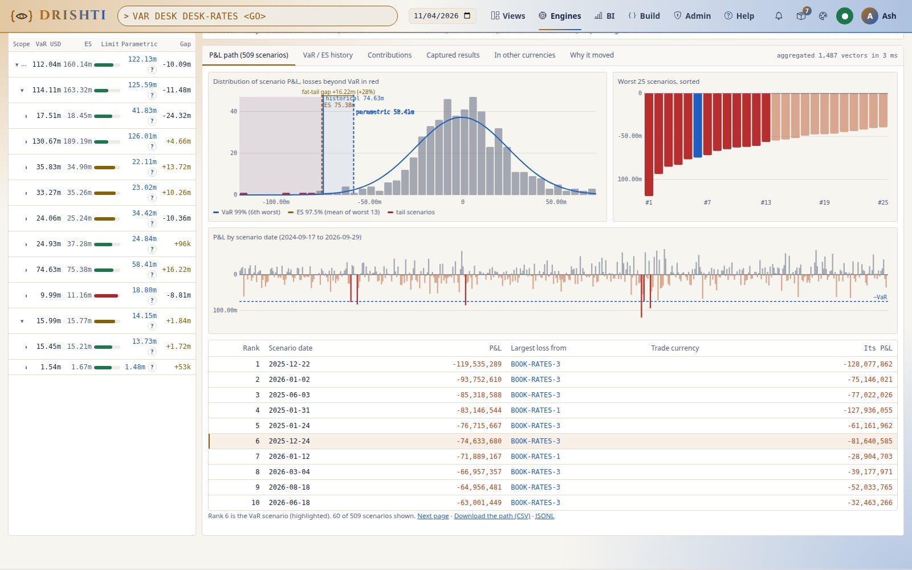
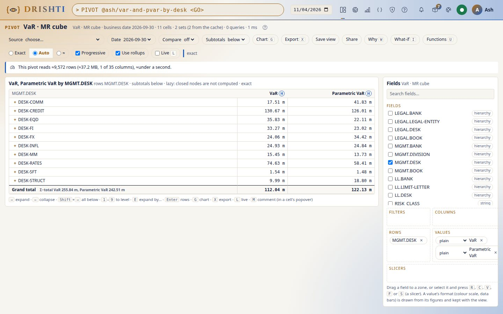
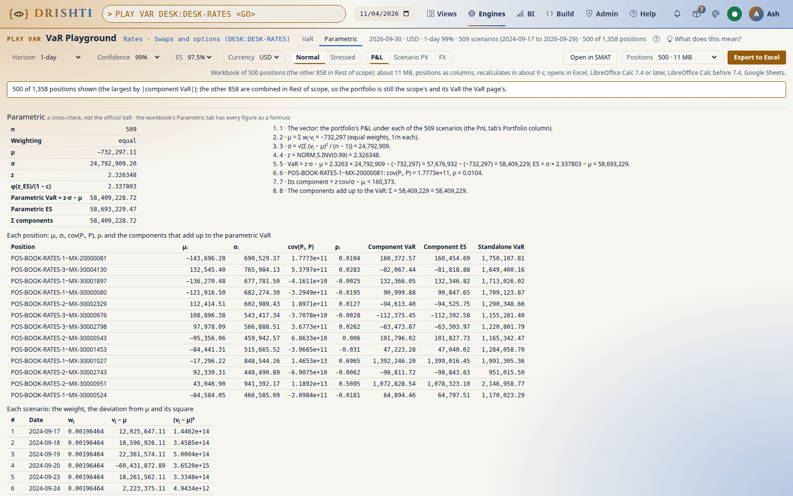

<!--
  Project Drishti · Any data. Any domain. One grammar.

  Copyright (c) 2026 Ashutosh Sinha <ajsinha@gmail.com>.
  All rights reserved.

  PROPRIETARY AND CONFIDENTIAL.

  This file is the confidential and proprietary property of Ashutosh Sinha.
  Unauthorised copying, use, modification, distribution or disclosure of this
  file, via any medium, is strictly prohibited except with the express prior
  written permission of the copyright holder.

  See the LICENSE file in the root of this repository for the full terms.
-->
# Tutorial 43 · Parametric VaR beside historical: the fat-tail gap

Historical VaR ranks a scope's own 509 scenario P&Ls and reads the 6th worst. **Parametric VaR** fits a normal distribution to the same
509 numbers and reads its 1% tail: z·σ − μ. It is a **cross-check, never the official VaR**: limits, limit use, the backtest, official
records and regulatory reports stay historical. Where the two differ, the difference is the **fat-tail gap**: positive when the scope's
real tail is heavier than a normal with the same σ predicts. In this tutorial you turn on the VaR explorer's **Parametric** toggle on the
bank (`PVAR BANK` opens it that way), read a desk's **?** line by line, see the normal curve over the P&L histogram, compare the tail bin
by bin, check that the Euler components add up to the cent, read the correlation matrix, put `pvar()` in the MR cube, and work every
figure out in the VaR Playground's **Parametric** tab and its workbook. Each step shows the UI,
the command line and the JSON or YAML behind it, with real output from the committed test data. The reference is
[VAR_GUIDE.md sections 3.12 and 18.15](../guides/VAR_GUIDE.md#1815-parametric-var-and-es-a-cross-check); the design and its reasons are
in [PARAMETRIC_VAR.md](../guides/VAR_GUIDE.md).

## Time to complete

About 25 minutes.

## Before you start

- [Tutorial 25](25-var-from-the-bank-to-a-trade.md), step 1, done: the VaR tables built on the test data's own date, 2026-09-30
  (`drishti.py lake demo --as-of data --only market-risk/...`), so your numbers are the ones below.
- The server and console running (tutorial 1). For the command line: `DRISHTI_SERVER=http://localhost:18480` and `DRISHTI_TOKEN=...`
  (My account → API tokens), or `--user` with sign-in off.
- Parametric VaR is on as shipped (`drishti.var.parametric.enabled`, below). The VaR data is **synthetic**, not prices.

## What you will learn

- what parametric VaR and ES are (z·σ − μ of the scope's own vector) and why they are a cross-check, never official;
- how to read the fat-tail gap, the skew, the excess kurtosis and the days beyond the parametric VaR;
- the **?** on every parametric figure: the server's own lines, the formula with the scope's numbers;
- the normal curve over the P&L histogram, the **N** toggle, and the tail bin by bin against the days the normal expects;
- the Euler components z·cov(Pᵢ, P)/σ − μᵢ, which add up to the parametric VaR exactly, and the parts' correlation matrix;
- `pvar()` beside `var()` in the MR cube and the pivot;
- the VaR Playground's **Parametric** tab: every parametric figure worked out, and the workbook's **Parametric** tab of real formulas.

## Step 1 · Turn on Parametric on the bank

**The UI.** Type `VAR BANK <GO>` and tick **Parametric** beside the tiles (or type `PVAR BANK <GO>`: the same explorer with the toggle
on; `&pm=1` in the link). Beside the historical tiles come three more: **Parametric VaR**, **Parametric ES** and the **Fat-tail gap**;
the tree gains the **Parametric** and **Gap** columns. Untick it and the explorer is historical only again.



**The command line.**

```text
$ drishti.py var show BANK --date 2026-09-30
VAR BANK  ·  Drishti Bank  ·  node  ·  2026-09-30
  VaR 99%   112,041,646 USD   (the 6th worst of 509)
  ES 97.5%   160,143,809 USD   (mean of the 13 worst)
  ...
  parametric VaR 122,130,910 USD = z·σ − μ = 2.3263 × 53,901,012 − (3,261,595)   ES 122,748,342   fat-tail gap -10,089,265 (-8.3%)   a cross-check, not official
```

`--no-parametric` leaves the line out (the API's `parametric=false`).

**The YAML.** The measure's settings sit in the VaR engine's file, `config/engines/var.yaml`:

```yaml
drishti:
  var:
    parametric:
      enabled: ${DRISHTI_VAR_PARAMETRIC_ENABLED:true}   # off: no block, no toggle, no playground Parametric tab, no pvar() (asked: refused in words)
      weighting: equal               # equal (1/N, sigma with N - 1) or ewma (lambda below)
      lambda: 0.94
      horizon-rule: lens             # the lens's own vector, or square-root-of-time
      curve-points: 121
      matrix-max-parts: 60
      show-curve: true
```

**You should see** historical VaR 112,041,646 and parametric VaR 122,130,910 for the bank: a **negative** gap of −10,089,265 (−8.3%).
Diversified across ten desks, the bank's worst days were milder than a normal with the same σ predicts, even though the vector's excess
kurtosis is 23.66: one very bad day stretches σ, and the normal spreads it over the whole tail.

## Step 2 · A desk's ? read line by line

**The UI.** Open `PVAR DESK DESK-RATES` (or click **Rates · Swaps and options** in the tree) and press the **?** beside the Parametric VaR
tile. It opens the server's own lines (a bottom sheet on a phone); the console places the text and computes nothing.



**The JSON.** The same lines are the headline's `parametric.describe`
(`GET /api/v1/risk/var/scope?scope=DESK:DESK-RATES&asOf=2026-09-30`):

```text
Parametric VaR 99% · 1 day · Rates · Swaps and options
A cross-check, not the official VaR. The official figure is historical: 74,633,680.
Method: normal (variance–covariance) on this scope's own scenario P&L vector: the same 509 values historical VaR ranks.
Window: 509 scenario days, the set HS-509, ending 2026-09-29.
Weighting: equal (1/n each); EWMA off.
Confidence: 99% → z = 2.3263.
Horizon: 1 day.
n, μ, σ: 509 · −732,297 · 24,792,909 (sample, n − 1).
VaR = z·σ − μ = 2.3263 × 24,792,909 − (−732,297) = 57,676,932 − (−732,297) = 58,409,229
ES = σ·φ(z_ES)/(1 − 0.975) − μ = 24,792,909 × 2.3378 − (−732,297) = 58,693,229.
Historical VaR (6th worst of 509): 74,633,680.
Fat-tail gap = historical − parametric = +16,224,451 (+27.8%). Positive: the scope's real tail is heavier than a normal with the same σ, so the normal understates the loss. Skew −0.38, excess kurtosis 1.94 (a normal has 0 and 0). 12 scenario days lie beyond the parametric VaR; the normal expects 5.09.
Computed in the server (VaR engine), never in the browser.
```

**The command line.** `drishti.py var show DESK:DESK-RATES --date 2026-09-30` prints the same in one line:
`parametric VaR 58,409,229 USD = z·σ − μ = 2.3263 × 24,792,909 − (-732,297)   ES 58,693,229   fat-tail gap +16,224,451 (+27.8%)`.

**You should see** the opposite of the bank: the rates desk's historical VaR (74,633,680) is 27.8% above its parametric VaR (58,409,229).
Check the formula yourself: 2.3263 × 24,792,909 = 57,676,932, and subtracting a mean of −732,297 gives 58,409,229. Twelve of the 509
days lie beyond the parametric VaR where the normal expects 5.09: the tail is fat.

## Step 3 · The normal curve over the P&L histogram

**The UI.** With Parametric on, the P&L path's histogram carries the **fitted normal**: a smooth blue line, the historical VaR marker (solid, at
−74.6m) and the parametric one (dashed, at −58.4m), both tails lightly shaded and the gap bracket between them. Hover the curve for its
formula. Press **N** (the *Normal curve* toggle) to hide the curve, the parametric marker, its tail and the bracket; the choice is
remembered for you and in the link (`&nc=0`).



**The JSON.** `GET /api/v1/risk/var/scope/path?scope=DESK:DESK-RATES&asOf=2026-09-30` → `parametric`: the server sends every point, the
browser draws them.

```json
{"var": 58409229, "gap": 16224451, "mu": -732297.11, "sigma": 24792909.20, "n": 509, "binWidth": 4545795.83,
 "markers": {"historical": -74633680.0, "parametric": -58409228.72},
 "curve": {"x": [-119535289.0, -117944260.46, "... 121 points"], "y": [0.00038, 0.00052, "..."]},
 "curveDescribe": ["Fitted normal N(μ, σ²) · n = 509 · μ −732,297 · σ 24,792,909",
                   "Expected days per bin at P&L x = n × bin width × φ((x − μ)/σ)/σ (bin width 4,545,796)", "..."]}
```

**You should see** the curve sit on the bars' scale (expected days per bin of 4,545,796) and the dashed parametric marker to the right of
the solid historical one: a positive gap.

## Step 4 · The tail bin by bin

**The UI.** The histogram of step 3 shows it: the bars beyond the solid marker against the curve under them. Each book's gap is its
**Gap** cell in the tree (expand the rates desk).

**The JSON.** The same path answer: `histogram.counts` (the days) beside `parametric.expected` (the normal's days). The worst bins of the
rates desk:

| Bin (USD) | Scenario days | The normal expects |
|---|---|---|
| −119,535,289 to −114,989,493 | 1 | 0.00 |
| −96,806,310 to −92,260,514 | 1 | 0.03 |
| −87,714,718 to −83,168,922 | 1 | 0.11 |
| −83,168,922 to −78,623,126 | 1 | 0.20 |
| −78,623,126 to −74,077,331 | 2 | 0.36 |
| −74,077,331 to −69,531,535 | 1 | 0.62 |

**You should see** six days below −69.5m where the normal expects about 1.3: the tail the normal misses. The books' gaps differ in sign
(`BOOK-RATES-1` +2,098,588, `BOOK-RATES-2` −2,183,557, `BOOK-RATES-3` +7,054,283 on the tree).

## Step 5 · The components add up, and the correlations

**The UI.** Open **Worked in the playground** on the rates desk (step 7): its **Parametric** tab lists each position's Euler component
z·cov(Pᵢ, P)/σ − μᵢ with μᵢ, σᵢ, cov(Pᵢ, P), ρᵢ and the standalone VaR, and Σ components beside the parametric VaR. The parts' correlation
matrix is on the command line and in the API below.

**The command line.**

```text
$ drishti.py var parts DESK:DESK-RATES --date 2026-09-30 --matrix
DESK:DESK-RATES  by book  VaR 74,633,680  ES 75,377,415 USD  sum of components 74,633,680
Part          Standalone VaR  Component VaR  % of VaR  Incremental VaR  Component ES  Param. component  ρ
------------  --------------  -------------  --------  ---------------  ------------  ----------------  -----
BOOK-RATES-1      33,153,425     30,612,282      41.0       -5,131,638    10,403,265         2,992,868  0.089
BOOK-RATES-2      30,872,370     25,280,825      33.9       21,654,002    20,263,766        16,411,411  0.466
BOOK-RATES-3      61,499,103     18,740,573      25.1       26,690,191    44,710,384        39,004,950  0.724
parametric VaR 58,409,229: the components add up to 58,409,229; diversification 60,146,355
correlations (openblas):
              BOOK-RATES-1  BOOK-RATES-2  BOOK-RATES-3
------------  ------------  ------------  ------------
BOOK-RATES-1          1.00         -0.07         -0.42
BOOK-RATES-2         -0.07          1.00         -0.04
BOOK-RATES-3         -0.42         -0.04          1.00
```

**The JSON.** `GET /api/v1/risk/var/scope/contributions?scope=DESK:DESK-RATES&asOf=2026-09-30&matrix=true`: per row `pComponentVar`, `rho`,
`sigma`, `mu`; totals `pSumComponent`, `pDiversification`; and `parametric.matrix {keys, labels, correlation, covariance, truncated,
engine}`. `matrix=true` with `parametric=false` is refused (`400`): the matrix is parametric.

**You should see** 2,992,868 + 16,411,411 + 39,004,950 = 58,409,229, the parametric VaR to the unit. The components rank the books
differently from historical: `BOOK-RATES-3` carries 39.0m of the parametric VaR but only 18.7m of the historical one, because its P&L
moves with the desk's (ρ 0.724) while `BOOK-RATES-1` hedges it (ρ 0.089, correlation −0.42 with book 3). The matrix is computed through
the linear-algebra seam (`openblas` here; `java` when that engine is off: the same figures).

## Step 6 · pvar() in the MR cube

**The UI.** `MCUBE <GO>`, then add the measure **Parametric VaR** (`pvar()`) beside `var()` in the values; or in any pivot of the VaR
source. Each cell is z·σ − μ of the cell's own summed vector, so, like VaR, a total is never the sum of its rows.



**The command line.**

```text
$ drishti.py pivot run --source var --rows MGMT.DESK --values "var()" --values "pvar()" --date 2026-09-30
VaR · MR cube · 2026-09-30 · 11 cells · 2 sets, 0 from the cache · 1 queries · 2 ms · exact
MGMT.DESK                                              var()                    pvar()
+ DESK-COMM                                       17,514,512                41,831,180
+ DESK-CREDIT                                    130,670,864               126,006,967
+ DESK-EQD                                        35,827,767                22,108,846
+ DESK-FI                                         33,274,561                23,016,541
+ DESK-FX                                         24,060,533                34,417,545
+ DESK-INFL                                       24,933,130                24,837,290
+ DESK-MM                                         15,446,375                13,731,339
+ DESK-RATES                                      74,633,680                58,409,229
+ DESK-SFT                                         1,536,322                 1,483,558
+ DESK-STRUCT                                      9,987,431                18,801,995
Grand total                                      112,041,646               122,130,910
computed as: exact
```

**The JSON.** A view's values: `{"values": ["var()", "pvar()"]}` (`POST /api/v1/pivot/query`, source `var`).

**You should see** every row and the grand total equal to the tree's figures of step 1 and 2. The gap changes sign from desk to desk:
the commodities desk's parametric VaR (41.8m) is more than twice its historical one (17.5m), the rates desk's 22% below.

## Step 7 · Work it out by hand: the playground's Parametric tab and its workbook

**The UI.** With Parametric on, press **Worked in the playground** (or the foot of any **?**), or type `PLAY VAR DESK DESK-RATES <GO>`
and choose the **Parametric** tab (`&measure=parametric` in the link): the server's figures and steps, each position's μ, σ, cov, ρ and
component, each scenario's weight, deviation and square. **Export** writes the
workbook; its **Parametric** tab holds the named cells and checks in formulas (`NORM.S.INV`), recalculated by Excel or LibreOffice equal
to the engine to the cent.



**The command line.**

```text
$ drishti.py var playground DESK:DESK-RATES --date 2026-09-30 --measure parametric
1 · The vector: the portfolio's P&L under each of the 509 scenarios (the PnL tab's Portfolio column).
2 · μ = Σ wⱼ·vⱼ = −732,297 (equal weights, 1/n each).
3 · σ = √(Σ (vⱼ − μ)² / (n − 1)) = 24,792,909.
4 · z = NORM.S.INV(0.99) = 2.326348.
5 · VaR = z·σ − μ = 2.3263 × 24,792,909 − (−732,297) = 57,676,932 − (−732,297) = 58,409,229; ES = σ × 2.337803 − μ = 58,693,229.
6 · POS-BOOK-RATES-1~MX-20000081: cov(Pᵢ, P) = 1.7773e+11, ρ = 0.0104.
7 · Its component = z·cov/σ − μᵢ = 160,373.
8 · The components add up to the VaR: Σ = 58,409,229 = 58,409,229.
Rates · Swaps and options on 2026-09-30 in USD: 500 of 1358 positions, 509 scenarios
...
$ drishti.py var playground DESK:DESK-RATES --date 2026-09-30 --measure parametric --count 100 --xlsx rates.xlsx
wrote rates.xlsx (2,702,682 bytes): the VaR Playground workbook, every figure a formula (Main, Config, Data, FX, PnL, Parametric, Explain, Provenance)
```

**The JSON.** `GET /api/v1/risk/var/playground?scope=DESK:DESK-RATES&asOf=2026-09-30&measure=parametric` carries the panel's figures and
`parametric.steps`; the workbook is `GET /api/v1/risk/var/playground.xlsx` with the same parameters.

**You should see** the eight steps end with the components adding up to 58,409,229, and in the workbook the Parametric tab's checks all
true: the sheet's VaR and ES equal the engine's to the cent.

## Next steps

- [VAR_GUIDE.md section 3.12](../guides/VAR_GUIDE.md#312-parametric-var-beside-historical-pvar) (the screen) and
  [section 18.15](../guides/VAR_GUIDE.md#1815-parametric-var-and-es-a-cross-check) (the method, EWMA, the 10-day lens, the decomposition).
- [PARAMETRIC_VAR.md](../guides/VAR_GUIDE.md): the design, the worked example and the open questions.
- [API_REFERENCE.md, VaR engine](../guides/API_REFERENCE.md#19-var-engine-apiv1riskvar): the `parametric` block, `parametric=false`, `matrix=true`,
  `measure=parametric`; [CLI_GUIDE.md, var](../guides/CLI_GUIDE.md#var-the-var-engine): `--no-parametric`, `--matrix`, `--measure`.
- [Tutorial 25](25-var-from-the-bank-to-a-trade.md): historical VaR from the bank to a trade; [tutorial 38](38-the-mr-cube-on-the-pivot-engine.md): the MR cube.
