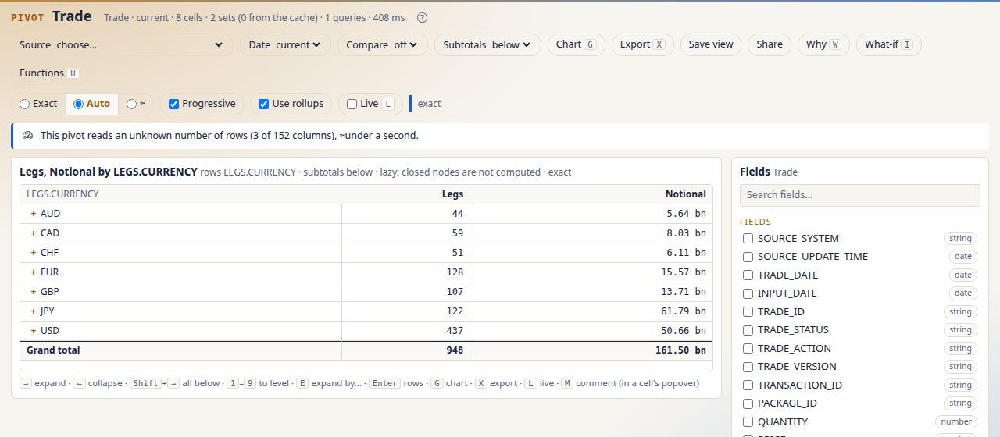
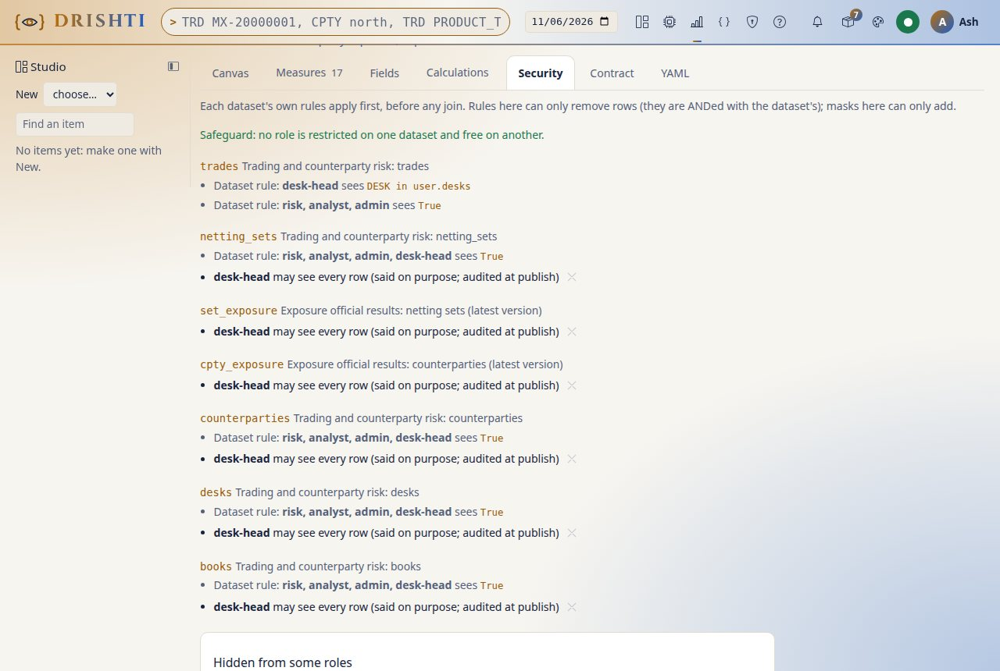
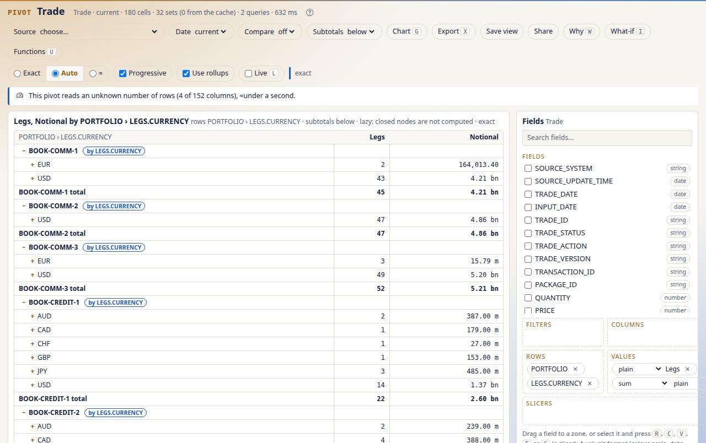
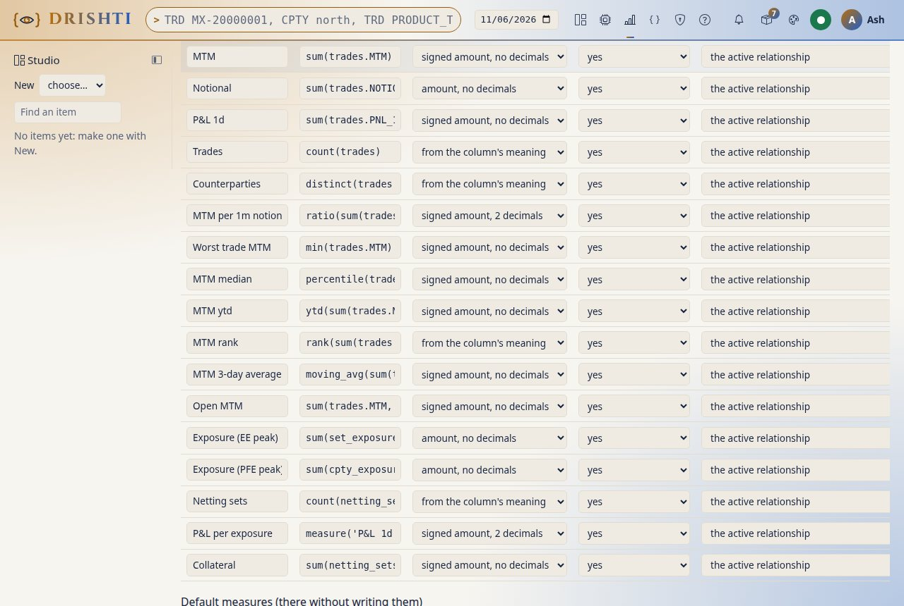
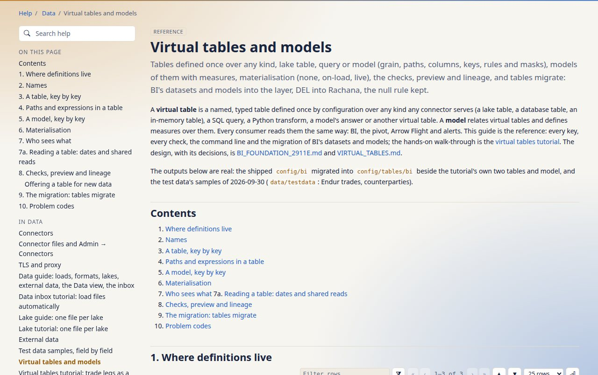

<!--
  Project Drishti · Any data. Any domain. One grammar.

  Copyright (c) 2026 Ashutosh Sinha <ajsinha@gmail.com>.
  All rights reserved.

  PROPRIETARY AND CONFIDENTIAL.

  This file is the confidential and proprietary property of Ashutosh Sinha.
  Unauthorised copying, use, modification, distribution or disclosure of this
  file, via any medium, is strictly prohibited except with the express prior
  written permission of the copyright holder.

  See the LICENSE file in the root of this repository for the full terms.
-->

# Tutorial 44 · Virtual tables and models: trade legs as a table, a model over it, BI's samples migrated

A virtual table turns documents into rows and typed columns, once, for every reader. In this tutorial you define the trades' legs as a
table, preview it over sample documents, add a column converted to US dollars and the desk's name looked up in a table of books, give a
trader only their own trades, relate the legs to the books in a model with measures, and migrate BI's shipped datasets and models with a dry
run first. Each step shows the YAML, the command line and the screen. The guide is [TABLES_GUIDE.md](../guides/TABLES_GUIDE.md).

The outputs below are real: the test data's Endur trades, books and FX spots of 2026-09-30 (`data/testdata`), and the shipped
`config/bi`. BI reads the table layer from the switch on; until then the screens shown are the ones that read the same data today.

## Time to complete

About 30 minutes.

## Before you start

- A checkout of the repository and the server's exec jar built (`./mvnw -q -DskipTests package`): the `tables` commands run from it
  without starting a server ([CLI_GUIDE.md](../guides/CLI_GUIDE.md)).
- Sample documents as JSON Lines, one entity a line, in the folder you work in:

  ```text
  $ zcat data/testdata/trades/endur/trade_endur.2026-09-30.jsonl.gz > trades.jsonl
  $ zcat data/testdata/core/book/book.2026-09-30.jsonl.gz > books.jsonl
  $ zcat data/testdata/market-data/fx-spot/fx-spot.2026-09-30.jsonl.gz > fx-spot.jsonl
  ```

- Run every command from the folder that holds `config/tables` (the repository's folder, or a copy of it to try things in): the tables live
  under `config/tables`, one folder per domain, and `tables migrate` reads `config/bi` beside it.

## What you will learn

- how a table's grain, paths and columns turn a trade's legs into rows, and what `$`, `@` and `^` name;
- why a calculated column reads the source, never another column, and how `fx` and `related` read another source;
- how a table's rules and masks apply to every reader, and what a reader no rule names sees;
- how a model relates tables and defines measures in Rachana;
- how `tables migrate` turns BI's datasets and models into tables and models, keeping every figure (the null rule).

## Step 1 · A table of the trades' legs

An Endur trade holds its legs in `LEGS`, each with `LEG_ID`, `CURRENCY` and `NOTIONAL`; the trade's book is `PORTFOLIO`. Write
`config/tables/trading/trade_legs.table.yaml`:

```yaml
rachana: 3
table: trading.trade_legs
from: { kind: trade }
grain: $.LEGS[*]                          # one row per leg
keys: [TRADE_ID, LEG_ID]
columns:
  TRADE_ID: $.TRADE_ID                    # the trade's own field
  BOOK:     { path: $.PORTFOLIO, type: string }
  LEG_ID:   { path: "@.LEG_ID", type: string }
  CURRENCY: { path: "@.CURRENCY", type: string }
  NOTIONAL: { path: "@.NOTIONAL", type: decimal, format: amount0 }
materialize: on-load
```

Check it:

```text
$ python3 tools/drishti.py tables check
1 table(s), 0 model(s): 0 error(s), 0 warning(s)
```

You should see `0 error(s)`. Write `$.LEGS[0]` as the grain and the check names the grain and every path that needed it:

```text
$ python3 tools/drishti.py tables check
trading/trade_legs.table.yaml: error DRS-9603 grain: a grain is a path from $ that ends in a list: $.LEGS[*] or $.LEGS[*].CASH_FLOWS[*]
trading/trade_legs.table.yaml: error DRS-9603 columns.LEG_ID.path: @ names the grain's element: this table's grain is the entity (use $)
trading/trade_legs.table.yaml: error DRS-9603 columns.CURRENCY.path: @ names the grain's element: this table's grain is the entity (use $)
trading/trade_legs.table.yaml: error DRS-9603 columns.NOTIONAL.path: @ names the grain's element: this table's grain is the entity (use $)
1 table(s), 0 model(s): 4 error(s), 0 warning(s)
```

On the screen: the Pivot reads the same grain from the trades today. Rows `$.LEGS[*].CURRENCY` count one row per leg, as the table will:



## Step 2 · Its rows over sample documents

```text
$ python3 tools/drishti.py tables preview trading.trade_legs --sample trades.jsonl --limit 5
id	business_date	index	TRADE_ID	BOOK	LEG_ID	CURRENCY	NOTIONAL
row-1		0	1000016	BOOK-COMM-3	1	USD	1.484794E7
row-1		1	1000016	BOOK-COMM-3	2	USD	1.1878352E7
row-2		0	1000138	BOOK-COMM-3	1	USD	3.52635228E7
row-2		1	1000138	BOOK-COMM-3	2	USD	3.635252842E7
row-3		0	1000156	BOOK-COMM-3	1	EUR	6437605.63
5 row(s) from 136 document(s)
```

Add `--json` for the rows as JSON. Check the keys on the sample:

```text
$ python3 tools/drishti.py tables check --sample trading.trade_legs=trades.jsonl
1 table(s), 0 model(s): 0 error(s), 0 warning(s)
```

You should see one row per leg (trade 1000016 has two), the built-in columns `id`, `business_date` and `index` first (a sample file has
no entity id or business date: the preview numbers its documents `row-1`, `row-2` ...), and no `DRS-9613` (the keys are unique on each
business date).

## Step 3 · A column in dollars and the desk's name

Add two calculated columns. A column's expression reads the source (`@.NOTIONAL`), never another column (`NOTIONAL`):

```yaml
  NOTIONAL_USD: { expr: "@.NOTIONAL * fx(@.CURRENCY, 'USD')", type: decimal }
  DESK_NAME:    { expr: "related(core.books.DESK_NAME, on = $.PORTFOLIO)", type: string }
```

`fx` reads the installation's one FX source at the row's business date; `related` reads the `DESK_NAME` of the `core.books` row whose key
is the trade's book. Write `config/tables/core/books.table.yaml`:

```yaml
rachana: 3
table: core.books
from: { kind: book }
keys: [BOOK_ID]
columns:
  BOOK_ID:   { path: $.BOOK_ID, type: string }
  NAME:      { path: $.NAME, type: string }
  DESK_NAME: { path: $.DESK_NAME, type: string }
```

then preview again, the books' and the FX spots' samples beside the trades' (`--related` gives a table's sample, `--fx` the spot rates;
without them only a currency to itself converts and `related` finds nothing):

```text
$ python3 tools/drishti.py tables preview trading.trade_legs --sample trades.jsonl --related core.books=books.jsonl --fx fx-spot.jsonl --limit 6
id	business_date	index	TRADE_ID	BOOK	LEG_ID	CURRENCY	TRADER	NOTIONAL	NOTIONAL_USD	DESK_NAME
row-1		0	1000016	BOOK-COMM-3	1	USD	TRDR-FROSSI	1.484794E7	14847940	Commodities
row-1		1	1000016	BOOK-COMM-3	2	USD	TRDR-FROSSI	1.1878352E7	11878352	Commodities
row-2		0	1000138	BOOK-COMM-3	1	USD	TRDR-FROSSI	3.52635228E7	3.52635228E7	Commodities
row-2		1	1000138	BOOK-COMM-3	2	USD	TRDR-FROSSI	3.635252842E7	3.635252842E7	Commodities
row-3		0	1000156	BOOK-COMM-3	1	EUR	TRDR-TBRENNAN	6437605.63	7557749.00962	Commodities
row-4		0	1000172	BOOK-COMM-1	1	USD	TRDR-TBRENNAN	659442.31	659442.31	Commodities
6 row(s) from 136 document(s)
```

(The `TRADER` column is step 4's.) You should see the EUR leg in dollars at the sample's EUR/USD spot (1.174) and the desk's name. Write
`NOTIONAL * 2` instead and the check refuses it with the path to write:

```text
trading/trade_legs.table.yaml: error DRS-9152 columns.DOUBLE.expr: no field 'NOTIONAL'; did you mean @.NOTIONAL?
trading/trade_legs.table.yaml: error DRS-9127 columns.DOUBLE.expr: 'NOTIONAL' is a column of this table: an expression reads the source, so write the column's path (@.NOTIONAL)
```

## Step 4 · Who sees which rows

Add rules, and a column masked for readers without the raw power:

```yaml
  TRADER:   { path: $.TRADER_ID, type: string, masked: true }
...
rules:
  - { role: trader, where: "$.TRADER_ID == user.name" }
  - { role: [risk, analyst], where: "true" }
```

The rules apply to every reader of the table: BI, the pivot, Arrow Flight; `tables check` reads each rule in Rachana's checked mode (a
rule reads the row and `user`). You should see `0 error(s)` from the check and, once BI reads the layer, a trader see the legs of their
own trades, risk and analysts every leg, and a role no rule names none, told so (`DRS-9131`). A list attribute is strict: a rule
`$.DESK in user.desks` holds nothing for a reader with no desks. On the screen, BI's model `trading-risk` shows the same today on its Security tab: a row rule
per role and the masked columns, which `tables migrate` carries into its tables (step 6):



## Step 5 · A model over the legs and the books

Write `config/tables/trading/legs.model.yaml`:

```yaml
rachana: 3
model: legs
tables:
  legs:  { table: trading.trade_legs, role: fact }
  books: { table: core.books, role: dimension }
relationships:
  - { from: legs.BOOK, to: books.BOOK_ID }
measures:
  Notional USD:   { expr: "sum(legs.NOTIONAL_USD)", format: amount0 }
  Legs:           { expr: "count(legs)" }
  Average leg:    { expr: "measure('Notional USD') / measure('Legs')", format: amount0 }
  Non-USD legs:   { expr: "count(legs, where = legs.CURRENCY != 'USD' && legs.CURRENCY != null)" }
hierarchies:
  Desk and book: [books.DESK_NAME, books.NAME]
```

```text
$ python3 tools/drishti.py tables check
2 table(s), 1 model(s): 0 error(s), 0 warning(s)
$ python3 tools/drishti.py tables lineage trading.trade_legs
used by  model legs: reads it as legs (fact)
$ python3 tools/drishti.py tables lineage legs
reads  legs  trading.trade_legs
reads  books  core.books
```

You should see `0 error(s)`, and the lineage name the model `legs` and what it reads. Asked by `books.DESK_NAME` or by book, the layer
compiles each measure with Rachana's one compiler and the pivot engine's aggregates: one row per leg underneath, each book's subtotal and
the grand total, as the Pivot shows over the same trades today (rows `$.PORTFOLIO` and `$.LEGS[*].CURRENCY`, every book open):



## Step 6 · BI's samples migrated, with a dry run first

The dry run prints the diff of every file it would write and a report; nothing is written:

```text
$ python3 tools/drishti.py tables migrate --dry-run --report migration.txt
--- /dev/null
+++ b/bi/counterparty_exposure_counterparties.table.yaml
...
--- a/config/bi/reports/live-trading-desk.report.yaml
+++ b/config/bi/reports/live-trading-desk.report.yaml
@@ -30,7 +30,7 @@
 sample: true
 endorsement: promoted
 tags: [sample, trading, live, streaming, tutorial]
+model: live-trading@1
-dataset: live-trading
 theme: { palette: default }
items: 34 (converted 34, unchanged 0, refused 0)
expressions: 103 (rewritten 22, refused 0)
files to write: 32
```

You should see 34 items converted, none refused: 22 tables and 10 models under `config/tables/bi/`, and the two live reports bound to their
models. In the report, `trading-risk`'s *Open MTM*:

```text
converted  models/trading-risk.model.yaml  ->  bi/trading-risk.model.yaml
    measures.Open MTM.expr:
      - sum(trades.MTM, where=trades.TRADE_STATUS != 'MATURED')
      + sum(trades.MTM, where = trades.TRADE_STATUS != 'MATURED' && trades.TRADE_STATUS != null)
        (DEL into Rachana (section 2.4))
        (kept DEL's meaning for a missing value: trades.TRADE_STATUS != 'MATURED' && trades.TRADE_STATUS != null (Q1))
```

The guard keeps BI's figure: in Rachana a missing status is not `'MATURED'`, so without it a trade with no status would be counted. On the
screen, the model's measures as BI shows them today, *Open MTM* among them:



Then the write, with an audit line per file, and `--check` (exit 1 while something would change):

```text
$ python3 tools/drishti.py tables migrate --audit data/audit/tables-migrate.jsonl
...
34 file(s) written under /path/to/drishti/config/tables
$ python3 tools/drishti.py tables migrate --check
nothing to migrate
$ python3 tools/drishti.py tables check
24 table(s), 11 model(s): 0 error(s), 0 warning(s)
```

You should see the files under `config/tables/bi/` beside your own two tables and model, 34 lines in the audit, the second run change
nothing, and the whole catalogue check clean.

## Next steps

- Every key, check and code: [TABLES_GUIDE.md](../guides/TABLES_GUIDE.md), in Help beside this tutorial:

  

- The language: [RACHANA_REFERENCE.md](../guides/RACHANA_REFERENCE.md) (paths, `in`, the null rule, checked mode).
- The design and what is built: [BI_FOUNDATION_2911E.md](../architecture/BI_FOUNDATION_2911E.md).
