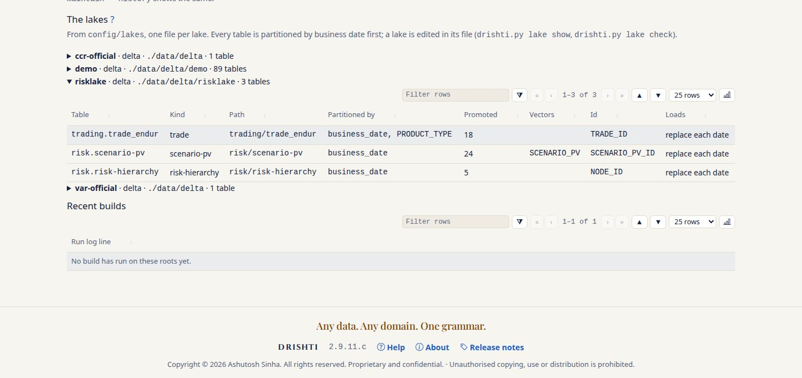
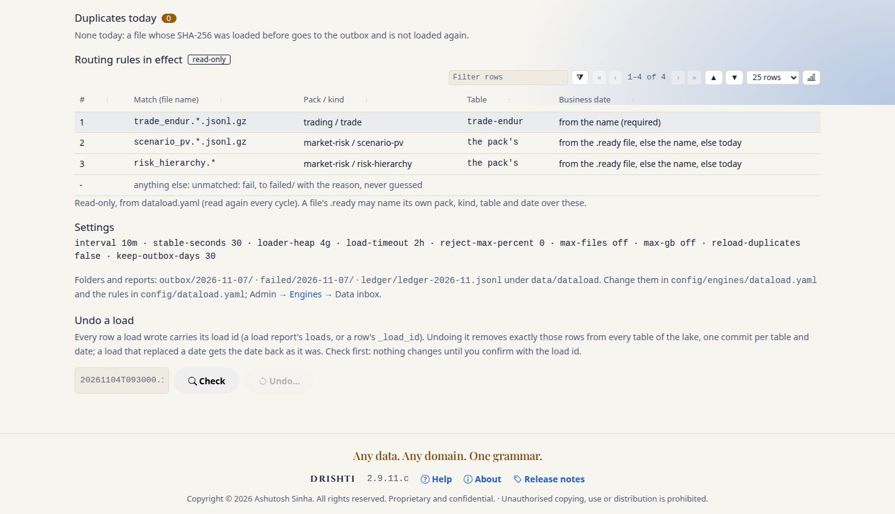
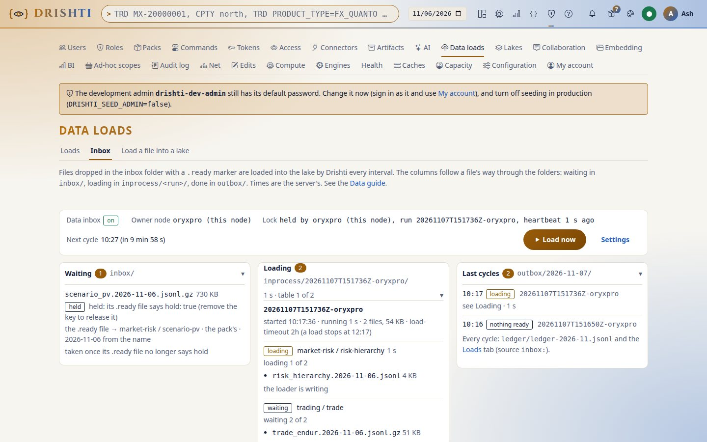
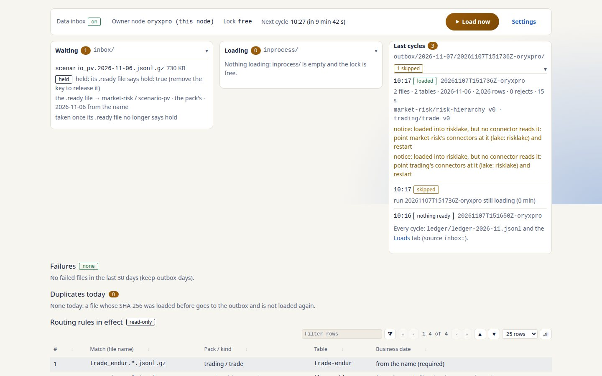
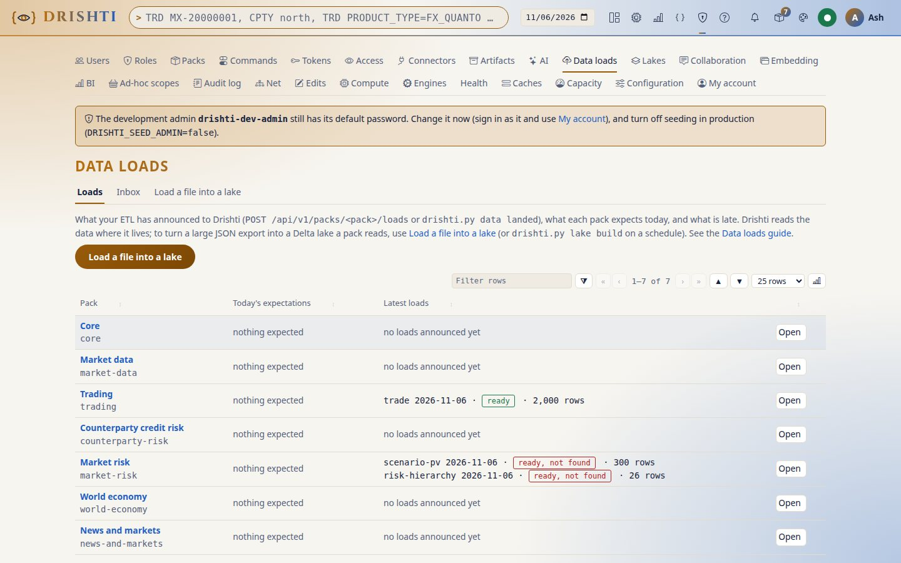
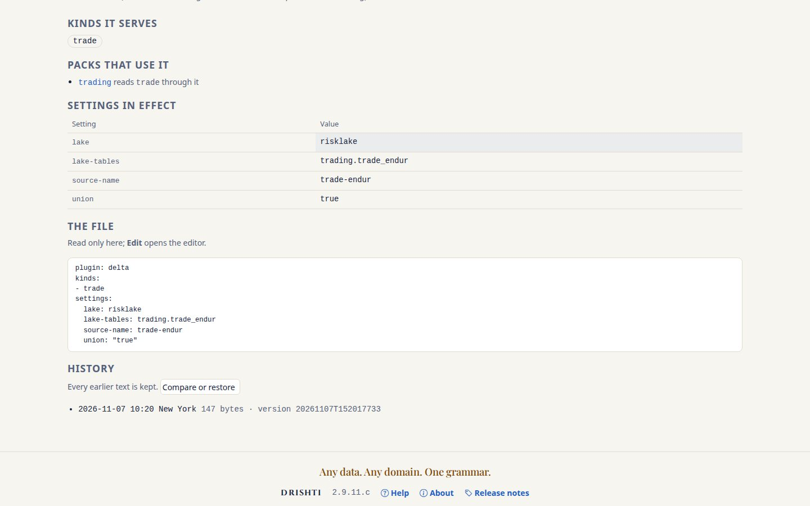
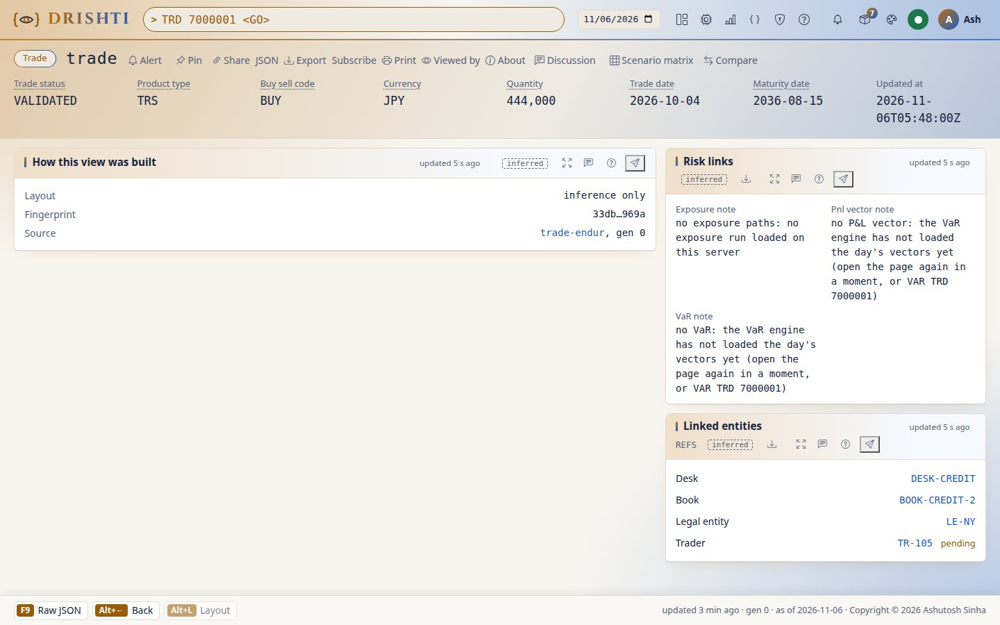
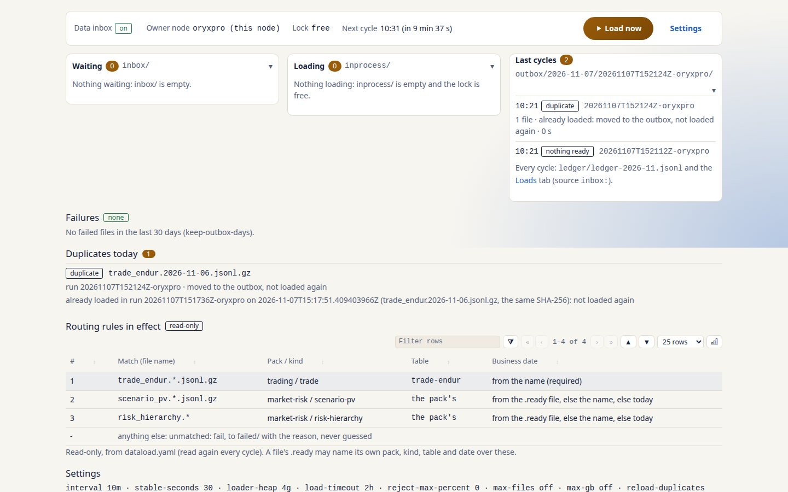

<!--
  Project Drishti · Any data. Any domain. One grammar.

  Copyright (c) 2026 Ashutosh Sinha <ajsinha@gmail.com>.
  All rights reserved.

  PROPRIETARY AND CONFIDENTIAL.

  This file is the confidential and proprietary property of Ashutosh Sinha.
  Unauthorised copying, use, modification, distribution or disclosure of this
  file, via any medium, is strictly prohibited except with the express prior
  written permission of the copyright holder.

  See the LICENSE file in the root of this repository for the full terms.
-->
# Tutorial 45 · Load your own data into a new lake

You have your own trades, positions with their scenario PVs, and a VaR hierarchy, and you want Drishti to read them instead of the demo.
In this tutorial you create a lake of your own, `risklake`, in its own folder beside the demo lake; route files to it; drop one business
day of trades, scenario PVs and VaR nodes with full `.ready` files; watch them load; point the connectors at the new lake; check and undo
a load; and go back to the demo. Each step shows the UI, the command line and the YAML.

The data is synthetic and Endur-style (`TRADE_ID`, `PRODUCT_TYPE`, `DESK`, `BOOK`, `COUNTERPARTY_ID`), written by a small script that
ships with the tutorials; your own files take its place once you have seen the way through.

## Time to complete

About 30 minutes.

## Before you start

- The server built (`./mvnw clean package -DskipTests`) and the demo lake in place (`drishti.py lake demo`,
  [tutorial 1](01-first-15-minutes.md)). Since 2.9.11.d the demo lake sits in its own folder, `data/delta/demo/`
  ([the guide, section 7](../guides/DATA_LAKE_GUIDE.md#7-the-demo-lakes-one-time-move)).
- Signed in as an administrator, with a personal token in `DRISHTI_TOKEN` (Admin → Engines, Admin → Data loads → Inbox and the
  `dataload` commands are for administrators).
- Run the commands from the server's working folder (the repository): the lake files are in `config/lakes/`, the inbox in
  `data/dataload/`.
- The data inbox on ([tutorial 36](36-load-files-with-the-data-inbox.md), step 1): Admin → Engines → **Data inbox** → On, or
  `python3 tools/drishti.py server engines on dataload --reason "tutorial 45"`.

## What you will learn

- what a lake file is and how to write one for your own tables, with partitions kept few and the layout set by rules of thumb;
- how a routing rule and a `.ready` file send a file to a table of that lake, and every key of the `.ready` file;
- how a load is seen from the Inbox screen, the command line and the files it leaves behind;
- how the connectors are pointed at a lake, why demo and real data never mix, and how to go back;
- how a load is checked and undone.

The reference for every step is the [data lake and data load guide](../guides/DATA_LAKE_GUIDE.md).

## Step 1 · Describe the new lake

A lake is one file. Create `config/lakes/risklake.yaml`:

**The YAML.**

```yaml
lake: risklake                    # the file's name; its folder is data/delta/risklake (no root: needed)
format: delta
defaults:
  load-mode: replace              # a load replaces each business date it holds
  compression: zstd
tables:
  trading.trade_endur:
    kind: trade
    partition-by: [PRODUCT_TYPE]  # after business_date; for a million trades a day, use none (guide, section 9)
    promote: [TRADE_ID, TRADE_VERSION, SOURCE_SYSTEM, TRADE_STATUS, PRODUCT_TYPE, PRODUCT_GROUP, DESK, BOOK, PORTFOLIO, COUNTERPARTY_ID,
      LEGAL_ENTITY, TRADER_ID, BUY_SELL_CODE, CURRENCY, QUANTITY, NOTIONAL, TRADE_DATE, MATURITY_DATE]
    id: TRADE_ID
    latest-by: UPDATED_AT
    sort-by: [DESK, BOOK, id]
    file-rows: 250000
    row-group-rows: 1000
  risk.scenario-pv:
    promote: [VALUE_TYPE, GRAIN, TRADE_ID, POSITION_ID, CURRENCY, SOURCE_SYSTEM, SECURITY_ID, LEGAL_ENTITY, DIVISION, DESK, TT_BOOK,
      LIMIT_LETTER, PORTFOLIO, PRODUCT_GROUP, PRODUCT_TYPE, DIRECTION, QUANTITY, BASE_PV, VALUATION_DATE, SCENARIO_SET_ID, BATCH_ID, RUN_KIND,
      COMPUTED_AT, STATUS]
    vectors: [SCENARIO_PV]
    id: SCENARIO_PV_ID
    date: BUSINESS_DATE
    latest-by: COMPUTED_AT
    sort-by: [DESK, TT_BOOK, id]
    file-size-mb: 256
    row-group-mb: 64
  risk.risk-hierarchy:
    promote: [NODE_ID, HIERARCHY, LEVEL, PARENT_ID, NAME]
    id: NODE_ID
    date: BUSINESS_DATE
```

Why each key is there, and the arithmetic behind keeping `partition-by` short, is the guide's
[section 2](../guides/DATA_LAKE_GUIDE.md#2-the-lake-file-every-key).

**The command line.**

```bash
python3 tools/drishti.py lake show
```

```text
  risklake: delta at data/delta/risklake, 3 tables
    trading.trade_endur                      trading/trade_endur                      partitioned by business_date, PRODUCT_TYPE; 18 promoted
    risk.scenario-pv                         risk/scenario-pv                         partitioned by business_date; 24 promoted, vectors SCENARIO_PV
    risk.risk-hierarchy                      risk/risk-hierarchy                      partitioned by business_date; 5 promoted
```

(The other lakes, `demo`, `var-official` and `ccr-official`, are listed too.) A mistake in the file is refused with the key named:
a fifth partition column, `business_date` in `partition-by`, a misspelt key (*unknown key tables.trading.trade_endur.promte*).

**The UI.** Admin → Lakes lists `risklake` with its format, root and three tables, read-only from the file. No table exists yet: the
first load creates each one exactly as the file says.



**You should see** `risklake` beside `demo`, at `./data/delta/risklake`, with three tables: `trading.trade_endur` partitioned by
`business_date, PRODUCT_TYPE` (18 promoted), `risk.scenario-pv` with the vector `SCENARIO_PV` (24 promoted) and `risk.risk-hierarchy`
(5 promoted), each *replace each date*.

## Step 2 · Route the files to it

The inbox sends a file where its `.ready` file says, else where the first matching rule says. Write the rules once, so a plain empty
`.ready` is enough every day.

**The YAML.** `config/dataload.yaml`:

```yaml
dataload:
  rules:
    - match: "trade_endur.*.jsonl.gz"
      pack: trading
      kind: trade
      connector: trade-endur          # the table that connector's entry names: trading/trade_endur
      lake: risklake
      date-from: name                 # the name must carry the business date
    - match: "scenario_pv.*.jsonl.gz"
      pack: market-risk
      kind: scenario-pv
      lake: risklake
      date-field: BUSINESS_DATE
    - match: "risk_hierarchy.*"
      pack: market-risk
      kind: risk-hierarchy
      lake: risklake
  unmatched: fail
```

The rules are read again at every cycle: no restart.

**The command line.** `python3 tools/drishti.py dataload status --json` gives the rules in effect under `rules`, each with its pack,
kind, lake and where the business date comes from (`"lake": "risklake"`, `"date": "from the name (required)"`).

**The UI.** Admin → Data loads → Inbox → **Routing rules in effect** shows the same three rules, read-only.



**You should see** three rules: `trade_endur.*.jsonl.gz` to *trading / trade*, table `trade-endur`, the date *from the name
(required)*; `scenario_pv.*.jsonl.gz` and `risk_hierarchy.*` to *market-risk*, the pack's table, the date *from the .ready file, else
the name, else today*; and a last line, *anything else: unmatched: fail*. The screen does not show the lake; `dataload status --json`
does.

## Step 3 · Make a day of data

**The command line.**

```bash
python3 docs/tutorials/data/risklake/make_day.py --out data/tmp/drop --date 2026-11-06
```

```text
data/tmp/drop/trade_endur.2026-11-06.jsonl.gz  rows: 2000  sha256: 521f496bb0793e6c2cbf2922c44c0aa58adfe7ca80440ed90dd0ca76283ee4e7
data/tmp/drop/scenario_pv.2026-11-06.jsonl.gz  rows: 300  sha256: e46294c4566b785f780d3f6dd8b9edaf71473b3cd4b87a0336cc448cd6b0eb90
data/tmp/drop/risk_hierarchy.2026-11-06.jsonl  rows: 26  sha256: a8ef6dcae92b7c15871a93aa455e5e7bda0379f19c64d78b9c5eebcccb58c133
```

The script writes the same bytes every time for the same date, so your checksums are these. Use a date that is not in the future on
your machine (a business date may never be). Each file is named `<table>.<YYYY-MM-DD>.<extension>`: the load takes the business date
from the name, never from a row. One line of each:

```json
{"TRADE_ID": "7000001", "TRADE_VERSION": 1, "SOURCE_SYSTEM": "ENDUR", "TRADE_STATUS": "VALIDATED", "PRODUCT_TYPE": "TRS", "PRODUCT_GROUP": "Credit", "DESK": "DESK-CREDIT", "BOOK": "BOOK-CREDIT-2", "PORTFOLIO": "BOOK-CREDIT-2", "COUNTERPARTY_ID": "CP-LONGFIELD", "LEGAL_ENTITY": "LE-NY", "TRADER_ID": "TR-105", "BUY_SELL_CODE": "BUY", "CURRENCY": "JPY", "QUANTITY": 444000.0, "NOTIONAL": 44400000.0, "TRADE_DATE": "2026-10-04", "MATURITY_DATE": "2036-08-15", "UPDATED_AT": "2026-11-06T05:48:00Z"}
{"VALUE_TYPE": "PV", "GRAIN": "POSITION", "POSITION_ID": "POS-BOOK-RATES-3~SEC-SWAPTION-CAD-0001", "SCENARIO_PV_ID": "SPV-POS-BOOK-RATES-3~SEC-SWAPTION-CAD-0001-HS-509", "DESK": "DESK-RATES", "TT_BOOK": "BOOK-RATES-3", "PRODUCT_TYPE": "SWAPTION", "DIRECTION": "SHORT", "BASE_PV": -759516.49, "SCENARIO_PV": [-769997.21, -779760.78, ...], ...}
{"NODE_ID": "BANK", "HIERARCHY": "MGMT", "LEVEL": "BANK", "PARENT_ID": null, "NAME": "The bank", "BUSINESS_DATE": "2026-11-06"}
```

(The scenario-PV line is shortened: it carries 509 numbers and the rest of the fields.)

**You should see** the three files in `data/tmp/drop/` with exactly the rows and checksums above: 2,000 trades, 300 scenario-PV
rows, 26 hierarchy nodes.

## Step 4 · Drop the files with their `.ready` files

Copy each data file first, then its `.ready` file: the marker says the file is complete.

**The YAML.** A `.ready` may be empty (the rules route it). Here each one says more, to show the keys:

```yaml
# data/dataload/inbox/trade_endur.2026-11-06.jsonl.gz.ready
lake: risklake                  # over the rule's lake (the same here)
mode: replace                   # the date replaced if you load it again
sha256: 521f496bb0793e6c2cbf2922c44c0aa58adfe7ca80440ed90dd0ca76283ee4e7
rows: 2000                      # a file cut short fails before anything is written
```

```yaml
# data/dataload/inbox/scenario_pv.2026-11-06.jsonl.gz.ready
lake: risklake
pack: market-risk
kind: scenario-pv
sha256: e46294c4566b785f780d3f6dd8b9edaf71473b3cd4b87a0336cc448cd6b0eb90
rows: 300
hold: true                      # wait: the risk run is not signed off yet
```

```yaml
# data/dataload/inbox/risk_hierarchy.2026-11-06.ready     (the short form of the name)
lake: risklake
rows: 26
```

Every key, with what each does, is the guide's [section 4](../guides/DATA_LAKE_GUIDE.md#4-the-ready-file-every-key).

**The command line.**

```bash
cp data/tmp/drop/*.jsonl* data/dataload/inbox/
# then write the three .ready files above into data/dataload/inbox/
python3 tools/drishti.py dataload status
```

**The UI.** Admin → Data loads → Inbox → **Waiting**: the trades and the hierarchy *ready* once stable for 30 seconds, each with the rule
that routes it and *2026-11-06 from the name*; the scenario PVs **held**.



**You should see** **Waiting 3**: `risk_hierarchy.2026-11-06.jsonl` and `trade_endur.2026-11-06.jsonl.gz` *ready* (*stable 40 s · marker
with keys*, *rule 3 → market-risk / risk-hierarchy* and *rule 1 → trading / trade · trade-endur*, *2026-11-06 from the name*, *taken at
the next cycle*), and `scenario_pv.2026-11-06.jsonl.gz` *held: its .ready file says hold: true (remove the key to release it)*.
`dataload status` says the same:

```text
waiting (3):
  risk_hierarchy.2026-11-06.jsonl                 3.6 KB  ready: the next cycle takes it
                                                          business date: 2026-11-06 from the name
  trade_endur.2026-11-06.jsonl.gz                50.8 KB  ready: the next cycle takes it
                                                          business date: 2026-11-06 from the name
  scenario_pv.2026-11-06.jsonl.gz               729.9 KB  held: its .ready file says hold: true (remove the key to release it)
                                                          business date: 2026-11-06 from the name
```

## Step 5 · Load, and release the held file

**The UI.** Press **Load now** (or wait for the next cycle). **Loading** shows the run table by table (the hierarchy, then the trades),
each with its date's version and rows while it commits; **Last cycles** then shows the cycle as loaded, with its two files, two tables,
one date and 2,026 rows. Each table was created in `data/delta/risklake/` as the lake file says.



The cycle carries two notices, one per pack: *loaded into risklake, but no connector reads it: point market-risk's connectors at it
(lake: risklake) and restart*, and the same for trading. (A scheduled cycle that falls due while a run loads is shown *skipped: run …
still loading*: runs never overlap.)

Now remove the `hold: true` line from the scenario PVs' `.ready` file and press **Load now** again: it loads. The position rows carry
509 scenario PVs each, kept as a vector column.

**The command line.**

```bash
python3 tools/drishti.py dataload run
python3 tools/drishti.py dataload status
ls data/delta/risklake/trading/trade_endur/business_date=2026-11-06/
ls data/dataload/outbox/*/*/
```

The table's folder has one subfolder per `PRODUCT_TYPE` (fifteen here: `PRODUCT_TYPE=CDS` … `PRODUCT_TYPE=WARRANT`); the outbox holds
each file, its `.ready` and its `<file>.loaded.json` report (the route, each date's version and rows), and `loads/` the loader's own
log and summary.

Admin → Data loads → **Loads** lists every load by pack, as the packs were told of them:



**You should see**, on Admin → Data loads → Inbox and in each report, the warning *loaded into risklake, but no connector reads it:
point trading's connectors at it (lake: risklake) and restart*; on **Loads**, *trade 2026-11-06 · ready · 2,000 rows* for Trading and,
for Market risk, *scenario-pv 2026-11-06 · ready, not found · 300 rows* and *risk-hierarchy 2026-11-06 · ready, not found · 26 rows*:
the rows are in the lake, but no connector of the pack reads it, so no page shows them yet. That is the next step.

## Step 6 · Point the connectors at risklake

A connector reads one lake. Edit the two connector files the packs wrote at the first start.

**The YAML.** `config/connectors/trade-endur.yaml`:

```yaml
plugin: delta
kinds: [trade]
settings:
  lake: risklake                  # was: demo
  lake-tables: trading.trade_endur
  source-name: trade-endur
```

`config/connectors/risk-store.yaml`, with only the kinds risklake holds (a table the lake file lacks is refused, naming it):

```yaml
plugin: delta
enabled: true
kinds: [scenario-pv, risk-hierarchy]
settings:
  lake: risklake
  lake-tables: risk.scenario-pv,risk.risk-hierarchy
  refresh-seconds: 30
```

**The command line.** Check, then restart the server:

```bash
python3 tools/drishti.py lake check
```

```text
lake check: 4 lakes, 0 errors
```

(each demo table not built on this machine is a *note*; an error is a connector naming a table its lake lacks, or a table on disk that
differs from its file).

**The UI.** After the restart, Admin → Connectors → `trade-endur` shows the connector's page: the kinds it serves, the packs that use
it, its settings in effect (`lake: risklake`, `lake-tables: trading.trade_endur`) and its file.



Now open a trade: `TRD 7000001 <GO>` shows the synthetic trade from risklake.



`trade-endur` now reads risklake only; a connector never reads two lakes at once. The other trade connectors still serve the demo's
trades: `trade-calypso` and `trade-murex` still say `lake: demo`, and `trading-stream` is the Kafka feed. On the run behind these
pictures the demo ComSwap `TRD 1000001` still opened after the restart, so do not take a demo trade's absence as the check: open one of
your own, as above. For a server that shows only your data, point the other trade connectors at risklake too, or switch them off.

**You should see** `lake check: 4 lakes, 0 errors`; after the restart, `trade-endur` *running* with `lake: risklake` in its settings;
and `TRD 7000001` as the trade above: *Trade status VALIDATED*, *Product type TRS*, *BUY*, *JPY*, *Quantity 444,000*, *Trade date
2026-10-04*, *Maturity date 2036-08-15*, source `trade-endur`, linked to `DESK-CREDIT`, `BOOK-CREDIT-2`, `LE-NY` and `TR-105`. Its VaR
and P&L-vector notes say the VaR engine has not loaded the day's vectors yet: this tutorial loads scenario PVs, not the VaR run.

## Step 7 · Check a load, undo it, and go back to the demo

**Check.** Admin → Data loads lists the three loads with *inbox:* and their files; `python3 tools/drishti.py dataload status --json`
gives the same as JSON; the ledger `data/dataload/ledger/ledger-<yyyy-MM>.jsonl` has a line for every step of every file. Drop
`trade_endur.2026-11-06.jsonl.gz` again with an empty `.ready`: the next cycle moves it straight to the outbox, *already loaded in run
…*. A file is never loaded twice.



**Undo.** A load's id is in its report (`loads` in the loader's summary, `loaderRun` in `dataload status --json`, plus `.1` for its
first load) and on every row (`_load_id`).

**The command line.** Check first, on risklake's folder:

```bash
python3 tools/drishti.py lake undo 20261107T101740.754-2543825.1 --lake data/delta/risklake --dry-run
```

```text
would undo risk/risk-hierarchy 2026-11-06: 26 rows of load 20261107T101740.754-2543825.1 removed
```

Your id differs (it carries the time of your load). Run it again without `--dry-run` (it asks for the id once more; `--yes` in a
script). The hierarchy was appended (its `.ready` names no mode, and the inbox's `default-mode` is `append`), so its rows simply go; an
undone replace restores the date as it was.

**The UI.** Admin → Data loads → Inbox → **Undo a load** (paste the id, **Check**, type the id again, confirm) works on the inbox's own
lake, `lake:` in `config/engines/dataload.yaml` (`demo` as shipped): for a load into risklake it answers *no row of load … in demo*.
Use the command line above for risklake, or make risklake the inbox's lake (`DRISHTI_DATALOAD_LAKE=risklake`).

**You should see** **Duplicates today 1**: `trade_endur.2026-11-06.jsonl.gz`, *moved to the outbox, not loaded again*, *already loaded
in run … (the same SHA-256)*, and **Last cycles** *duplicate · 1 file · already loaded*; then the dry run's one line, *26 rows … removed*.

**Go back to the demo.** Set `lake: demo` back in both connector files (for `risk-store`, its full list of kinds and `lake-tables`, or
delete the file: the pack writes its template again at the next start) and restart. Neither lake changes: risklake stays in
`data/delta/risklake/` for the next time, the demo in `data/delta/demo/`.

**The YAML** of the rules: comment out the three rules in `config/dataload.yaml`, or leave them: a file nobody drops is never loaded.

## Clean up

```bash
rm -rf data/tmp/drop
# to remove the lake completely (with the server stopped):
rm -rf data/delta/risklake config/lakes/risklake.yaml
```

## When something goes wrong

| You see | Do |
|---|---|
| a file stays *no marker* | its `.ready` is missing or misnamed: `<file>.ready` or the name without its data extension |
| `failed/`: *the .ready file's key … is not one of …* | a typo in the `.ready`; correct it and **Retry** (`drishti.py dataload retry <file>`) |
| `failed/`: *its .ready file says 2000 rows, the file holds …* | the copy was cut short: copy it again, then Retry |
| `failed/`: the date in the name is refused | a business date is a real date, not in the future: run `make_day.py` with today's date or an earlier one |
| a connector refused: *lake risklake has no table risk.pnl-vector* | list only risklake's tables in `lake-tables:` and `kinds:` |
| the page still shows demo trades | the connector file still says `lake: demo`, or the server was not restarted |

More in the guide's [troubleshooting table](../guides/DATA_LAKE_GUIDE.md#8-checking-a-load-and-troubleshooting).

## Next steps

- [The data lake and data load guide](../guides/DATA_LAKE_GUIDE.md): sizing a real day (section 9), modes and repeats (section 5),
  a lake in S3 or Iceberg, reading an existing Databricks lakehouse (section 10).
- [Tutorial 36](36-load-files-with-the-data-inbox.md): the inbox on its own, `ready.all`, a failed file retried.
- [Tutorial 25](25-var-from-the-bank-to-a-trade.md): VaR from the bank to a trade, now on your own scenario PVs.
