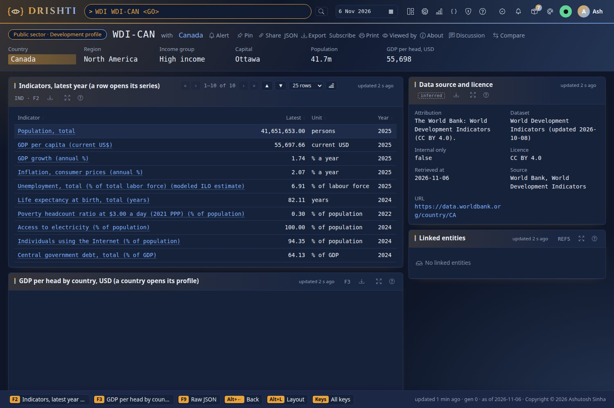
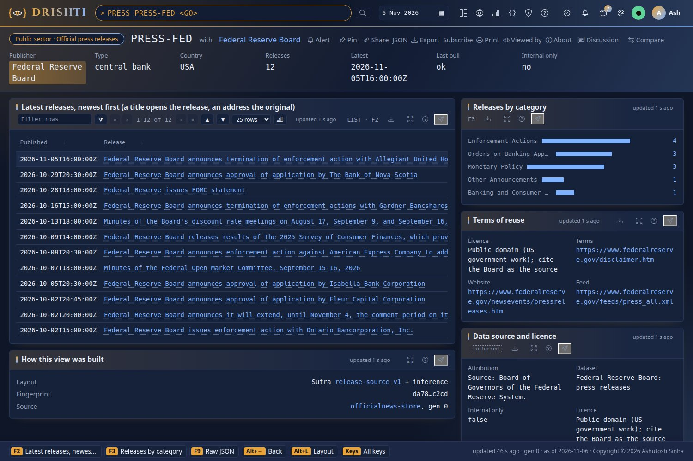

<!--
  Project Drishti · Any data. Any domain. One grammar.

  Copyright (c) 2026 Ashutosh Sinha <ajsinha@gmail.com>.
  All rights reserved.

  PROPRIETARY AND CONFIDENTIAL.

  This file is the confidential and proprietary property of Ashutosh Sinha.
  Unauthorised copying, use, modification, distribution or disclosure of this
  file, via any medium, is strictly prohibited except with the express prior
  written permission of the copyright holder.

  See the LICENSE file in the root of this repository for the full terms.
-->
# Tutorial 46 · Public sector data and free news

Where is Canada on GDP per head, when did the Bank of Canada last move, what did Statistics Canada release this morning, which OECD
member has the highest inflation, what did the Fed publish this week, and how did the world's news read the United States yesterday? The
**public sector** (part of the economy module, with its own Public sector lens) answers from public sources, each pulled every day by
its own feed. In this tutorial you turn its packs on, run the six feeds, open each screen, schedule the feeds daily and change what one of them pulls. Each step shows the UI, the command
line and the YAML behind it. Every option, source and licence is in the one reference,
[PUBLIC_SECTOR_GUIDE.md](../guides/PUBLIC_SECTOR_GUIDE.md); each step ends with its section.

## Time to complete

About 30 minutes (the first runs of the feeds download a few megabytes).

## Before you start

- [Tutorial 1](01-first-15-minutes.md) done: a server and console you can build, start and stop.
- A network to the public sources (the feeds' tests use recorded answers; this tutorial uses the real sources).
- Optional: a free FRED key (https://fred.stlouisfed.org/docs/api/api_key.html) in `DRISHTI_FRED_API_KEY` for the Federal Reserve's
  series; without it the Bank of Canada's still load.
- For the command-line steps: `DRISHTI_SERVER=http://localhost:18480` and `DRISHTI_TOKEN=...` (My account → API tokens), or sign-in off.

**Where this data comes from.** External, public data: the World Bank (CC BY 4.0), FRED and the Bank of Canada, Statistics Canada (Open
Licence), the OECD (CC BY 4.0), the press releases of central banks, regulators and governments (each publisher's own terms; the Bank of
England, OSFI and the Canada Gazette are internal only), and GDELT (free with a citation). Nothing is committed but a few sample
documents; the feeds write into your own `worldlake` and `newslake`. Every source: [External data](../guides/EXTERNAL_DATA.md).

## What you will learn

- How a domain module brings packs, functions and a lens, and how to switch it.
- How a feed pulls only what is new and loads it into a lake, and how its licence travels with the data.
- How each public-sector screen is read: maps, charts, tables and links.

## Step 1 · Turn the packs on and see the module

**UI.** Admin → Modules lists **economy** (*Economy and markets*, content only) as on, with its packs (the six public-sector ones
among them), its functions and the World and Public sector lenses. Start the server with the packs loaded:

```bash
DRISHTI_PACKS=core,world-economy,world-development,central-banks,national-statistics,oecd,official-news,gdelt-events \
  java -jar drishti-server/target/drishti-server-*-exec.jar
```

**Command line.**

```bash
curl -s "$DRISHTI_SERVER/api/v1/modules" -H "Authorization: Bearer $DRISHTI_TOKEN" | python3 -m json.tool | grep -B2 -A6 '"publicsector"'      # the Public sector lens
```

**YAML.** The public sector is part of the economy module; the site's switch is `config/modules/economy.yaml`:

```yaml
enabled: true            # false, then a restart: the economy's packs, functions and lenses are gone; banking is untouched
```

You should see the economy module on in Admin → Modules, and *Public sector* among the lenses in Views (the `curl` prints its
record with its ten functions).

More: [PUBLIC_SECTOR_GUIDE.md sections 1 and 2](../guides/PUBLIC_SECTOR_GUIDE.md#1-the-module-its-lens-and-its-functions).

## Step 2 · Run the six feeds

**Command line.** See them, ask what one would fetch, then run all six (each pulls, writes `data/datafeeds/<feed>/<date>/` and loads into
its lake with the parallel loader):

```bash
python3 tools/drishti.py feed list
python3 tools/drishti.py feed run oecd --dry-run
for f in world-development central-banks national-statistics oecd official-news gdelt-events; do
  python3 tools/drishti.py feed run "$f" || echo "$f exited $?"
done
```

Each run ends with one line, `feed ok exit=0 feed=oecd date=... files=2 rows=... load=java`. Run one again: it says nothing new and
writes nothing.

**UI.** Admin → Data loads → Feeds: one row a feed with its last run, rows, lake and licence; *Run now* runs one.

world-development is the one fetcher of the World Bank's development indicators: the world-economy feed reads them from its output, so
run world-development first (its schedule does: 06:30, then world-economy at 06:45).

You should see six `feed ok` lines, and six green rows in Admin → Data loads → Feeds, each with its rows and its lake.

**YAML.** A feed file, `config/feeds/oecd.yaml` (shortened):

```yaml
feed: oecd
class: oecd.OecdFeed                 # tools/feeds/sources/oecd.py
lake: worldlake
schedule: {at: "07:00", days: daily}
licence: {name: OECD terms and conditions (CC BY 4.0), redistribution: attribution, internal-only: false}
datasets:
  oecd-country: {pack: oecd, kind: oecd-country, key: COUNTRY_ID}
  oecd-series:  {pack: oecd, kind: oecd-series, key: SERIES_ID}
options:
  sources: [{id: oecd, licence: "...", terms: "https://www.oecd.org/en/about/terms-conditions.html", internal-only: false}]
  countries: [AUS, AUT, ...]          # the 38 members
  measures: [...]                     # CLI, unemployment, inflation, GDP growth
```

More: [section 5](../guides/PUBLIC_SECTOR_GUIDE.md#5-the-feeds) and the [External data guide](../guides/EXTERNAL_DATA.md).

## Step 3 · A country's development: WDI

**UI.** Type `WDI WDI-CAN <GO>`. The strip gives Canada's region, income group, capital, population and GDP per head. The table lists
every indicator with its latest year; click *GDP growth (annual %)* to open its history (`WDIS WDIS-CAN-NY_GDP_MKTP_KD_ZG`). The world
map is shaded by GDP per head; click Brazil to open `WDI-BRA`.



**Command line.**

```bash
curl -s "$DRISHTI_SERVER/api/v1/entities/development-profile/WDI-CAN/raw" -H "Authorization: Bearer $DRISHTI_TOKEN" | python3 -m json.tool | head -30
```

**YAML.** The screen is the Sutra `config/packs/economy/world-development/sutras/development-profile.v1.sutra.yaml`, built from the UI kit:

```yaml
panels:
  - { id: indicators, kind: table, rows: $.INDICATORS, columns: [ { label: Indicator, bind: "link(@.WDI_SERIES, 'development-series', @.INDICATOR)" }, ... ] }
  - use: region-map@1
    with: { highlight: $.ISO3, link-kind: development-profile, link-id: "WDI-{iso3}", shade-kind: development-profile, shade-field: $.GDP_PER_CAPITA }
```

You should see Canada's strip and indicators, the map with Canada highlighted, and the curl printing the start of `WDI-CAN`'s record.

More: [section 3](../guides/PUBLIC_SECTOR_GUIDE.md#3-the-screens) and the contract page
[world-development.md](../contracts/packs/world-development.md).

## Step 4 · A central bank: CBANK and CBSER

**UI.** Type `CBANK CBANK-BOC <GO>`: the target for the overnight rate, the date it last moved and by how many basis points, two years of
the rate, and every series of the bank (CORRA, the 2- and 10-year yields, USD/CAD). Click *Press releases* for the bank's latest releases
(Step 6). Type `CBSER CBSER-BOC-BD_CDN_10YR_DQ_YLD <GO>` for one series with its change on the day and on the year.

**Command line.**

```bash
curl -s "$DRISHTI_SERVER/api/v1/entities/central-bank/CBANK-BOC/raw" -H "Authorization: Bearer $DRISHTI_TOKEN" \
  | python3 -c "import json,sys; d=json.load(sys.stdin); print(d['POLICY_RATE'], d['LAST_MOVE_DATE'], d['LAST_MOVE_BP'])"
```

**YAML.** Add a series in `config/feeds/central-banks.yaml`:

```yaml
options:
  series:
    - { source: boc, code: V39079, bank: BOC, title: "Bank of Canada target for the overnight rate", unit: "%" }
```

*(screenshot filled in the heavy run: `CBANK CBANK-BOC`, the policy rate, its last move and the bank's series)*

You should see the policy rate, its last move date and its size in basis points, the same three numbers on the screen and from the
command line.

More: [section 5](../guides/PUBLIC_SECTOR_GUIDE.md#5-the-feeds) (the FRED key).

## Step 5 · National statistics and the OECD: NSTAT, OECD

**UI.** Type `NSTAT NSTAT-V41690973 <GO>`: Canada's consumer price index, the change on the month and on the year in per cent, the time
Statistics Canada released it, five years of history. Type `OECD OECD-CAN <GO>`: the leading indicator, unemployment, inflation and GDP
growth; the 38 members on a map shaded by inflation (click Japan to open `OECD-JPN`).

**Command line.**

```bash
python3 tools/drishti.py feed status national-statistics
```

**YAML.** A vector is one line of `config/feeds/national-statistics.yaml`:

```yaml
options:
  vectors:
    - { vector: 41690973, title: "Consumer price index, all-items (Canada)", unit: "index 2002=100", topic: Prices }
```

*(screenshot filled in the heavy run: `OECD OECD-CAN`, the members on a map shaded by inflation)*

You should see the CPI's latest value with its release time, the OECD map shaded by inflation, and `feed status` with the last run and
its rows.

More: [section 7](../guides/PUBLIC_SECTOR_GUIDE.md#7-changing-what-is-pulled).

## Step 6 · Official news: PRESS and PREL

**UI.** Type `PRESS PRESS-FED <GO>`: the Federal Reserve Board's latest releases, newest first. A title opens the release in Drishti
(`PREL ...`: its date, category and summary); the address opens the original on federalreserve.gov in a new tab. Type `PRESS PRESS-BOE
<GO>`: the strip says *Internal only: yes* and why (the Bank of England allows no commercial reuse). In the World lens, `PRESS` and
`GDELT` are there too.



**Command line.**

```bash
curl -s "$DRISHTI_SERVER/api/v1/entities/release-source/PRESS-BOE/raw" -H "Authorization: Bearer $DRISHTI_TOKEN" \
  | python3 -c "import json,sys; d=json.load(sys.stdin); print(d['INTERNAL_ONLY'], d['WHY_INTERNAL'])"
```

**YAML.** Each publisher's terms in `config/feeds/official-news.yaml`:

```yaml
options:
  sources:
    - { id: BOE, title: Bank of England, type: central bank, country: GBR, feed: "https://www.bankofengland.co.uk/rss/news",
        licence: "personal or internal non-commercial use", redistributable: false, internal-only: true,
        why-internal: "The Bank of England allows personal and internal non-commercial use only" }
```

You should see the Fed's releases newest first with working links, and for `PRESS-BOE` the command line printing `True` and the reason.

More: [section 6](../guides/PUBLIC_SECTOR_GUIDE.md#6-licences-and-internal-only-data).

## Step 7 · World events: GDELT

**UI.** Type `GDELT GDELT-USA <GO>`: yesterday's events whose first actor is the United States, how often they were mentioned, the average
tone (below zero: negative coverage) and its change on the 30-day window, the Goldstein scale, the share of conflict; the tone by day; the
events by CAMEO category; the world map shaded by tone; the most-mentioned stories, each a link to the publisher.

**Command line.**

```bash
python3 tools/drishti.py feed run gdelt-events --dry-run      # the days it would read: only those after the last one
```

**YAML.** `config/feeds/gdelt-events.yaml`: `history-days: 30`, `min-events: 20`, `top-stories: 5`.

*(screenshot filled in the heavy run: `GDELT GDELT-USA`, the day's events, the tone by day and the map by tone)*

You should see the United States' events, tone and map, and the dry run listing only the days after the last one read.

More: [section 3](../guides/PUBLIC_SECTOR_GUIDE.md#3-the-screens).

## Step 8 · Run them every day

**Command line.** Print the scheduler's entries and install them:

```bash
python3 tools/drishti.py feed schedule --cron world-development central-banks national-statistics oecd official-news gdelt-events
python3 tools/drishti.py feed schedule --systemd world-development       # a service and a timer
python3 tools/drishti.py feed schedule --windows world-development       # Task Scheduler
```

**UI.** Admin → Data loads → Feeds shows a failing feed with its badge; the platform alert `data-feed-failed` tells you.

**YAML.** Each feed's `schedule: {at: "HH:MM", days: daily | weekdays}` (local time).

You should see one cron line per feed (a service and a timer for systemd, a task for Windows), each at the feed's own time.

More: [External data](../guides/EXTERNAL_DATA.md).

## Step 9 · Change what a feed pulls

**YAML.** Add the World Bank's health spending to every profile, in `config/feeds/world-development.yaml`:

```yaml
options:
  indicators:
    - { code: SH.XPD.CHEX.GD.ZS, field: HEALTH_SPENDING, unit: "% of GDP" }
```

**Command line.** Pull again (a new indicator is pulled even when the World Bank has not changed), then check the contract:

```bash
python3 tools/drishti.py feed run world-development
python3 tools/contracts.py check        # names HEALTH_SPENDING until the contract and config/about.yaml describe it
```

**UI.** `WDI WDI-CAN <GO>`: the new row in the indicators table.

You should see *Current health expenditure (% of GDP)* in Canada's indicators, and `contracts.py check` naming `HEALTH_SPENDING` until
the contract describes it.

More: [section 7](../guides/PUBLIC_SECTOR_GUIDE.md#7-changing-what-is-pulled).

## Next steps

- [External data](../guides/EXTERNAL_DATA.md): write a feed of your own.
- [Data lake and data load](../guides/DATA_LAKE_GUIDE.md): the lakes the feeds load.
- [Access model](../architecture/ACCESS_MODEL.md): modules, lenses and functions.
